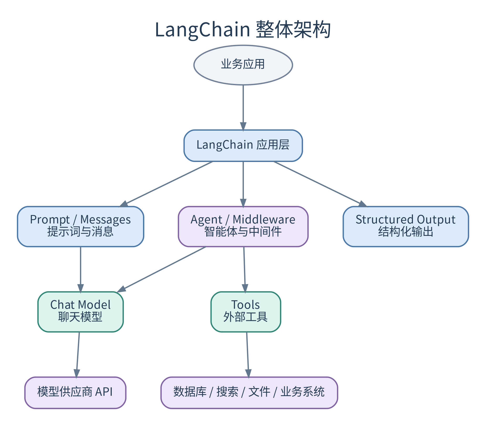
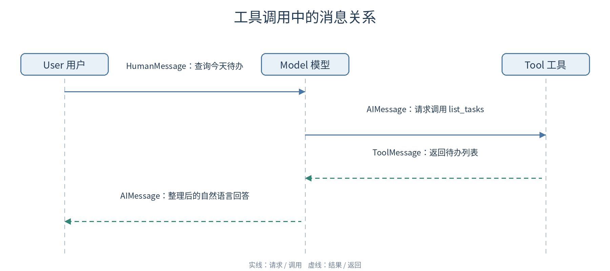
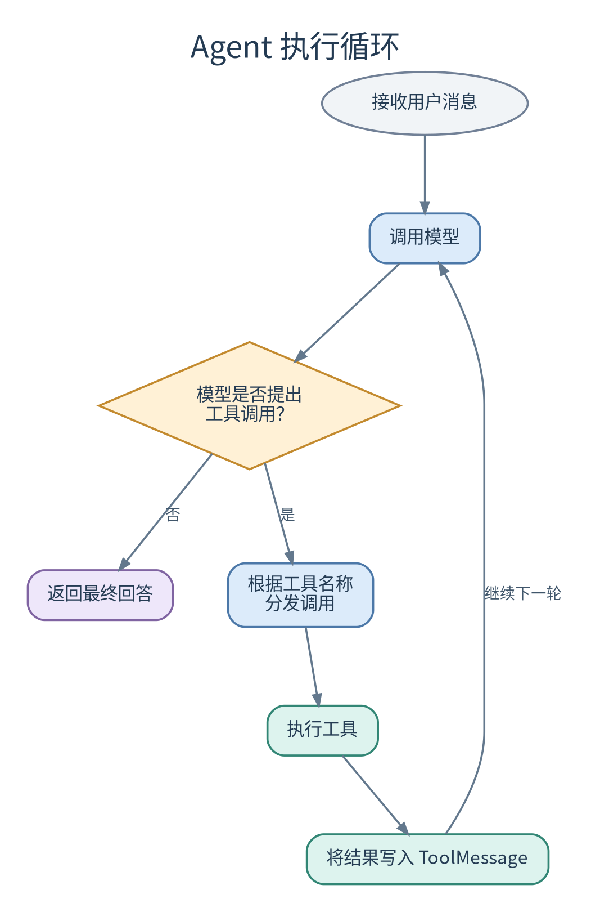
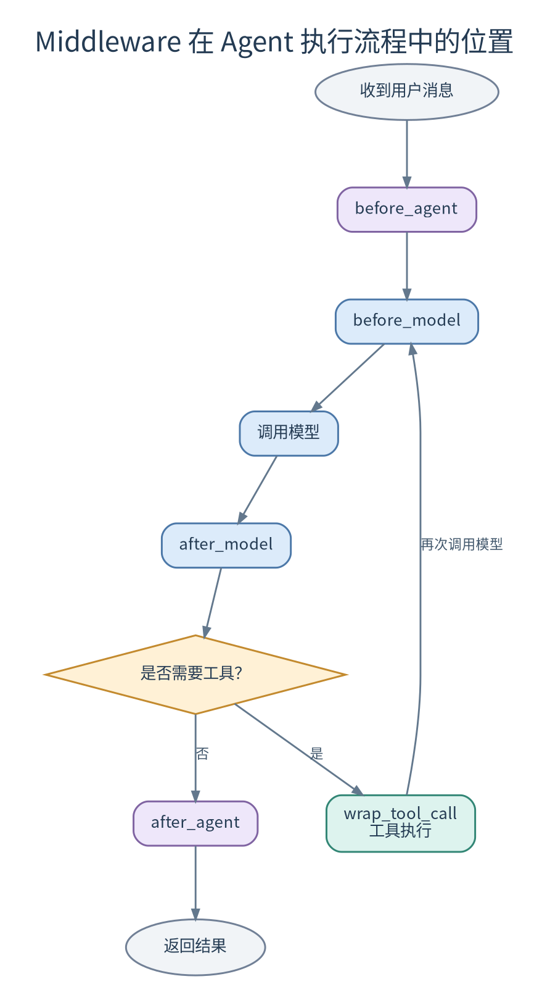
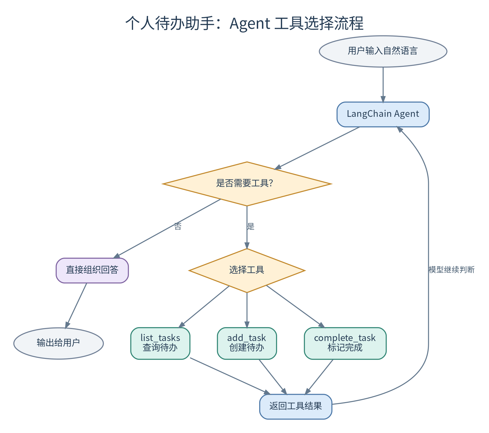

# LangChain 1.x：从模型调用到 Agent 构建

> 一篇从实际开发问题出发的 LangChain 1.x 学习笔记。本文先从模型调用开始，逐步引入消息、提示词、结构化输出和工具，最后使用 `create_agent` 把这些组件组织成一个可以调用工具的 Agent。
>
> **适用范围**：Python、LangChain 1.x。本文示例优先采用 LangChain 1.x 的公开 API。模型供应商、模型名称和部分集成包会持续变化，运行前应以对应集成的官方参考文档为准。
>
> **实战场景**：个人待办助手。它可以查询待办、创建待办、标记完成，并把 Agent 的执行过程以流式方式输出。

## LangChain 是什么

如果只想调用一次大语言模型，其实并不一定需要 LangChain。安装模型供应商提供的 SDK，创建客户端，传入问题，再读取返回结果，就能完成最基本的对话。

但当应用逐渐复杂时，事情就不再只是“发一个请求、收一段文本”了。一个真实的 AI 应用可能需要：

- 在不同模型供应商之间切换；
- 将系统指令、用户问题和历史消息组织在一起；
- 让模型按照指定的数据结构返回结果；
- 让模型调用 Python 函数、查询数据库或访问外部服务；
- 在多次模型调用和工具执行之间维护状态；
- 记录执行过程，并在出现异常时进行处理。

这些工作如果完全依赖原生 SDK 自己实现，就需要为不同供应商分别处理请求格式、消息格式、工具参数和返回结果。应用越复杂，重复代码就越多。

**LangChain 是一个用于构建大语言模型应用和 Agent 的开发框架。** 它把模型、消息、提示词、工具和 Agent 等常见能力组织成相对统一的接口，让开发者可以把精力更多放在应用逻辑上，而不是每次都从底层 HTTP 请求开始写。

可以先把它理解为一套面向 LLM 应用的组件和运行机制：模型负责生成，Prompt 负责组织输入，Messages 负责描述对话，Tools 负责连接外部能力，Agent 负责根据任务决定何时调用模型和工具。

这里需要区分两个概念：

- **LLM 应用**：程序调用模型完成某项任务，执行步骤通常由代码提前确定。
- **Agent（智能体）**：程序把一部分步骤交给模型判断，模型可以根据当前信息选择工具，并根据工具结果决定下一步。

LangChain 1.x 将 Agent 放在框架核心位置，但并不意味着所有应用都必须使用 Agent。单次问答、固定流程的数据提取，直接调用模型往往更简单。

## 为什么需要 LangChain

先看一个不使用 LangChain 的简单调用过程。下面以 OpenAI Python SDK 的调用方式为例，重点是说明应用代码需要自己处理哪些事情，并不是说原生 SDK 不好。

```python
from openai import OpenAI

client = OpenAI()

response = client.chat.completions.create(
    model="your-model-name",
    messages=[
        {"role": "system", "content": "你是一名 Python 助手。"},
        {"role": "user", "content": "解释一下列表推导式。"},
    ],
)

print(response.choices[0].message.content)
```

这段代码完成一次模型调用没有问题。但如果项目接下来还要增加工具调用、结构化输出和多轮对话，就需要继续编写：工具 JSON Schema、工具调用分发、工具结果回传、消息历史管理，以及模型供应商之间的适配代码。

LangChain 的价值在于把这些重复出现的能力抽象成组件。例如：

| 开发中遇到的问题 | LangChain 提供的能力 |
|---|---|
| 不同模型的初始化方式不同 | 模型集成与 `init_chat_model` |
| 对话角色和消息结构需要统一 | Message 类型 |
| 提示词需要重复拼接 | Prompt Template |
| 模型输出需要满足数据格式 | Structured Output |
| 模型需要访问外部能力 | Tools / Tool Calling |
| 模型要自己决定是否调用工具 | `create_agent` |
| Agent 执行过程需要插入业务逻辑 | Middleware |
| 想逐步接收生成内容 | Streaming |

这并不是说 LangChain 可以自动解决所有工程问题。它提供的是一组抽象和运行机制，数据库连接、业务规则、权限控制、异常处理和部署仍然需要开发者负责。

例如，给 Agent 一个 `delete_user` 工具，并不意味着它就能安全地删除用户。工具背后的权限校验、确认流程、日志记录和幂等处理，仍然是应用本身的责任。

## LangChain 的整体架构

初学时容易把 LangChain 看成一个“把大模型包起来的库”。更准确的理解是：它提供了从模型接入到 Agent 运行的一组构建组件，并通过集成包连接不同供应商。

可以先从下面几个层次理解：




各部分的职责可以这样理解：


1. **模型层**：统一调用不同供应商的聊天模型。模型是 Agent 的推理引擎，但模型本身并不知道你项目里的数据库和 Python 函数。
2. **消息与提示词层**：决定传给模型的内容、角色和上下文。它们影响模型如何理解任务。
3. **工具层**：把应用中的某些能力封装成模型可以请求调用的工具。
4. **Agent 层**：将模型和工具组织成一个执行循环。模型决定是否需要调用工具，Agent 负责执行工具并把结果交回模型。
5. **中间件层**：在 Agent 的执行环节插入控制逻辑，例如调用前记录日志、限制调用次数或处理工具错误。

还需要知道 LangChain 并不是整个 LangChain 生态的全部。通常会同时看到下面几个名字：

| 名称 | 主要职责 | 可以怎样理解 |
|---|---|---|
| LangChain | LLM 应用与 Agent 的高层抽象 | 提供常用组件和标准 Agent 入口 |
| LangGraph | Agent 的底层编排与运行时 | 更明确地控制状态、节点、分支、中断和恢复 |
| Deep Agents | 面向复杂任务的更高层 Agent 方案 | 在常见 Agent 能力上提供更完整的开箱即用方案 |
| LangSmith | 开发调试、追踪和评估平台 | 观察一次 Agent 运行中发生了什么 |

本文只重点讲 LangChain。LangGraph 会在后续独立文档中展开，这里只需要记住：LangChain 1.x 的 `create_agent` 底层基于 LangGraph 运行时构建，因此它可以利用图运行时提供的状态和持久化能力，但使用者不必一开始就手动定义 StateGraph。

##  LangChain 1.x 的主要变化

如果搜索 LangChain 教程，会看到很多代码仍然使用 `LLMChain`、`initialize_agent` 或 `AgentExecutor`。这些代码并不一定完全没有价值，但它们主要属于早期版本的开发方式。

LangChain 1.x 对主包和 Agent 的入口进行了调整，写新项目时需要优先使用新版方式。

###  Agent 的标准入口变为 `create_agent`

新版创建 Agent 的入口是：

```python
from langchain.agents import create_agent

agent = create_agent(
    model="provider:model-name",
    tools=[],
    system_prompt="你是一名认真负责的助手。",
)
```

以前的教程中可能会看到 `initialize_agent`、`AgentExecutor`，或者直接使用 `langgraph.prebuilt.create_react_agent`。学习旧项目迁移时仍然可能遇到它们，但编写 LangChain 1.x 新代码时，应优先从 `create_agent` 开始。

### Middleware 成为 Agent 的主要扩展方式

旧教程可能通过各种 hook 或 AgentExecutor 参数扩展行为。LangChain 1.x 推荐通过 Middleware 在 Agent 生命周期中加入自定义逻辑。

例如，在每次模型调用前记录消息数量：

```python
from langchain.agents.middleware import before_model


@before_model
def log_before_model(state, runtime):
    print(f"本轮模型调用前共有 {len(state['messages'])} 条消息")
    return None
```

这里的 `before_model` 是一个中间件装饰器。它不负责调用模型，而是在 Agent 准备调用模型之前执行。

### `langchain` 主包的命名空间更加精简

LangChain 1.x 将主包重点放在 Agent、模型、消息和工具等核心构件上。部分旧版链式抽象和辅助能力迁移到了 `langchain-classic`，模型供应商集成则通过独立集成包安装。

因此，不要看到旧教程中的 `from langchain...` 就认为新版仍然有完全相同的导入路径。遇到导入错误时，首先检查教程版本和当前安装版本。

###  标准内容块和消息能力得到增强

新版消息对象可以携带文本之外的内容块，例如多模态内容、工具调用信息或其他结构化内容。不同模型供应商的返回格式可能不同，LangChain 会在支持的集成中尽可能提供统一访问方式。

### 版本选择建议

本文以 LangChain 1.x 的思路和 API 为主。1.x 内部也会继续迭代，所以不能把某一个小版本的表现理解成所有 1.x 版本永远不变。

建议新建环境后记录实际安装版本：

```bash
python -m pip show langchain langchain-core langgraph
```

当某个示例无法运行时，先检查：

1. 是否把 0.x 教程的代码复制到了 1.x 环境；
2. 是否安装了对应模型的集成包；
3. 导入路径是否与当前版本文档一致；
4. 模型供应商是否支持示例所用的工具调用或结构化输出能力。

---

# Model 模型

## Chat Model

理解 LangChain，首先要弄清楚它怎样调用模型。

大语言模型通常通过 API 接收输入，再生成文本或其他内容。早期的模型接口经常以字符串作为输入、以字符串作为输出。但现在的模型应用普遍需要处理多轮对话、不同角色、工具调用和多模态内容，因此 LangChain 中更常用的是 **Chat Model（聊天模型）**。

Chat Model 接收的输入可以是一个字符串，也可以是一组消息对象；返回的通常是 `AIMessage`，而不是一个裸字符串。

```python
from langchain.chat_models import init_chat_model

model = init_chat_model("openai:your-model-name", temperature=0)

response = model.invoke("用一句话介绍 LangChain。")

print(response)
print(response.content)
```

这里有两个值得注意的地方：

- `invoke()` 是一次同步调用。它把输入交给模型，等待模型返回完整结果。
- `response` 是一个消息对象，真正的文本内容通常在 `response.content` 中。

为什么不直接返回字符串？因为模型的回复不一定只有文本。它还可能带有工具调用、使用量统计、停止原因、供应商返回的元数据等信息。使用消息对象可以把这些信息一起保留下来。

### Chat Model 与传统文本模型有什么不同？

可以先用最简单的方式区分：

| 对比项 | 传统文本补全思路 | Chat Model |
|---|---|---|
| 输入 | 一段文本 | 一条或多条带角色的消息，也可接收字符串简写 |
| 上下文 | 通常需要自己拼接 | 可以显式传入多轮消息 |
| 角色 | 角色信息一般写在文本中 | System、Human、AI、Tool 等角色有明确结构 |
| 返回值 | 通常以文本为主 | 通常返回 AIMessage，可能包含工具调用等信息 |

在实际开发中，不需要纠结模型内部是不是仍然采用某种文本预测机制。对 LangChain 使用者来说，重要的是 Chat Model 提供了适合构建对话应用的统一接口。

## `init_chat_model`

不同模型供应商的 SDK 不一样。例如，OpenAI、Anthropic、Google、DeepSeek 等模型可能拥有不同的初始化类、参数和环境变量。如果项目需要更换模型，直接在业务代码里使用各家 SDK，切换成本就会比较高。

LangChain 提供 `init_chat_model()` 作为统一的模型初始化入口。只要对应供应商的集成包已经安装，就可以通过统一的方式创建模型。

```python
from langchain.chat_models import init_chat_model

model = init_chat_model(
    "openai:your-model-name",
    temperature=0.2,
    timeout=30,
    max_retries=2,
)
```

模型名称通常采用 `provider:model-name` 的形式：

- `provider` 表示模型供应商或集成名称；
- `model-name` 表示该供应商实际提供的模型标识。

这里的 `your-model-name` 是占位符，应替换成账号当前可用的模型名称。不同模型对 `temperature`、`max_tokens`、工具调用和结构化输出等参数的支持可能不同，不能因为初始化入口统一，就认为所有参数在所有模型上完全等价。

### 常见初始化参数

| 参数 | 作用 | 说明 |
|---|---|---|
| `temperature` | 控制生成随机性 | 较低值通常更稳定，但不是“准确率开关” |
| `max_tokens` | 限制生成长度 | 具体含义和上限取决于模型集成 |
| `timeout` | 设置请求超时时间 | 避免网络请求无限等待 |
| `max_retries` | 设置失败重试次数 | 具体默认值由集成包决定 |
| `model_provider` | 显式指定供应商 | 模型名无法自动判断或希望固定供应商时使用 |

例如，想使用统一入口创建某个模型，可以这样写：

```python
from langchain.chat_models import init_chat_model

model = init_chat_model(
    model="provider:model-name",
    model_provider="provider",
    temperature=0,
)
```

有些供应商也支持根据模型名称自动识别 provider。但在团队项目中，显式写清 provider 往往更直观，也更容易排查初始化问题。

### 通用接入与 DeepSeek 接入示例

通用写法的重点是：**模型初始化逻辑尽量不和某个具体业务绑在一起，供应商差异集中在配置和集成包中。**

例如，使用 OpenAI 集成：

```bash
pip install -U langchain langchain-openai
```

```python
from langchain.chat_models import init_chat_model

model = init_chat_model(
    "openai:your-model-name",
    temperature=0.2,
)
```

如果要切换到 DeepSeek，可以安装 DeepSeek 的 LangChain 集成：

```bash
pip install -U langchain langchain-deepseek python-dotenv
```

在项目根目录创建 `.env`：

```dotenv
DEEPSEEK_API_KEY=替换为你自己的_API_Key
```

然后通过统一入口初始化：

```python
from dotenv import load_dotenv
from langchain.chat_models import init_chat_model

load_dotenv()

model = init_chat_model(
    "deepseek:deepseek-flash",
    temperature=0.2,
)

response = model.invoke("用一句话介绍 LangChain。")
print(response.content)
```

也可以直接使用供应商集成类：

```python
from langchain_deepseek import ChatDeepSeek

model = ChatDeepSeek(
    model="deepseek-flash",
    temperature=0.2,
)
```

两种方式的区别在于：`init_chat_model()` 让初始化代码更统一；`ChatDeepSeek` 则直接使用 DeepSeek 集成类，便于阅读供应商专属参数和能力。

本文使用 DeepSeek 示例时采用当前集成文档中的模型标识。网络教程中可能仍出现旧模型名称，实际使用前应查看 DeepSeek 当前模型列表和 LangChain DeepSeek 集成文档。模型名称、服务能力和价格可能变化，不建议把旧教程中的模型名不加核对地复制到新项目。

另外，虽然 DeepSeek API 提供 OpenAI 兼容接口，但当前 LangChain 已经有专门的 `langchain-deepseek` 集成。对于需要使用 DeepSeek 特有响应字段或模型能力的场景，优先考虑专用集成，而不是默认认为 `ChatOpenAI(base_url=...)` 能完整保留第三方供应商的所有响应信息。

### `init_chat_model` 解决了什么问题？

它解决的是模型初始化和接入方式的统一问题，不是把所有模型的能力变成完全一样。不同模型是否支持工具调用、JSON 模式、原生结构化输出、图片输入等，仍然要看具体模型和集成包。

##  模型调用流程

模型调用并不是把 Python 字符串直接“交给模型思考”这么简单。应用层会先准备输入，集成包再将其转换成供应商接口可以识别的请求格式。

一次普通调用可以抽象成下面的过程：


在代码层面，最常见的调用方法有：

| 方法 | 用途 | 特点 |
|---|---|---|
| `invoke()` | 单次调用 | 等待完整结果后返回 |
| `stream()` | 流式调用 | 逐块返回模型生成内容 |
| `ainvoke()` | 异步单次调用 | 适合异步应用 |
| `astream()` | 异步流式调用 | 适合异步流式接口 |
| `batch()` | 批量调用 | 一次提交多组输入 |

例如：

```python
response = model.invoke("解释什么是 Python 装饰器。")
print(response.content)
```

如果使用异步程序：

```python
import asyncio


async def main():
    response = await model.ainvoke("解释什么是 Python 装饰器。")
    print(response.content)


if __name__ == "__main__":
    asyncio.run(main())
```

同步还是异步并不是 LangChain 专属概念。FastAPI 等异步应用通常更适合使用异步调用，避免在事件循环中长时间执行同步网络请求。

##  模型返回结果

执行下面的代码：

```python
response = model.invoke("用一句话解释 Agent。")
print(type(response))
print(response.content)
print(response.usage_metadata)
print(response.response_metadata)
```

通常可以看到，返回对象是 `AIMessage` 或其相关消息类型。除了文本内容，还可能包含：

| 属性 | 含义 |
|---|---|
| `content` | 模型返回的主要内容，可能是字符串，也可能是内容块列表 |
| `tool_calls` | 模型提出的工具调用请求 |
| `usage_metadata` | 标准化的 Token 使用量信息（集成支持时） |
| `response_metadata` | 供应商返回的响应元数据，例如结束原因等 |
| `id` | 消息标识（如供应商或集成返回） |

不要直接认为 `response.content` 永远是普通字符串。简单文本对话通常是字符串；多模态或结构化内容场景可能返回内容块列表。开发时最好先观察对象结构，再决定如何处理。

还有一个容易混淆的点：`AIMessage` 表示模型生成的一条消息，它不一定意味着模型已经向用户输出最终答案。如果 `tool_calls` 不为空，这条 AIMessage 可能表达的是“我需要调用某个工具”。后面讲 Tools 和 Agents 时会用到这一点。

---

# Messages 消息管理

前面调用模型时，我们直接传入了一段字符串。对简单问题来说，这样已经够用。但如果希望模型区分系统规则、用户提问、模型历史回答和工具执行结果，只传一段字符串就不够清楚了。

Chat Model 通常通过消息列表表示对话。每条消息都具有角色和内容，不同角色承担不同职责。

##  SystemMessage

`SystemMessage` 用于提供系统级指令，告诉模型应该扮演什么角色、遵守什么规则，以及回答时需要注意哪些限制。

```python
from langchain_core.messages import SystemMessage

message = SystemMessage(
    content="你是一名 Python 助手。回答时先给出结论，再解释原因。"
)
```

它通常用于设置应用的全局行为，而不是直接承载用户当前的问题。

例如：

- 你是一名擅长 Python 的编程助手；
- 只能依据提供的资料回答；
- 不确定时要明确说明，不允许编造数据；
- 涉及删除或修改数据时，必须先确认。

SystemMessage 是模型输入的一部分，不是强制的权限系统。**如果系统提示词写着“不能删除数据”，但程序仍向模型暴露了删除工具，安全控制不能只依赖这句话。** 真正的权限校验必须由工具和业务后端完成。

##  HumanMessage

`HumanMessage` 表示用户发送的消息，也就是对话中的用户输入。

```python
from langchain_core.messages import HumanMessage

message = HumanMessage(content="帮我解释一下 Python 的装饰器。")
```

用户输入可能是一句问题，也可能包含图片、文件或其他多模态内容。对于纯文本入门示例，通常只需要传入字符串。

##  AIMessage

`AIMessage` 表示模型生成的消息。它既可以是正常回答，也可以是工具调用请求。

```python
from langchain_core.messages import AIMessage

message = AIMessage(content="装饰器本质上是一个接收函数并返回函数的可调用对象。")
```

通过模型调用得到的 `AIMessage` 还可能包含额外字段，例如 `tool_calls`：

```python
response = model.invoke("用一句话介绍 LangChain。")

print(response.content)
print(response.tool_calls)
```

普通回答时，`tool_calls` 通常为空列表；模型决定调用工具时，`tool_calls` 中会包含工具名称、参数和调用 ID。

要记住：工具调用请求仍然是模型产生的 AIMessage，不是 ToolMessage。

##  ToolMessag

`ToolMessage` 用于表示工具执行后的返回结果。它通常与前面 AIMessage 中的一次工具调用对应。

```python
from langchain_core.messages import ToolMessage

message = ToolMessage(
    content="当前有 3 条待完成任务。",
    tool_call_id="call_001",
    name="list_tasks",
)
```

其中最重要的是 `tool_call_id`。模型有可能在一轮中请求多个工具调用，因此工具执行结果需要通过 ID 与对应的工具请求关联起来。

简单理解：

- AIMessage：模型说“我要调用这个工具，参数是这些”；
- ToolMessage：工具执行后返回“这是执行结果”。

ToolMessage 不是用户输入，也不是模型最终回复。它是工具与模型之间交互链条中的一环。

## 一次工具调用中的消息关系

假设用户问：“帮我查一下今天还有哪些待办任务。”模型判断需要查询任务列表，于是请求调用 `list_tasks` 工具。

一次完整交互可能包含以下消息：



对应的消息列表可以抽象成：

```python
messages = [
    HumanMessage(content="帮我查询今天的待办任务。"),
    AIMessage(
        content="",
        tool_calls=[
            {
                "name": "list_tasks",
                "args": {"status": "pending"},
                "id": "call_001",
                "type": "tool_call",
            }
        ],
    ),
    ToolMessage(
        content="T001：复习 LangChain；T002：完成课程作业",
        tool_call_id="call_001",
        name="list_tasks",
    ),
    AIMessage(content="你目前有两项待完成任务……"),
]
```

上面的列表用于说明消息之间的关系。真实的 AIMessage 工具调用结构由模型集成产生，不建议在业务代码中手工伪造工具调用结果。

在 LangChain 中，消息对象还包含时间、元数据、多模态内容等能力。当前先理解四种常见消息类型即可，后面学习 Agent 时会反复看到它们。

---

# Prompt 提示词

消息解决了“谁在说话”的问题，但实际开发中还会遇到另一个问题：每次请求模型时，提示词都要重新组织，变量也需要手动拼接。

例如，我们想让模型根据用户提供的主题生成一段学习建议。如果直接用字符串拼接：

```python
topic = "LangGraph"
prompt = "请给我一份关于 " + topic + " 的学习建议。"
```

这样当然可以运行，但当模板越来越长，变量越来越多，就不容易维护。提示词模板的作用就是把固定指令和动态变量分开。

##  PromptTemplate

`PromptTemplate` 用于构建普通字符串提示词。

```python
from langchain_core.prompts import PromptTemplate

prompt = PromptTemplate.from_template(
    "你是一名技术导师，请用通俗的语言解释 {topic}，并给出一个 Python 示例。"
)

prompt_value = prompt.invoke({"topic": "装饰器"})
print(prompt_value.to_string())
```

输出的提示词已经将 `{topic}` 替换成传入的值。

`PromptTemplate` 适合输入和输出都以普通文本为主、暂时不需要区分多轮消息角色的场景。

它的核心思路是：模板中保留变量位置，调用时提供变量字典，模板负责完成格式化。

## ChatPromptTemplate

对话模型通常需要知道不同内容属于哪个角色。此时使用 `ChatPromptTemplate` 更合适。

```python
from langchain_core.prompts import ChatPromptTemplate

prompt = ChatPromptTemplate.from_messages(
    [
        ("system", "你是一名专业的 {role}。回答要准确、简洁。"),
        ("human", "请解释一下 {topic}。"),
    ]
)

messages = prompt.invoke(
    {
        "role": "Python 导师",
        "topic": "列表推导式",
    }
)

for message in messages.to_messages():
    print(message.type, message.content)
```

这里的 `from_messages()` 接收一个消息模板列表。每个元素都描述一条消息：角色是什么，内容如何填充。

在上面的例子中：

- `system` 对应系统指令；
- `human` 对应用户问题；
- `{role}` 和 `{topic}` 是需要在运行时填充的变量。

也可以进一步把 Prompt 和模型连接起来：

```python
chain = prompt | model

response = chain.invoke(
    {
        "role": "Python 导师",
        "topic": "列表推导式",
    }
)

print(response.content)
```

这里的 `|` 是 LangChain Runnable 组合中常见的写法，可以把前一个组件的输出交给后一个组件。`prompt | model` 表示先格式化提示词，再把生成的消息传给模型。

这属于 LangChain 的 Runnable / LCEL 使用方式。即使本文重点放在 1.x 的 Agent 上，这种组合方式仍然有用，尤其适合确定步骤的简单处理链。

## MessagesPlaceholder

上面的 ChatPromptTemplate 主要由固定的系统消息和当前用户消息组成。那如果用户连续提问，想让模型看到之前的对话记录，应该如何处理？

可以直接在模板中添加历史消息变量，但需要让模板知道：这个变量不是一段字符串，而是一组消息对象。这时可以使用 `MessagesPlaceholder`。

```python
from langchain_core.messages import HumanMessage, AIMessage
from langchain_core.prompts import ChatPromptTemplate, MessagesPlaceholder

prompt = ChatPromptTemplate.from_messages(
    [
        ("system", "你是一名耐心的 Python 学习助手。"),
        MessagesPlaceholder(variable_name="history", optional=True),
        ("human", "{question}"),
    ]
)

history = [
    HumanMessage(content="我最近在学习 Python。"),
    AIMessage(content="很好，可以先从基础语法和数据结构开始。"),
]

messages = prompt.invoke(
    {
        "history": history,
        "question": "那我接下来应该学习什么？",
    }
)

for message in messages.to_messages():
    print(message.type, message.content)
```

`MessagesPlaceholder` 会把传入的消息列表插入模板中指定的位置，而不是把整个列表转换成普通字符串。

这里 `optional=True` 表示即使调用时没有提供 `history`，模板也允许继续执行；如果不设置为可选，调用方就需要提供这个变量。

需要注意，`MessagesPlaceholder` 只负责把历史消息放进 Prompt，并不负责保存历史消息。它不会自动把上一次模型的回复写入数据库，也不会自动记住上一个请求。历史消息从哪里来、保存多久、何时裁剪，仍需要应用层或 Agent 的状态管理机制负责。

## 什么时候使用哪一种模板

| 模板 | 输入形式 | 典型场景 |
|---|---|---|
| `PromptTemplate` | 普通文本模板 | 摘要、分类、单段文本生成 |
| `ChatPromptTemplate` | 多角色消息模板 | 聊天、Agent、需要角色区分的任务 |
| `MessagesPlaceholder` | 消息列表占位符 | 将历史对话插入聊天模板 |

三者并不是相互替代的关系。`MessagesPlaceholder` 通常作为 `ChatPromptTemplate` 的一部分使用。

---

# Structured Output 结构化输出

##  为什么需要结构化输出

模型默认擅长生成自然语言，但程序通常希望得到确定的数据结构。

例如，用户输入：“帮我在周五之前完成 LangChain 笔记整理，优先级高一些。”

如果模型只返回：

> 好的，我会帮你创建一项高优先级任务，在周五之前完成 LangChain 笔记整理。

人能看懂这句话，但程序很难稳定地从中提取任务标题、日期和优先级。我们可能需要用字符串查找、正则表达式，或者再调用一次模型解析。

更好的方式是让模型按照预先定义的结构返回结果：

```json
{
  "title": "整理 LangChain 笔记",
  "due_date": "2026-11-27",
  "priority": "high"
}
```

这就是结构化输出的意义：把模型生成的结果约束为程序更容易处理的数据格式。

它常见于：

- 从自然语言中提取订单、联系人或任务信息；
- 让模型返回分类标签或风险等级；
- 提取简历中的姓名、技能和工作经历；
- 从用户描述中生成符合业务字段定义的对象。

## Pydantic

Pydantic 是 Python 中常用的数据校验与模型定义库。可以通过类和字段类型描述一份数据应该包含什么，以及字段应满足什么约束。

```python
from typing import Literal
from pydantic import BaseModel, Field


class TaskInfo(BaseModel):
    title: str = Field(description="待办事项标题")
    due_date: str | None = Field(
        default=None,
        description="截止日期，格式为 YYYY-MM-DD；未知时为 null",
    )
    priority: Literal["low", "medium", "high"] = Field(
        description="任务优先级，只能是 low、medium 或 high",
    )
```

这段代码定义了一个任务对象：

- `title` 必须是字符串；
- `due_date` 可以是字符串，也可以为空；
- `priority` 只能使用三个规定值之一；
- `Field(description=...)` 可以补充字段说明，让模型更容易理解字段含义。

Pydantic 不仅能描述结构，还能进行数据验证：

```python
task = TaskInfo(
    title="整理 LangChain 笔记",
    due_date="2026-11-27",
    priority="high",
)

print(task.title)
print(task.model_dump())
```

如果传入的数据类型或取值不符合定义，Pydantic 会抛出校验错误。这样就可以把模型的输出交给程序进一步验证，而不是完全依靠自然语言判断。

## with_structured_output

LangChain 的 Chat Model 在支持相应能力的前提下，可以通过 `with_structured_output()` 将模型包装成一个按照指定结构返回数据的 Runnable。

```python
from typing import Literal
from pydantic import BaseModel, Field


class TaskInfo(BaseModel):
    title: str = Field(description="待办事项标题")
    due_date: str | None = Field(
        default=None,
        description="截止日期，格式 YYYY-MM-DD；不知道时填写 null",
    )
    priority: Literal["low", "medium", "high"] = Field(
        description="任务优先级",
    )


structured_model = model.with_structured_output(TaskInfo)

result = structured_model.invoke(
    "帮我创建一个高优先级任务：周五之前整理 LangChain 笔记。"
)

print(result)
print(result.title)
print(result.model_dump())
```

这里的执行过程可以理解为：

1. 我们定义 `TaskInfo`，明确需要哪些字段；
2. `with_structured_output(TaskInfo)` 将结构要求交给模型集成；
3. 模型按照支持的结构化输出方式生成结果；
4. LangChain 将响应解析为对应结构；
5. 如果使用 Pydantic 类，解析后的数据会经过 Pydantic 校验。

### include_raw=True  有什么用？

调试时，只想看到解析后的对象可能不够。可以使用 `include_raw=True`：

```python
structured_model = model.with_structured_output(
    TaskInfo,
    include_raw=True,
)

result = structured_model.invoke(
    "帮我创建一个高优先级任务：周五之前整理 LangChain 笔记。"
)

print(result["raw"])
print(result["parsed"])
print(result["parsing_error"])
```

这样可以同时看到原始 AIMessage、解析后的对象，以及解析过程中是否出现错误。

### 结构化输出有不同实现方式

不同供应商支持的能力不一样。常见的实现策略包括：

- **Provider Native Structured Output**：供应商原生支持结构化输出时，直接使用供应商提供的约束能力；
- **Tool / Function Calling**：把目标结构包装成工具参数 Schema，要求模型生成符合结构的工具调用参数；
- **JSON Mode**：要求模型返回合法 JSON，但仍可能需要在 Prompt 中明确字段要求，并由应用进行校验。

`with_structured_output()` 的默认方法取决于具体模型集成，不能认为所有模型默认都使用相同的底层机制。比如 DeepSeek 集成支持通过工具调用方式或 JSON 模式实现结构化输出，具体参数以 `ChatDeepSeek` 当前参考文档为准。

DeepSeek 示例：

```python
from langchain_deepseek import ChatDeepSeek

model = ChatDeepSeek(model="deepseek-flash", temperature=0)
structured_model = model.with_structured_output(
    TaskInfo,
    method="function_calling",
)

result = structured_model.invoke(
    "创建一项任务：本周五之前整理 LangChain 笔记，优先级高。"
)
print(result)
```

## 结构化输出不等于绝对正确

结构化输出解决的是“结果是否符合预期数据结构”的问题，不代表模型理解的业务含义一定正确。

例如，模型可能正确返回：

```json
{
  "title": "整理 LangChain 笔记",
  "due_date": "2026-11-28",
  "priority": "high"
}
```

JSON 格式没问题，字段类型也可能符合 Pydantic 定义，但用户说的“周五”是否确实对应 2026-11-28，还需要结合当前日期、时区和业务规则判断。

因此，生产应用中通常还需要：

1. 使用 Pydantic 校验字段类型和取值；
2. 使用业务代码校验日期、金额和权限；
3. 对模糊信息向用户追问；
4. 重要操作执行前提供确认机制。

模型负责理解和生成，程序负责最终的数据校验与业务约束。不要把所有判断都交给模型。

---

# Tools 工具调用

##  为什么需要工具

到目前为止，模型能接收消息、理解提示词，还能按照指定结构返回数据。但它仍然有一个重要限制：**模型本身不能直接访问当前 Python 程序中的变量、数据库和外部服务。**

例如，用户问：“我今天还有哪些待办任务？”

如果模型没有连接任何任务数据，它只能根据训练知识或当前上下文回答，无法知道你本地任务列表里有什么。

这时就需要工具。

Tool 可以理解为应用提供给模型使用的一种外部能力。工具背后通常是一个 Python 函数，也可以是数据库查询、HTTP 请求或其他业务服务。

常见工具包括：

- 查询天气；
- 查询订单；
- 搜索知识库；
- 查询数据库；
- 创建任务或提交表单；
- 调用内部业务系统接口。

工具不是模型自己执行的 Python 代码。模型通常只负责提出调用请求，真正执行函数的是应用或 Agent 运行时。

## 使用 `@tool` 定义工具

在 LangChain 中，可以使用 `@tool` 装饰器把 Python 函数转换为 Tool。

```python
from langchain.tools import tool


@tool
def get_current_date() -> str:
    """获取当前日期，返回 YYYY-MM-DD 格式。"""
    from datetime import date

    return date.today().isoformat()
```

使用 `@tool` 后，这个函数不再只是普通 Python 函数，而是一个 LangChain Tool 对象。它具备工具名称、描述和参数 Schema 等信息。

```python
print(get_current_date.name)
print(get_current_date.description)
print(get_current_date.args)
```

这些信息后面会被用于工具调用。模型不需要读取你的 Python 源码，而是通过工具 Schema 理解有哪些工具可用、每个工具做什么、需要什么参数。

## 工具参数与描述

定义工具时，函数名、类型提示和文档字符串都很重要。

```python
from langchain.tools import tool


@tool
def search_tasks(keyword: str) -> str:
    """根据关键词搜索待办事项。

    Args:
        keyword: 用户要查找的任务关键词，例如 LangChain、作业或复习。
    """
    return f"搜索关键词：{keyword}，找到 2 条相关任务。"
```

这个工具包含三类信息：

1. **工具名称**：`search_tasks`，模型根据名称初步判断工具用途；
2. **工具描述**：说明工具适合什么场景；
3. **参数定义**：`keyword: str` 告诉模型需要提供一个字符串参数。

如果工具描述写得不明确，模型就可能在不应该调用时调用，或者在应该调用时选择了其他工具。

例如下面的描述就不够好：

```python
@tool
def query_data(value: str) -> str:
    """查询数据。"""
    ...
```

“查询数据”没有说清楚查询什么数据、参数是什么、返回什么结果。更清晰的描述应该是：

```python
@tool
def search_tasks(keyword: str) -> str:
    """根据任务标题中的关键词查找待办事项，返回匹配任务的 ID、标题、截止日期和状态。"""
    ...
```

### 参数 Schema 可以单独定义

当参数较多，或者希望为字段增加更明确的说明和校验时，可以使用 Pydantic 定义工具参数：

```python
from typing import Literal
from pydantic import BaseModel, Field
from langchain.tools import tool


class AddTaskArgs(BaseModel):
    title: str = Field(description="任务标题，使用简洁明确的表达")
    due_date: str | None = Field(
        default=None,
        description="任务截止日期，格式 YYYY-MM-DD；未知时为 null",
    )
    priority: Literal["low", "medium", "high"] = Field(
        default="medium",
        description="任务优先级，只能选择 low、medium 或 high",
    )


@tool(args_schema=AddTaskArgs)
def add_task(
    title: str,
    due_date: str | None = None,
    priority: Literal["low", "medium", "high"] = "medium",
) -> str:
    """创建一条新的待办事项。"""
    return f"创建成功：{title}，截止日期：{due_date}，优先级：{priority}。"
```

Pydantic Schema 可以帮助 LangChain 形成工具参数定义，但仍建议在函数内部对日期格式、业务状态和权限做二次验证。

## 模型如何决定调用工具

定义好工具后，还需要让模型知道它们的存在。模型集成一般通过工具绑定机制，把工具的名称、描述和参数 Schema 提供给模型。

```python
model_with_tools = model.bind_tools([search_tasks, get_current_date])

response = model_with_tools.invoke(
    "帮我查一下 LangChain 相关的待办任务。"
)

print(response.tool_calls)
```

模型会根据用户问题和工具说明，决定是否生成工具调用请求。

需要注意：`bind_tools()` 并不会在 Python 侧自动执行这些工具。它主要完成的是“让模型知道可以调用哪些工具，并让模型有能力生成工具调用请求”。真正的工具分发和执行，需要调用方自行完成，或者交给 Agent 运行时处理。

##  工具调用与结果返回

一次完整的工具调用通常包含以下步骤：

1. 应用把用户问题和可用工具定义发送给模型；
2. 模型返回 AIMessage，其中包含一个或多个 tool call；
3. 应用根据工具名称找到对应的 Python Tool；
4. 使用模型提供的参数执行工具；
5. 将执行结果包装成 ToolMessage，并关联原来的 `tool_call_id`；
6. 把包含工具结果的消息历史再次交给模型；
7. 模型根据工具结果生成最终回答。

下面用一个简化示例说明手动执行过程：

```python
from langchain_core.messages import HumanMessage, ToolMessage


tools = [search_tasks, get_current_date]
tools_by_name = {item.name: item for item in tools}

messages = [HumanMessage(content="帮我查一下 LangChain 相关的待办任务。")]
model_with_tools = model.bind_tools(tools)

ai_message = model_with_tools.invoke(messages)
messages.append(ai_message)

for tool_call in ai_message.tool_calls:
    tool = tools_by_name[tool_call["name"]]
    tool_result = tool.invoke(tool_call["args"])

    messages.append(
        ToolMessage(
            content=str(tool_result),
            tool_call_id=tool_call["id"],
            name=tool_call["name"],
        )
    )

final_message = model_with_tools.invoke(messages)
print(final_message.content)
```

这个例子为了突出原理，假设模型只需要一轮工具调用。如果模型在获得结果后还提出新的工具调用，就需要继续执行循环。还需要补充异常处理、并行调用处理以及工具权限控制。

这也解释了为什么后面需要 Agent：如果每个应用都手动实现工具分发、消息追加和重复调用循环，代码会越来越复杂。Agent 把这套常见执行过程封装起来。

---

# Agents 智能体

## Agent 是什么

普通模型调用通常是：应用构造输入，模型生成结果，调用结束。

但很多任务不是一次模型调用就能完成。例如用户说：“帮我看看今天还有哪些待办，如果有 LangChain 相关的任务，就把它们整理一下。”

程序很难提前写死唯一流程，因为它需要先判断：

- 是否需要查询任务；
- 应该调用哪个工具；
- 工具返回结果后是否还需要进一步处理；
- 什么时候可以结束并回答用户。

如果把所有分支都提前写在 Python 代码里，最终会变成一套复杂的规则流程。

Agent 的思路是：把可用工具交给模型，让模型结合当前上下文决定下一步。模型可能直接回答，也可能先调用一个工具，读取工具结果后再决定是否调用其他工具。

**Agent 可以理解为由模型驱动决策、由运行时负责执行工具和管理循环的一种应用模式。**

它不是“模型自己拥有了电脑权限”，也不是“模型生成 Python 代码后就自动执行”。模型提出的是结构化工具调用请求，应用仍然控制工具是否可用以及如何执行。

## create_agent

LangChain 1.x 推荐使用 `create_agent()` 创建标准 Agent。

最基本的创建过程只需要模型、工具和系统提示词：

```python
from langchain.agents import create_agent
from langchain.tools import tool


@tool
def get_weather(city: str) -> str:
    """查询指定城市的天气。"""
    return f"{city} 今天晴天，气温 22℃。"


agent = create_agent(
    model=model,
    tools=[get_weather],
    system_prompt="你是一名天气助手。需要查询天气时使用工具，不要编造实时天气。",
)
```

这里有三个核心参数：

| 参数 | 含义 |
|---|---|
| `model` | Agent 使用的聊天模型，可以是模型对象，也可以是支持的 provider:model 字符串 |
| `tools` | Agent 可以调用的工具列表 |
| `system_prompt` | Agent 的系统级指令 |

创建完成后，Agent 可以通过 `invoke()` 执行：

```python
result = agent.invoke(
    {
        "messages": [
            {"role": "user", "content": "帮我查询一下洛阳今天的天气。"}
        ]
    }
)

print(result["messages"][-1].content)
```

注意，新版 Agent 的输入核心字段是 `messages`。不要把旧教程中的 `{"input": "..."}` 直接套到 `create_agent()` 上。

## Agent 执行循环

`create_agent()` 的核心价值不只在于少写几行代码，而在于它替我们管理了模型与工具之间的执行循环。

可以把一次 Agent 运行理解为：



例如用户问：“帮我查询当前待办任务。”

1. Agent 收到用户消息；
2. 模型判断需要查询任务，于是生成 `list_tasks` 的工具调用请求；
3. Agent 运行时执行 `list_tasks`；
4. 工具结果被追加到消息历史中；
5. Agent 再次调用模型；
6. 模型根据查询结果组织自然语言回答；
7. 因为模型没有再提出工具调用，Agent 结束本轮运行。

这里最重要的是：**Agent 的执行循环是模型和工具之间反复交互的过程，不是简单地把一个工具函数调用一次。**

##  Tool Calling

Tool Calling 是模型提出工具调用请求的能力。模型会根据工具的描述和参数 Schema，判断当前任务是否需要使用工具。

例如：

- 用户问“什么是 LangChain？”：模型可能直接回答，不需要工具；
- 用户问“我还有几条未完成任务？”：模型可能调用 `list_tasks`；
- 用户说“把任务 T001 标记为完成”：模型可能调用 `complete_task`。

Tool Calling 的关键点有两个：

1. 模型负责决定“是否调用、调用哪个工具、使用什么参数”；
2. Agent 运行时或应用负责“校验请求、执行工具、把结果返回模型”。

工具调用不等于模型可以任意执行本地代码。可调用范围由应用传入的工具列表决定。

### 一个模型可以提出多个工具调用吗？

部分模型支持在一次响应中提出多个工具调用。例如用户同时查询两个城市天气，模型可能分别请求两次天气工具。运行时是否并行执行，则取决于 Agent 框架、工具执行器和配置。

工具是否能并行执行，不代表所有工具都适合并行。涉及写数据库、转账、删除数据等有副作用的操作，仍需要考虑执行顺序、事务、幂等和权限。

## Agent 的输入与输出

Agent 的输入通常是一个状态字典，核心字段是 `messages`：

```python
input_data = {
    "messages": [
        {"role": "user", "content": "我还有哪些待办任务？"}
    ]
}

result = agent.invoke(input_data)
```

返回值通常也是状态字典，其中 `messages` 保存了本次运行涉及的消息历史：

```python
for message in result["messages"]:
    message.pretty_print()
```

如果只是想拿到最终自然语言回答，可以读取最后一条消息：

```python
final_message = result["messages"][-1]
print(final_message.content)
```

但是，调试工具调用过程时，最好把整个 `messages` 列表打印出来。因为里面可能包含：

- 用户提出的问题；
- 模型生成的 AIMessage；
- AIMessage 中的工具调用请求；
- 工具执行后的 ToolMessage；
- 模型最终生成的回答。

如果 Agent 启用了结构化响应，状态中还可能包含 `structured_response` 等字段。不要假设所有 Agent 的返回结构都只有 `messages`，具体要看创建 Agent 时启用了哪些能力。

##  Agent 与普通模型调用的区别

| 对比项 | 普通模型调用 | Agent |
|---|---|---|
| 执行次数 | 通常一次模型调用 | 可能多次调用模型和工具 |
| 是否能用工具 | 需要自行绑定并执行工具 | 运行时管理工具调用循环 |
| 流程决定者 | 通常由应用代码决定 | 模型可以动态选择下一步工具 |
| 输入输出 | 通常是消息到消息 | 通常是状态到状态 |
| 适合场景 | 固定任务、内容生成、分类 | 需要根据结果动态选择动作的任务 |

不是所有任务都值得使用 Agent。如果流程固定，直接使用 Prompt、Model 和普通 Python 代码通常更可控，也更容易测试。只有当“下一步应该做什么”确实需要根据模型判断时，Agent 才能体现价值。

---

# Middleware 中间件

##  为什么需要 Middleware

Agent 已经可以根据用户问题调用工具，但在真实应用中，我们很快会遇到新的问题：

- 每次调用模型前，能否记录日志？
- 模型返回结果后，能否检查是否包含不允许的内容？
- 对话太长时，能否先压缩历史消息？
- 工具执行前，能否检查参数或要求人工审批？
- 模型调用次数过多时，能否强制停止？

这些逻辑如果全部写进工具函数或系统提示词，代码会变得混乱。Middleware 提供了一种更清晰的扩展方式：在 Agent 执行过程中的特定阶段插入自定义逻辑。

可以把它理解为 Agent 执行循环上的“钩子”。它不是一个独立的 Agent，也不代替模型和工具，而是在这些组件执行的前后执行额外逻辑。

## before_model

`before_model` 会在 Agent 每次调用模型之前触发。由于 Agent 可能进行多轮工具调用，所以它不一定只执行一次。

例如，我们想观察模型调用前，当前消息历史有多少条：

```python
from langchain.agents.middleware import before_model


@before_model
def log_before_model(state, runtime):
    message_count = len(state["messages"])
    print(f"即将调用模型，当前消息数量：{message_count}")
    return None
```

这里的 `state` 是当前 Agent 状态，默认情况下可以从中读取 `messages`。`runtime` 用来访问本次运行上下文等运行时信息，本例没有用到它。

钩子可以返回状态更新字典，也可以返回 `None`。返回 `None` 表示不修改状态。

如果希望钩子修改 Agent 状态，应当先把要使用的字段加入自定义状态 Schema，再从钩子中返回对应的状态更新。LangChain 1.x 的 Agent 自定义状态以 `TypedDict` 为基础，不要直接沿用旧教程中把 Pydantic 模型或 dataclass 当作 Agent 状态 Schema 的写法。

不要在 `before_model` 中放入耗时很长的阻塞操作，否则每一次模型调用都会增加额外等待时间。

## after_model

`after_model` 会在模型返回之后触发。可以用它观察模型输出、记录调用信息，或者根据模型响应更新 Agent 状态。

```python
from langchain.agents.middleware import after_model


@after_model
def log_after_model(state, runtime):
    last_message = state["messages"][-1]
    print(f"模型本轮返回类型：{last_message.type}")
    return None
```

如果模型刚刚提出了工具调用请求，最后一条消息可能是包含 `tool_calls` 的 AIMessage；如果模型生成了最终回答，最后一条消息则可能是普通的 AIMessage。

因此，`after_model` 不等于“用户已经收到最终回答”。Agent 后面可能还要继续执行工具，再次调用模型。

## 自定义 Middleware

最简单的方式是使用装饰器定义单个钩子，再把它传给 `create_agent()`：

```python
from langchain.agents import create_agent
from langchain.agents.middleware import before_model, after_model


@before_model
def log_before_model(state, runtime):
    print("开始调用模型")
    return None


@after_model
def log_after_model(state, runtime):
    print("模型已返回")
    return None


agent = create_agent(
    model=model,
    tools=[search_tasks],
    system_prompt="你是一名待办助手。",
    middleware=[log_before_model, log_after_model],
)
```

一次调用中，如果模型触发了工具并再次调用模型，`before_model` 和 `after_model` 都可能多次执行。

### 装饰器方式和类方式

如果只需要一个简单钩子，装饰器方式通常最直接。如果中间件需要多个钩子、内部配置或更复杂的控制逻辑，可以使用自定义 Middleware 类。

不同 1.x 小版本中的扩展接口可能继续演进，编写类式中间件时应直接对照当前的 [Custom Middleware 官方文档](https://docs.langchain.com/oss/python/langchain/middleware/custom)，不要把早期 hook API 与新版接口混在一起。

## Middleware 在 Agent 执行流程中的位置

把前面学到的执行流程和 Middleware 放在一起，就更容易理解它的用途：



常见钩子可以这样区分：

| Middleware 钩子 | 触发时机 | 适合做什么 |
|---|---|---|
| `before_agent` | 一次 Agent 运行开始前 | 请求级日志、运行前准备 |
| `before_model` | 每次模型调用前 | 消息裁剪、调用前记录 |
| `after_model` | 每次模型返回后 | 输出检查、模型响应记录 |
| `after_agent` | 一次 Agent 运行结束后 | 统计、清理、结果记录 |
| `wrap_model_call` | 包装模型调用 | 重试、模型选择、计时 |
| `wrap_tool_call` | 包装工具调用 | 权限检查、工具错误转换、计时 |

如果需要强制审批某个有副作用的工具，不应该只在系统提示词中写“执行前先询问用户”。提示词不能作为可靠的安全边界。应该使用明确的中间件、人工确认机制，或者在业务后端进行权限校验。

---

# Streaming 流式输出

前面调用模型时使用的是 `invoke()`。它会等待模型生成完整结果后再返回。对于较长的回答，用户可能需要等待一段时间才能看到第一个字。

Streaming（流式输出）解决的是这个体验问题：模型生成内容时，应用可以逐步接收结果，而不是等全部生成完毕再一次性返回。

### 模型级流式输出

对于单独的 Chat Model，可以使用 `stream()`：

```python
for chunk in model.stream("请介绍一下 LangChain 的主要作用。"):
    print(chunk.text, end="", flush=True)
```

这里返回的不是完整 AIMessage，而是一个个消息片段。应用可以把片段连续输出到终端或前端。

### Agent 级流式输出

Agent 不只有模型输出，还可能执行工具。因此，Agent 流式输出除了 Token，还可以把执行步骤或状态变化发送出来。

LangChain 1.x 的 Agent 基于图运行时，常见的流式模式包括：

| `stream_mode` | 主要用途 | 典型内容 |
|---|---|---|
| `messages` | 接收模型消息块 | Token、消息内容及元数据 |
| `updates` | 观察 Agent 步骤更新 | 模型节点或工具节点完成后的状态更新 |
| `custom` | 接收自定义进度事件 | 业务代码主动写出的进度信息 |

使用 `updates` 观察 Agent 执行过程：

```python
input_data = {
    "messages": [
        {"role": "user", "content": "查询我当前未完成的待办事项。"}
    ]
}

for update in agent.stream(input_data, stream_mode="updates"):
    print(update)
```

如果 Agent 调用了工具，通常可以观察到类似以下阶段：

1. 模型节点产生工具调用请求；
2. 工具节点执行并返回结果；
3. 模型节点根据工具结果生成最终回答。

这对调试 Agent 很有帮助。因为有时用户只看到最终回答，但开发者需要知道模型究竟调用了哪个工具、工具返回了什么。

### 只关注模型 Token

如果前端只想显示模型正在生成的文本，可以使用 `messages`：

```python
for token, metadata in agent.stream(input_data, stream_mode="messages"):
    if token.text:
        print(token.text, end="", flush=True)
```

`messages` 模式返回的是消息块和元数据。元数据中通常可以找到当前消息来自哪个图节点。实际项目中可以根据元数据筛选需要展示的模型输出，避免把工具节点或其他模型的内容混入同一个文本区域。

### Streaming 不等于异步

流式输出和异步调用是两个不同维度：

- Streaming 关注结果是否分块返回；
- Async 关注调用是否使用异步执行模型。

LangChain 同时提供 `stream()` 和 `astream()`。在异步 Web 服务中，可以根据接口设计使用异步流式调用。

### 什么时候需要流式输出？

- 用户正在和 Agent 对话，希望尽快看到模型生成的内容；
- Agent 需要执行多个步骤，希望前端显示执行进度；
- 调试工具调用过程，需要观察模型请求和工具返回；
- 后端需要通过 SSE 或 WebSocket 将生成内容推送给前端。

需要注意：模型的 Token 流、Agent 的步骤更新和业务进度不是一回事。设计前后端协议时，最好明确区分“文本增量”“工具执行状态”和“业务进度”，不要把所有事件都直接拼成回答字符串。

---

# 实战案例：个人待办助手

前面分别介绍了 Model、Messages、Prompt、Structured Output、Tools、Agents、Middleware 和 Streaming。现在用一个相对简单的业务场景把它们连接起来。

本次不做复杂的多 Agent 系统，也不接入 RAG。目标是做一个可以查询和维护个人待办事项的命令行助手。

##  需求分析

设想一下，平时我们可能会对学习助手说：

- “帮我创建一项任务，明天复习 LangGraph，优先级高。”
- “我现在还有哪些没有完成的任务？”
- “把任务 T001 标记为已完成。”
- “我最近的任务安排怎么样？”

如果只是调用普通模型，它只能根据用户提供的内容生成建议，并不知道本地真实的任务数据。

因此，我们需要给 Agent 提供几个工具：

| 工具 | 用途 | 是否修改数据 |
|---|---|---|
| `list_tasks` | 查询待办事项 | 否 |
| `add_task` | 创建一条新待办 | 是 |
| `complete_task` | 将待办标记为完成 | 是 |

系统整体流程如下：


为了让示例能够独立运行，任务数据暂时保存在 Python 列表中。这意味着程序退出后数据就会消失。它只是用于学习工具调用和 Agent 执行过程，不是生产环境的数据存储方案。

## 项目结构与环境配置

可以创建一个简单项目：

```text
langchain-todo-agent/
├── .env
├── requirements.txt
└── main.py
```

`requirements.txt`：

```text
langchain
langchain-deepseek
python-dotenv
pydantic
```

安装依赖：

```bash
python -m pip install -r requirements.txt
```

`.env` 文件：

```dotenv
DEEPSEEK_API_KEY=替换为你自己的_API_Key
```

不要将 `.env` 提交到 Git 仓库。建议在 `.gitignore` 中添加：

```text
.env
.venv/
__pycache__/
```

模型初始化采用前面介绍的通用入口：

```python
from dotenv import load_dotenv
from langchain.chat_models import init_chat_model

load_dotenv()

model = init_chat_model(
    "deepseek:deepseek-flash",
    temperature=0.2,
)
```

如果后续要切换模型，可以修改 provider 和模型名称，并安装对应的集成包。待办业务工具本身不应该因为模型供应商发生变化而重写。

## 定义模型与工具

先准备一个简单的任务列表。真实项目中，这一部分应该换成数据库表和 Repository/DAO 层：

```python
TASKS = [
    {
        "id": "T001",
        "title": "学习 LangChain 的基本组件",
        "due_date": "2026-11-27",
        "priority": "high",
        "status": "pending",
    },
    {
        "id": "T002",
        "title": "完成 Python 课程作业",
        "due_date": "2026-11-28",
        "priority": "medium",
        "status": "pending",
    },
]
```

接下来定义查询工具：

```python
from typing import Literal
from langchain.tools import tool


@tool
def list_tasks(status: Literal["all", "pending", "done"] = "pending") -> str:
    """查询待办事项。

    Args:
        status: 查询范围。all 表示全部任务，pending 表示未完成任务，done 表示已完成任务。
    """
    if status == "all":
        selected = TASKS
    else:
        selected = [task for task in TASKS if task["status"] == status]

    if not selected:
        return "没有找到符合条件的任务。"

    lines = []
    for task in selected:
        lines.append(
            f"{task['id']} | {task['title']} | "
            f"截止：{task['due_date'] or '未设置'} | "
            f"优先级：{task['priority']} | 状态：{task['status']}"
        )

    return "\n".join(lines)
```

这个工具只读取数据，不会修改任务列表。

然后定义创建工具：

```python
from datetime import date
from typing import Literal
from langchain.tools import tool


@tool
def add_task(
    title: str,
    due_date: str | None = None,
    priority: Literal["low", "medium", "high"] = "medium",
) -> str:
    """创建一条待办事项。

    Args:
        title: 任务标题，需要简洁明确。
        due_date: 截止日期，格式为 YYYY-MM-DD；没有明确日期时可以不传。
        priority: 优先级，只能是 low、medium 或 high。
    """
    if not title.strip():
        return "创建失败：任务标题不能为空。"

    if due_date:
        try:
            date.fromisoformat(due_date)
        except ValueError:
            return "创建失败：日期格式不正确，请使用 YYYY-MM-DD。"

    task_id = f"T{len(TASKS) + 1:03d}"
    task = {
        "id": task_id,
        "title": title.strip(),
        "due_date": due_date,
        "priority": priority,
        "status": "pending",
    }
    TASKS.append(task)

    return f"创建成功，任务编号为 {task_id}，任务标题为：{title}。"
```

最后定义完成工具：

```python
@tool
def complete_task(task_id: str) -> str:
    """将指定编号的待办事项标记为已完成。

    Args:
        task_id: 待办事项编号，例如 T001。
    """
    for task in TASKS:
        if task["id"] == task_id:
            if task["status"] == "done":
                return f"任务 {task_id} 已经是完成状态，无需重复操作。"

            task["status"] = "done"
            return f"任务 {task_id} 已成功标记为完成。"

    return f"没有找到编号为 {task_id} 的任务。"
```

这三个工具分别对应查询、创建和修改。工具函数本身不需要知道用户用什么语言提出需求；Agent 会负责把自然语言转换成工具参数。

这里也能看出工具描述为什么重要。模型需要知道 `status` 有哪些可选值、日期应该是什么格式、`task_id` 是什么。如果说明不清晰，模型就可能生成不符合业务要求的参数。

## 创建 Agent

工具准备好之后，创建 Agent：

```python
from langchain.agents import create_agent


agent = create_agent(
    model=model,
    tools=[list_tasks, add_task, complete_task],
    system_prompt=(
        "你是一名个人学习待办助手。\n"
        "你需要根据用户的要求管理待办事项。\n"
        "查询任务时必须调用 list_tasks，不允许编造任务数据。\n"
        "创建任务时，只有在用户明确表达创建意图后才能调用 add_task。\n"
        "标记完成时，必须使用用户提供的任务编号调用 complete_task。\n"
        "工具返回失败时，应如实告知用户，不得声称操作成功。\n"
        "如果截止日期不明确，不要自行编造具体日期。"
    ),
)
```

这里的系统提示词负责说明 Agent 的身份和使用工具时的行为约束。

需要注意：提示词是行为指导，不是安全边界。示例中的 `add_task` 和 `complete_task` 会修改数据，真实项目中如果这些操作影响重要业务，应增加用户身份校验、权限检查、人工确认和操作日志。不能因为提示词中写了“只有用户明确要求才能修改”，就认为程序已经具备可靠的权限控制。

## 调用与结果分析

现在可以通过自然语言向 Agent 提问：

```python
from langchain_core.messages import HumanMessage


result = agent.invoke(
    {
        "messages": [
            HumanMessage(content="帮我查询一下还有哪些未完成的任务。")
        ]
    }
)

print(result["messages"][-1].content)
```

如果模型判断需要查询任务，就会请求调用 `list_tasks`。Agent 执行后将结果交回模型，再由模型组织回答。

换一个问题：

```python
result = agent.invoke(
    {
        "messages": [
            HumanMessage(
                content="帮我创建一个高优先级任务，明天之前完成 LangGraph 学习笔记。"
            )
        ]
    }
)

print(result["messages"][-1].content)
```

模型需要从用户表达中提取任务标题、日期和优先级，再生成工具调用参数。这里有一个现实问题：“明天”是相对日期。要让 Agent 正确解析它，应该把当前日期和时区作为明确上下文提供给模型，或者由业务代码完成日期解析。不能依靠模型猜测当前日期。

本示例为突出 Agent 工具机制，使用明确日期的请求更容易复现，例如：

```python
result = agent.invoke(
    {
        "messages": [
            HumanMessage(
                content="创建一项任务：2026-11-27 之前整理 LangChain 笔记，优先级 high。"
            )
        ]
    }
)
print(result["messages"][-1].content)
```

想知道 Agent 到底做了什么，可以打印整个消息列表：

```python
for message in result["messages"]:
    message.pretty_print()
```

观察时重点看：模型是否提出了工具调用、调用参数是什么、工具返回了什么、模型是否根据结果生成了最终回答。

## 加入 Middleware

为了观察 Agent 每次调用模型前后的状态，可以加入两个中间件钩子：

```python
from langchain.agents.middleware import before_model, after_model


@before_model
def log_before_model(state, runtime):
    print(f"[Before Model] 消息数量：{len(state['messages'])}")
    return None


@after_model
def log_after_model(state, runtime):
    last_message = state["messages"][-1]
    print(f"[After Model] 消息类型：{last_message.type}")
    return None
```

创建 Agent 时将它们放入 `middleware`：

```python
agent = create_agent(
    model=model,
    tools=[list_tasks, add_task, complete_task],
    system_prompt="你是一名个人学习待办助手。需要查询或修改任务时使用相应工具。",
    middleware=[log_before_model, log_after_model],
)
```

执行时，终端会输出模型调用前后的日志。如果模型先调用工具，再根据工具结果生成最终回答，那么这两个钩子可能执行不止一次。

这种方式适合学习和调试。真实服务中，日志还应该考虑请求 ID、用户 ID、耗时和错误信息，并避免把 API Key、隐私数据等敏感内容直接写入日志。

## 实现流式输出

如果用户提出一个需要查询多个任务或组织较长回答的问题，希望能够逐步看到模型生成内容，可以使用 Agent 的 `stream()`。

```python
input_data = {
    "messages": [
        HumanMessage(content="查询我的未完成任务，并按优先级帮我总结一下。")
    ]
}

for token, metadata in agent.stream(input_data, stream_mode="messages"):
    if token.text:
        print(token.text, end="", flush=True)
```

这个示例主要展示文本增量。若希望观察 Agent 的节点执行过程，可以改用：

```python
for update in agent.stream(input_data, stream_mode="updates"):
    print(update)
```

开发 Web 应用时，可以将这些流式事件转换为 SSE 或 WebSocket 消息。建议不要把所有事件都当作普通文本：模型 Token、工具执行状态和业务进度应使用不同的事件类型。

##  完整代码与测试

把前面的内容放在一起，项目入口可以整理成下面这种结构。为了便于阅读，这里把任务数据、工具、模型和 Agent 放在同一个文件；实际项目建议拆分成多个模块。

```python
from datetime import date
from typing import Literal

from dotenv import load_dotenv
from langchain.agents import create_agent
from langchain.agents.middleware import before_model, after_model
from langchain.chat_models import init_chat_model
from langchain_core.messages import HumanMessage
from langchain.tools import tool


# --------------------------------------------------
# 1. 加载配置并初始化模型
# --------------------------------------------------
load_dotenv()

model = init_chat_model(
    "deepseek:deepseek-flash",
    temperature=0.2,
    timeout=30,
    max_retries=2,
)


# --------------------------------------------------
# 2. 模拟任务数据
#    注意：程序退出后数据会丢失，仅用于教学演示。
# --------------------------------------------------
TASKS = [
    {
        "id": "T001",
        "title": "学习 LangChain 的基本组件",
        "due_date": "2026-11-27",
        "priority": "high",
        "status": "pending",
    },
    {
        "id": "T002",
        "title": "完成 Python 课程作业",
        "due_date": "2026-11-28",
        "priority": "medium",
        "status": "pending",
    },
]


# --------------------------------------------------
# 3. 定义工具
# --------------------------------------------------
@tool
def list_tasks(status: Literal["all", "pending", "done"] = "pending") -> str:
    """查询待办事项。

    Args:
        status: all 表示全部任务，pending 表示未完成任务，done 表示已完成任务。
    """
    if status == "all":
        selected = TASKS
    else:
        selected = [task for task in TASKS if task["status"] == status]

    if not selected:
        return "没有找到符合条件的任务。"

    return "\n".join(
        f"{task['id']} | {task['title']} | 截止：{task['due_date'] or '未设置'} | "
        f"优先级：{task['priority']} | 状态：{task['status']}"
        for task in selected
    )


@tool
def add_task(
    title: str,
    due_date: str | None = None,
    priority: Literal["low", "medium", "high"] = "medium",
) -> str:
    """创建一条待办事项。

    Args:
        title: 任务标题，需要简洁明确。
        due_date: 截止日期，格式为 YYYY-MM-DD；没有明确日期时可以不传。
        priority: 优先级，只能是 low、medium 或 high。
    """
    if not title.strip():
        return "创建失败：任务标题不能为空。"

    if due_date:
        try:
            date.fromisoformat(due_date)
        except ValueError:
            return "创建失败：日期格式不正确，请使用 YYYY-MM-DD。"

    task_id = f"T{len(TASKS) + 1:03d}"
    TASKS.append(
        {
            "id": task_id,
            "title": title.strip(),
            "due_date": due_date,
            "priority": priority,
            "status": "pending",
        }
    )
    return f"创建成功，任务编号为 {task_id}。"


@tool
def complete_task(task_id: str) -> str:
    """将指定编号的待办事项标记为已完成。

    Args:
        task_id: 待办事项编号，例如 T001。
    """
    for task in TASKS:
        if task["id"] == task_id:
            if task["status"] == "done":
                return f"任务 {task_id} 已经完成，无需重复操作。"
            task["status"] = "done"
            return f"任务 {task_id} 已成功标记为完成。"

    return f"没有找到编号为 {task_id} 的任务。"


# --------------------------------------------------
# 4. 定义 Middleware
# --------------------------------------------------
@before_model
def log_before_model(state, runtime):
    print(f"[Before Model] messages={len(state['messages'])}")
    return None


@after_model
def log_after_model(state, runtime):
    last_message = state["messages"][-1]
    print(f"[After Model] message_type={last_message.type}")
    return None


# --------------------------------------------------
# 5. 创建 Agent
# --------------------------------------------------
agent = create_agent(
    model=model,
    tools=[list_tasks, add_task, complete_task],
    system_prompt=(
        "你是一名个人学习待办助手。\n"
        "查询任务必须使用 list_tasks，不允许编造任务数据。\n"
        "创建任务必须使用 add_task，只有工具返回成功后才能告诉用户创建成功。\n"
        "完成任务必须使用 complete_task，必须使用用户提供的任务编号。\n"
        "日期不明确时不要自行编造日期。\n"
        "工具执行失败时，应如实告知用户。"
    ),
    middleware=[log_before_model, log_after_model],
)


# --------------------------------------------------
# 6. 命令行交互
# --------------------------------------------------
def main() -> None:
    print("个人待办助手已启动，输入 exit 退出。")

    while True:
        user_input = input("你：").strip()

        if user_input.lower() in {"exit", "quit"}:
            print("助手：再见！")
            break

        if not user_input:
            continue

        try:
            result = agent.invoke(
                {
                    "messages": [
                        HumanMessage(content=user_input)
                    ]
                }
            )
            print("助手：", result["messages"][-1].content)
        except Exception as exc:
            print(f"调用失败：{type(exc).__name__}: {exc}")


if __name__ == "__main__":
    main()
```

运行：

```bash
python main.py
```

可以按下面的顺序测试：

| 测试输入 | 预期行为 |
|---|---|
| 查询当前未完成任务 | 调用 `list_tasks` |
| 创建一条指定日期的任务 | 调用 `add_task` |
| 将 T001 标记为完成 | 调用 `complete_task` |
| 查询已完成任务 | 调用 `list_tasks(status="done")` |
| 询问什么是 LangChain | 可以直接回答，不一定调用工具 |

### 这个案例有哪些不足？

这个示例只用于学习框架的基本使用方式，离真正的生产应用还有明显距离：

1. **数据没有持久化**：任务保存在全局列表中，程序退出后就丢失。实际项目应该接入 MySQL、PostgreSQL 或其他持久化存储。
2. **没有用户隔离**：多个用户共享同一个列表。真实应用需要根据登录用户过滤数据，并在后端检查权限。
3. **没有可靠的日期解析**：相对日期应结合明确的当前时间和用户时区解析，不能完全交给模型猜测。
4. **写操作没有人工审批**：创建和完成任务会改变数据。涉及重要操作时，需要增加确认步骤或审批机制。
5. **没有防止重复执行的机制**：网络重试或重复请求可能导致重复创建。生产工具应考虑幂等键和数据库唯一约束。
6. **没有保存多轮会话状态**：当前每次 `invoke()` 只传入当前问题，没有配置 Checkpointer，因此不会自动记住上一次对话。持久化对话状态属于后续学习内容。

这些问题并不是 LangChain 无法解决，而是说明 Agent 框架只负责一部分编排工作。业务系统本身仍然需要可靠的工程设计。

回顾这篇文章，LangChain 1.x 的核心知识可以串成一条比较清晰的链路：



这张图表示的是学习和开发过程中各个组件之间的关系，并不意味着它们在每个项目中都必须按照固定顺序全部使用。

我认为学习 LangChain 时，最值得掌握的不是记住多少个类和函数，而是理解下面几件事：

1. **模型和 Agent 不是一回事。** 模型负责生成响应，Agent 在模型和工具之间组织执行循环。
2. **消息和提示词不是一回事。** Messages 描述对话中的角色与内容，Prompt Template 负责按模板组织输入。
3. **工具调用请求和工具执行不是一回事。** 模型可以提出调用请求，真正执行函数的是应用或 Agent 运行时。
4. **结构化输出不等于业务正确。** Schema 可以约束数据格式，业务规则仍然要在代码中验证。
5. **Middleware 不应该代替安全设计。** 重要权限和数据操作必须由后端业务逻辑保证。
6. **不是所有应用都需要 Agent。** 固定流程用普通代码和模型组合往往更简单；需要模型动态选择工具时，再考虑 Agent。

