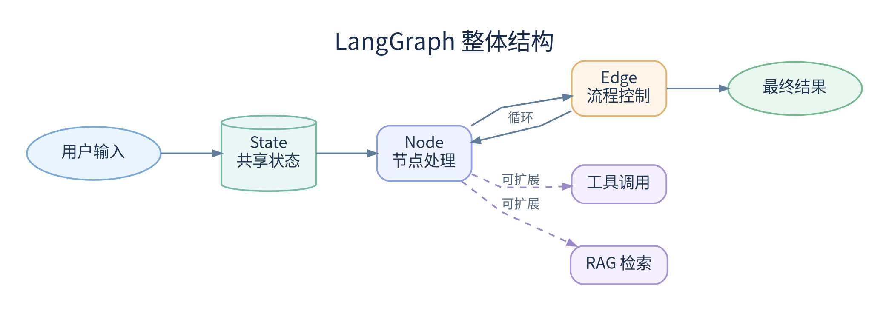
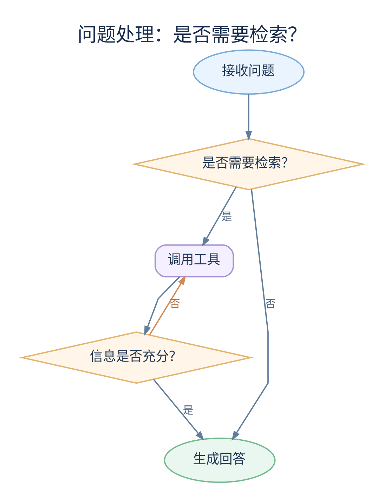
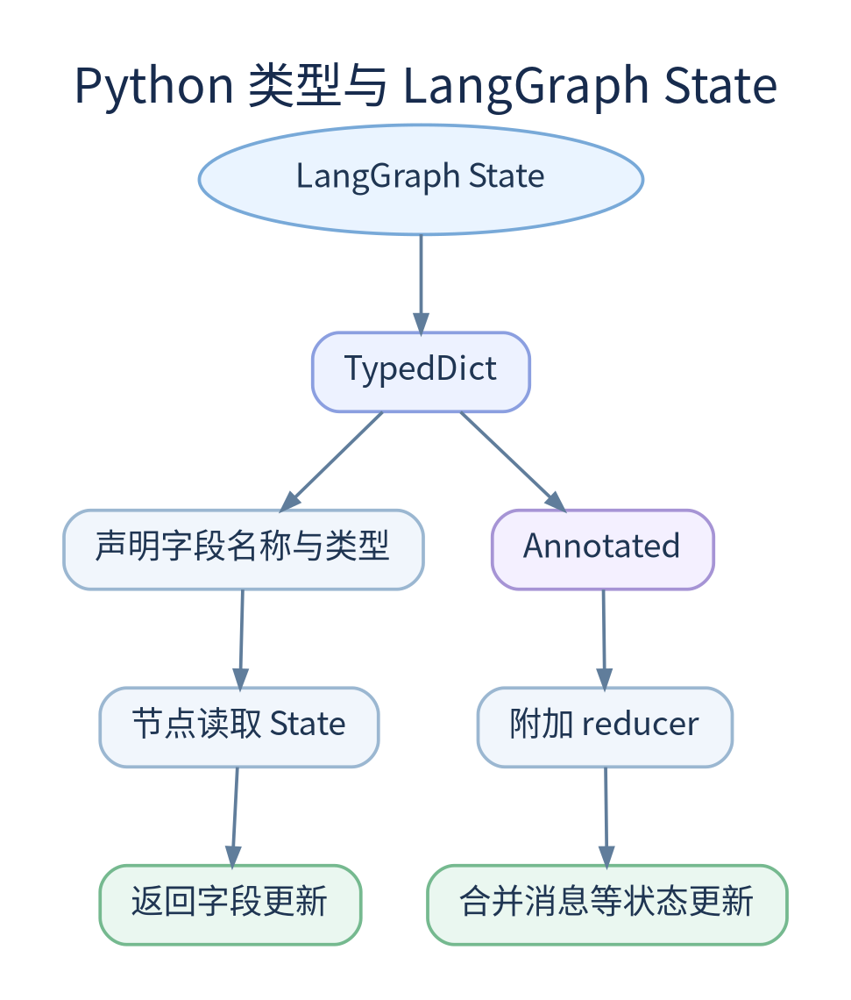
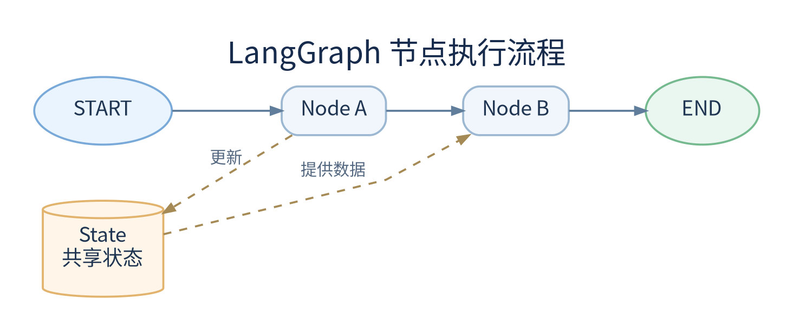
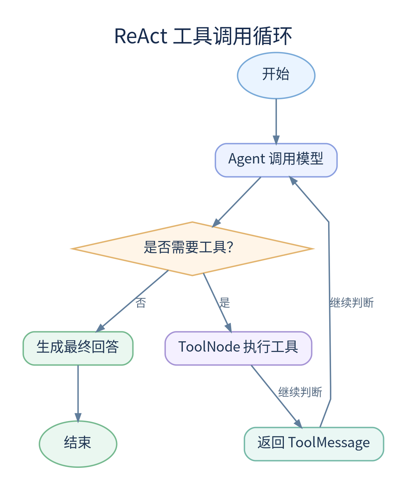
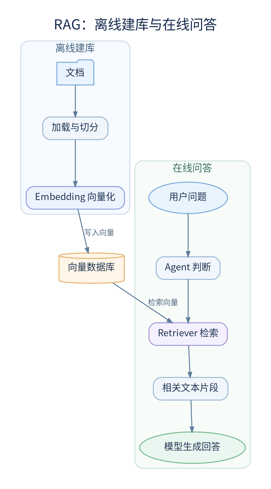

# LangGraph 从基础图到RAG-Agent

简单的模型调用用一个函数就能完成。但当 Agent 需要调用工具、处理分支、反复执行或保存状态时，流程会逐渐复杂。

LangGraph 用**状态图**组织这类工作流：State 保存数据，Node 执行任务，Edge 控制流向。本文从基础图开始，逐步实现条件路由、循环、ReAct 工具调用和 RAG。

内容参考了 freeCodeCamp 的 [LangGraph 入门课程](https://www.youtube.com/watch?v=jGg_1h0qzaM)及[配套代码](https://github.com/iamvaibhavmehra/LangGraph-Course-freeCodeCamp)，并结合实际开发中的常见用法整理。



*State 保存数据，Node 处理任务，Edge 决定流程。*

## 为什么使用图？

一个资料问答 Agent 可能经历以下步骤：



用单个函数也能实现，但分支、循环和状态一多，逻辑就容易缠在一起。LangGraph 将任务拆成节点，再用边连接，执行路径一目了然。

单次模型调用没必要使用 LangGraph；当流程需要分支、循环、持久化或人工介入时，状态图更有价值。

## Python 类型基础

LangGraph 的 State 通常是字典。阅读示例前，先了解 `dict`、`TypedDict` 和常见类型注解。

### dict 与 TypedDict

`dict` 是实际的数据容器；`TypedDict` 用于声明字典应包含哪些字段：

```python
from typing import TypedDict

class AgentState(TypedDict):
    name: str
    age: int
    message: str

state: AgentState = {
    "name": "Alex",
    "age": 21,
    "message": "你好",
}
```

`TypedDict` 不会在运行时校验数据，只提供类型提示。需要运行时校验时，可以使用 Pydantic。

默认字段都是必需的。允许某个字段缺省，可使用 `NotRequired`：

```python
from typing import NotRequired, TypedDict

class AgentState(TypedDict):
    messages: list[str]
    tool_result: NotRequired[str]
```

`NotRequired[str]` 表示键可以不存在；`str | None` 表示键存在时，值可以是字符串或 `None`。

### 常见字典容器

| 类型 | 用途 |
|---|---|
| `dict` | 通用键值映射 |
| `defaultdict` | 缺少键时自动创建默认值 |
| `Counter` | 统计元素出现次数 |
| `OrderedDict` | 提供 `move_to_end()` 等顺序操作 |
| `ChainMap` | 合并多个映射进行查找 |

```python
from collections import defaultdict, Counter

by_category = defaultdict(list)
by_category["agent"].append("LangGraph")

counts = Counter(["tool", "node", "tool"])
print(counts["tool"])  # 2
```

普通 `dict` 已能满足大多数场景。Python 3.7 起，字典插入顺序已成为语言保证；只有需要额外顺序操作时，才考虑 `OrderedDict`。

### 常见类型注解

| 注解 | 含义 | 现代写法 |
|---|---|---|
| `List[str]` | 字符串列表 | `list[str]` |
| `Dict[str, int]` | 字符串到整数的映射 | `dict[str, int]` |
| `Union[str, int]` | 字符串或整数 | `str \| int` |
| `Optional[str]` | 字符串或 `None` | `str \| None` |
| `Literal["a", "b"]` | 只能取指定值 | 同左 |
| `Annotated[T, metadata]` | 为类型附加元数据 | 同左 |
| `Any` | 放宽类型约束 | 同左 |

Python 3.9 起支持 `list[str]`、`dict[str, int]`；Python 3.10 起支持 `str | int`。旧代码中的 `List`、`Dict`、`Union` 和 `Optional` 仍然需要认识。

`Literal` 常用于限定路由结果：

```python
from typing import Literal

def route(state) -> Literal["tools", "end"]:
    return "tools" if state["need_tool"] else "end"
```

`Annotated` 则可以为 State 字段添加 reducer：

```python
from typing import Annotated, TypedDict
from langchain_core.messages import BaseMessage
from langgraph.graph.message import add_messages

class AgentState(TypedDict):
    messages: Annotated[list[BaseMessage], add_messages]
```

`list[BaseMessage]` 描述数据类型，`add_messages` 定义消息如何合并。


*TypedDict 描述状态结构，Annotated 可为字段指定更新规则。*

## LangGraph 核心概念

LangGraph 的基础只有四个部分：State、Node、Edge 和 StateGraph。

### State：共享状态

State 保存工作流输入和中间结果，通常使用 `TypedDict` 声明：

```python
from typing import TypedDict

class AgentState(TypedDict):
    name: str
    message: str
```

节点通过 State 交换数据。设计时只保留后续节点需要读取或判断的字段。

### Node：执行任务

Node 通常是一个 Python 函数，接收 State 并返回需要更新的字段：

```python
def greeting_node(state: AgentState):
    return {"message": f"你好，{state['name']}！"}
```

节点可以执行普通逻辑，也可以调用模型、数据库或外部 API。建议一个节点只负责一类任务。

### Edge：控制流向

普通边连接固定流程：

```python
builder.add_edge("first_node", "second_node")
```

条件边根据路由函数的返回值选择下一节点，后文会展开。

### StateGraph、START 与 END

`StateGraph` 是建图入口；`START` 和 `END` 分别表示流程起点和终点。

```python
from langgraph.graph import StateGraph, START, END

builder = StateGraph(AgentState)
builder.add_node("greeting", greeting_node)
builder.add_edge(START, "greeting")
builder.add_edge("greeting", END)

app = builder.compile()
```

`add_node()` 注册节点，`add_edge()` 连接节点，`compile()` 编译图，`invoke()` 执行图。



*节点读取状态并返回更新，边负责连接执行顺序。*

### Message 与 ToolNode

聊天 Agent 常用以下消息类型：

| 类型 | 作用 |
|---|---|
| `HumanMessage` | 用户消息 |
| `AIMessage` | 模型消息，也可携带工具调用请求 |
| `SystemMessage` | 系统指令 |
| `ToolMessage` | 工具执行结果 |

Tool 是具体能力，例如搜索或计算；`ToolNode` 是 LangGraph 提供的工具执行节点。模型决定是否调用工具，ToolNode 负责执行。

## 创建第一张图

先用一个节点跑通完整流程：

```python
from typing import TypedDict
from langgraph.graph import StateGraph, START, END

class AgentState(TypedDict):
    message: str


def greeting_node(state: AgentState):
    return {"message": f"Hey {state['message']}, how is your day going?"}


builder = StateGraph(AgentState)
builder.add_node("greeter", greeting_node)
builder.add_edge(START, "greeter")
builder.add_edge("greeter", END)

app = builder.compile()
result = app.invoke({"message": "Bob"})
print(result["message"])
```

输出：

```text
Hey Bob, how is your day going?
```

执行顺序是 `START → greeter → END`。`invoke()` 返回最终 State，因此通过 `result["message"]` 读取结果。

## 多节点与状态流转

多个节点可以按顺序处理同一份 State：

```python
from typing import TypedDict
from langgraph.graph import StateGraph, START, END

class AgentState(TypedDict):
    name: str
    age: int
    final: str


def first_node(state: AgentState):
    return {"final": f"Hi {state['name']}!"}


def second_node(state: AgentState):
    return {"final": state["final"] + f" You are {state['age']} years old!"}


builder = StateGraph(AgentState)
builder.add_node("first_node", first_node)
builder.add_node("second_node", second_node)
builder.add_edge(START, "first_node")
builder.add_edge("first_node", "second_node")
builder.add_edge("second_node", END)

app = builder.compile()
result = app.invoke({"name": "Charlie", "age": 20, "final": ""})
print(result["final"])
```

第一个节点更新 `final`，第二个节点读取更新后的值并继续处理。节点不需要直接调用彼此，只需通过 State 传递结果。

## 条件路由

条件边用于根据 State 选择执行路径。下面用运算符决定执行加法还是减法。

### 定义节点与路由函数

```python
from typing import TypedDict
from langgraph.graph import StateGraph, START, END

class AgentState(TypedDict):
    number1: int
    operation: str
    number2: int
    final_number: int


def adder(state: AgentState):
    return {"final_number": state["number1"] + state["number2"]}


def subtractor(state: AgentState):
    return {"final_number": state["number1"] - state["number2"]}


def decide_next_node(state: AgentState):
    if state["operation"] == "+":
        return "addition"
    if state["operation"] == "-":
        return "subtraction"
    return "invalid"
```

计算节点只负责运算，路由函数只负责选择路径。

### 配置条件边

```python
builder = StateGraph(AgentState)
builder.add_node("add_node", adder)
builder.add_node("subtract_node", subtractor)
builder.add_conditional_edges(
    START,
    decide_next_node,
    {
        "addition": "add_node",
        "subtraction": "subtract_node",
        "invalid": END,
    },
)
builder.add_edge("add_node", END)
builder.add_edge("subtract_node", END)

app = builder.compile()
result = app.invoke({
    "number1": 10,
    "operation": "-",
    "number2": 5,
    "final_number": 0,
})
print(result["final_number"])  # 5
```

`add_conditional_edges()` 接收起点、路由函数和映射表。路由函数返回值必须与映射表的键对应。

也可以使用 `lambda state: state` 注册一个原样返回状态的过渡节点，但它本身不负责路由。若不需要单独的过渡节点，可以直接从业务节点添加条件边。

## 循环

边也可以指回之前的节点。下面的图会生成 5 个随机数后结束：

```python
import random
from typing import TypedDict
from langgraph.graph import StateGraph, START, END

class AgentState(TypedDict):
    name: str
    numbers: list[int]
    counter: int


def greeting_node(state: AgentState):
    return {"name": f"Hi there, {state['name']}", "counter": 0}


def random_node(state: AgentState):
    return {
        "numbers": state["numbers"] + [random.randint(0, 10)],
        "counter": state["counter"] + 1,
    }


def should_continue(state: AgentState):
    return "loop" if state["counter"] < 5 else "exit"


builder = StateGraph(AgentState)
builder.add_node("greeting", greeting_node)
builder.add_node("random", random_node)
builder.add_edge(START, "greeting")
builder.add_edge("greeting", "random")
builder.add_conditional_edges(
    "random",
    should_continue,
    {"loop": "random", "exit": END},
)

app = builder.compile()
result = app.invoke({"name": "Vaibhav", "numbers": [], "counter": 0})
print(result)
```

每次执行 `random` 都会增加计数。计数小于 5 就回到自身，否则结束。Agent 的工具调用和结果重试也常采用这种循环结构。务必设置终止条件，并留意图的递归步数限制。

## 接入大语言模型

模型节点与普通节点的区别在于：它会把 State 中的消息发送给模型，再将模型回复写回 State。

```python
from typing import Annotated, TypedDict
from langchain_core.messages import BaseMessage
from langgraph.graph.message import add_messages

class AgentState(TypedDict):
    messages: Annotated[list[BaseMessage], add_messages]


def call_model(state: AgentState):
    response = llm.invoke(state["messages"])
    return {"messages": [response]}
```

`add_messages` 是消息 reducer，负责将新消息合并到历史消息中；如果消息 ID 相同，则更新对应消息。没有 reducer 时，字段更新通常会按默认规则覆盖旧值。

## 对话记忆

多轮对话需要把历史消息一并传给模型。例如用户先说“我叫 Alex”，再问“我叫什么？”，模型必须能看到前一轮消息。

简单场景可以在应用中维护消息列表；但列表通常只存在于当前进程，程序重启后不会自动恢复。

LangGraph 的 Checkpointer 可以保存图状态。编译图时配置 Checkpointer，并在调用时传入相同的 `thread_id`，即可区分并恢复对应会话。它与单纯把消息放进全局列表不同。

历史消息也不能无限累积。实际应用需要根据场景进行历史截断、摘要或长期记忆检索，控制上下文长度和调用成本。

## ReAct 工具调用

ReAct（Reasoning and Acting）将模型判断与工具执行连接起来：**模型决定行动，工具执行行动，结果再交给模型。**

### 定义并绑定工具

```python
from langchain_core.tools import tool
from langchain_openai import ChatOpenAI

@tool
def add(a: int, b: int) -> int:
    """计算两个整数的和。"""
    return a + b

llm = ChatOpenAI(model="gpt-4o")
tools = [add]
llm_with_tools = llm.bind_tools(tools)
```

`@tool` 将函数包装为工具；函数名、参数类型和 Docstring 帮助模型判断如何调用。`bind_tools()` 只向模型提供工具定义，不会执行工具。

### 构建 ReAct 图

```python
from typing import Annotated, TypedDict
from langchain_core.messages import BaseMessage
from langgraph.graph import StateGraph, START, END
from langgraph.graph.message import add_messages
from langgraph.prebuilt import ToolNode

class AgentState(TypedDict):
    messages: Annotated[list[BaseMessage], add_messages]


def call_model(state: AgentState):
    response = llm_with_tools.invoke(state["messages"])
    return {"messages": [response]}


def route_after_model(state: AgentState):
    last_message = state["messages"][-1]
    return "tools" if last_message.tool_calls else "end"


builder = StateGraph(AgentState)
builder.add_node("agent", call_model)
builder.add_node("tools", ToolNode(tools=tools))
builder.add_edge(START, "agent")
builder.add_conditional_edges(
    "agent",
    route_after_model,
    {"tools": "tools", "end": END},
)
builder.add_edge("tools", "agent")

app = builder.compile()
```



*模型决定是否调用工具；工具执行结果返回模型，形成循环。*

`ToolNode` 读取 `AIMessage` 中的 `tool_calls`，执行对应函数，并将结果封装为 `ToolMessage`。工具结果回到 Agent 后，模型可以继续调用工具，直到生成普通回复。

例如“先计算 40 + 12，再乘以 6”，模型可以先调用加法工具，再根据结果调用乘法工具，最后返回 312。

调试时可使用 `stream()` 观察节点执行过程；`invoke()` 则通常在图执行完成后返回结果。

## Drafter 文档助手

Drafter 展示了工具调用在文档编辑场景中的用法。它可以包含两个工具：

- `update(content)`：更新当前文档。
- `save(filename)`：保存文档。

执行流程：用户提出需求，Agent 生成初稿；用户要求修改时调用 `update`；用户确认后调用 `save`。

State 应保存当前文档和消息历史，不要用进程级全局变量保存多用户数据，否则容易发生内容覆盖。保存文件时还要校验路径和权限；涉及写文件、改数据库等操作时，应考虑确认机制和日志。

## RAG 知识库

RAG（Retrieval-Augmented Generation，检索增强生成）先从外部知识库检索相关内容，再将结果交给模型回答。它不重新训练模型，而是在生成前补充上下文。

### 加载与切分文档

```python
from langchain_community.document_loaders import PyPDFLoader
from langchain_text_splitters import RecursiveCharacterTextSplitter

loader = PyPDFLoader("Stock_Market_Performance_2024.pdf")
pages = loader.load()

text_splitter = RecursiveCharacterTextSplitter(
    chunk_size=1000,
    chunk_overlap=200,
)
chunks = text_splitter.split_documents(pages)
```

加载后得到 `Document` 对象，文本在 `page_content` 中，来源和页码等信息通常保存在 `metadata` 中。

切分可以避免把整份文档塞进模型上下文。`chunk_size` 是文本块目标长度（默认按字符计），`chunk_overlap` 用于保留相邻块的重叠内容。具体参数要根据文档和检索效果调整。

### 向量化与存储

```python
from langchain_openai import OpenAIEmbeddings
from langchain_chroma import Chroma

embeddings = OpenAIEmbeddings(model="text-embedding-3-small")

vector_store = Chroma.from_documents(
    documents=chunks,
    embedding=embeddings,
    collection_name="stock_market",
    persist_directory="./chroma_db",
)
```

Embedding 模型把文本转换为向量；向量数据库保存向量、原文和元数据。文档与查询应使用兼容的 Embedding 模型，更换模型后通常需要重新生成向量。

### 检索并封装为工具

```python
retriever = vector_store.as_retriever(
    search_type="similarity",
    search_kwargs={"k": 5},
)

from langchain_core.tools import tool

@tool
def retriever_tool(query: str) -> str:
    """检索股票市场资料中的相关内容。"""
    docs = retriever.invoke(query)
    if not docs:
        return "没有检索到相关内容。"

    results = []
    for doc in docs:
        source = doc.metadata.get("source", "未知文件")
        page = doc.metadata.get("page", "未知页码")
        results.append(
            f"来源：{source}，页码：{page}\n{doc.page_content}"
        )
    return "\n\n".join(results)
```

`k=5` 表示最多返回五个文本块。数量过少可能漏掉证据，过多则会引入噪声，需要结合实际效果调整。

把 Retriever 包装成工具后，Agent 就能按需检索。返回来源和页码，可以保留答案的出处；前提是加载文档时保留了对应 metadata。

### RAG Agent 流程





*离线阶段建立索引，在线阶段检索相关片段并生成答案。*

RAG 的效果不仅取决于向量数据库，还受文档解析、切块策略、Embedding、检索质量和答案忠实度影响。

## 开发要点

- **只返回需要更新的字段。** 节点返回局部字典，便于追踪状态变化。
- **按需配置 reducer。** 消息列表通常使用 `add_messages`；普通字段则根据业务选择更新方式。
- **区分会话记忆与长期数据。** Checkpointer 保存图状态，长期业务数据可存入数据库或 Store。
- **覆盖所有路由结果。** 处理非法输入，避免路由函数返回未配置的值。
- **写清工具描述。** 明确工具用途、参数和返回值，减少模型误用。
- **控制外部副作用。** 文件写入、数据库修改等操作要做好权限、确认和日志。


LangGraph 的核心是用 State 保存数据、Node 执行任务、Edge 控制流程。掌握这三点，就能从简单图逐步扩展到条件分支、循环、工具调用和 RAG。

学习时不要只记 API，重点观察每一步的 State 如何变化，以及流程为什么进入下一个节点。理解这两件事，复杂 Agent 也只是基础图结构的组合。

