# 数据结构（Java版）

> 在计算机科学中，数据结构是一种数据组织，管理和储存的格式。它帮助我们实现对数据高效的访问和修改。更准确地说，数据结构是数据值的集合，可以体现数据值之间的关系，以及可以对数据进行应用的函数或操作。


## 线性表

> 线性表是由同一类型性的数据元素构成的有序序列的线性结构。线性表中元素的个数就是线性表的长度，表的起始位置称为表头，表的结束位置称为表尾，当一个线性表中没有元素时，称为空表。

线性表一般需要包含以下功能：

* **获取指定位置上的元素：**直接获取线性表上指定位置i上的元素。
* **插入元素：**在指定位置i上插入一个元素。
* **删除元素：**删除指定位置i上的一个元素。
* **获取长度：**返回线性表的长度。

### 线性表：顺序表

> 底层依然采用顺序储存实现的线性表，我们称之为顺序表。

```java
package com.test.collection;

public class ArrayList<E> {  //泛型E，因为表中要存的具体数据类型待定
    private int size = 0;  //当前顺序表的容量
    private int capacity = 10;  //当前已经存放的元素数量
    private Object[] array = new Object[capacity];  //底层存放数据的数组
    
    //插入元素
    public void add(E element, int index) {  //插入方法需要支持在指定下标位置插入

        if (index < 0 || index > size)
            throw new IndexOutOfBoundsException("插入位置非法，合法的插入位置为：0 ~ " + size);
        if(size >= capacity){
            int newCapacity = capacity + (capacity >> 1);//扩容为原来的1.5倍
            Object[] newArray = new Object[newCapacity];  //创建一个新数组来存放更多的元素
            System.arraycopy(array,0,newArray,0,size);  //使用arraycopy快速拷贝原数组内容到新的数组
            array = newArray;  //更换为新的数组
            capacity = newCapacity;  //容量变成扩容之后的
        }
        for (int i = size; i > index; i--) {  //从后往前，一个一个搬运元素
            array[i] = array[i - 1];
        }
        array[index] = element;  //腾出位置之后，直接插入元素放到对应位置上
        size++;  //插入完成之后，记得将size自增

    }

    
    //删除元素
    @SuppressWarnings("unchecked")   //屏蔽未经检查警告
public E remove(int index){   //删除对应位置上的元素，注意需要返回被删除的元素
    E e = (E) array[index];   //因为存放的是Object类型，这里需要强制类型转换为E
    for (int i = index; i < size; i++)   //从前往后，挨个往前搬一位
        array[i] = array[i + 1];
    size--;    //删完记得将size--
    return e;
}
  
    //判断数组是否为空
    public boolean isEmpty(){
        return size == 0;
    }

    //查询位置元素
    @SuppressWarnings("unchanged")
    public E get(int index){
        if(index < 0 || index > size - 1)
            throw new IndexOutOfBoundsException("查询位置非法，合法的查询位置为：0 ~ "+ (size - 1));
        return (E) array[index];
    }
    //重写 toString 方法：该方法将 ArrayList 中的所有元素拼接成一个字符串，并以空格分隔。
    public String toString(){

        StringBuilder builder = new StringBuilder();
        for (int i = 0; i < size; i++) builder.append(array[i]).append(" ");
        return builder.toString();
    }


}

```

```java
//主函数调用
public static void main(String[] args) {
    ArrayList<Integer> list = new ArrayList<>();
    list.add(10, 1);    //一上来只能在第一个位置插入，第二个位置肯定是非法的
}
```


### 线性表：链表

> 链表不同于顺序表，顺序表底层采用数组作为储存容器，需要分配一块连续且完整的内存空间进行使用，而链表不需要，它通过一个指针来连接各个分散的结点，形成了一个链状的结构，每个结点存放一个元素，以及一个指向下一结点的指针，通过这样一个一个相连，最后形成了链表。它不需要申请连续的空间，只需要按照顺序连接即可，虽然物理上可能不相邻，但是在逻辑上依然是每个元素相邻存放的，这样的结构叫做链表（单链表）。

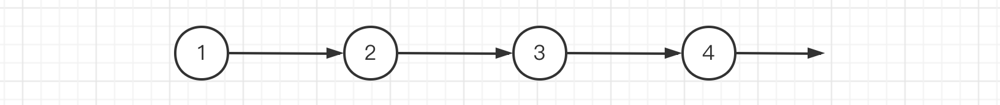

链表分为带头结点的链表和不带头节点的链表，带头结点的链表就是会有一个头节点指向后续的整个链表，但是头结点不存放数据：

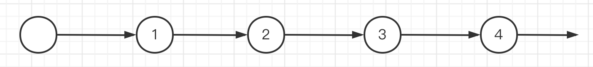

```java
package com.test.collection;

public class LinkedList<E> {


    private Node<E> head = new Node<>(null);
    private int size;

    //插入元素
    public void add(E element,int index){
        if(index < 0 || index > size)
            throw new IndexOutOfBoundsException("插入位置非法，合法的插入位置是：0 ~ "+ size);
        Node<E> prev = head;  //先找到对应位置的前驱结点
        for (int i = 0; i < index; i++) {
            prev = prev.next;
        }
        Node<E> node = new Node<>(element);  //创建新的结点
        node.next = prev.next;  //先让新的结点指向原本这个位置上的结点
        prev.next = node;  //然后让前驱结点指向当前结点
        size++;  //完事之后一样的，更新size
    }

    //删除元素
    public E remove(int index){
        if(index < 0 || index > size - 1)  //同样先判断位置是否合法
            throw new IndexOutOfBoundsException("删除位置非法，合法的删除位置为：0 ~ "+(size - 1));
        Node<E> prev = head;
        for (int i = 0; i < index; i++) {  //同样需要先找到前驱结点
            prev = prev.next;
        }
        E e = prev.next.element;  //先把待删除的结点存放的元素取出来
        prev.next = prev.next.next;  //可以删了
        size--;  //记得size--
        return e;
    }

    //获取相应位置元素
    public E get(int index){
        if(index < 0 || index > size - 1)
            throw new IndexOutOfBoundsException("非法的位置，合法的位置为：0 ~ "+(size - 1));
        Node<E> node = head;
        while(index-- >= 0)  //这里直接让index减到-1为止
            node = node.next;
        return node.element;
    }

    //获取链表中元素个数
    public int size(){
        return size;
    }

    //重写toString
    @Override
    public String toString() {
        StringBuilder builder = new StringBuilder();
        Node<E> node = head.next;  //从第一个结点开始，一个一个遍历，遍历一个就拼接到字符串上去
        while(node != null){
            builder.append(node.element).append(" ");
            node = node.next;
        }
        return builder.toString();
    }

    private static class Node<E>{

        private E element;
        private Node<E> next;

        public Node(E e){
            this.element = e;
        }
    }
}

```


* 当读取数据多于插入或者删除数据的情况下，使用顺序表更好。
* 在频繁出现插入或者删除的情况下，使用链表更好。


### 线性表：栈

> 栈是一种特殊的线性表，只能在表尾进行插入和删除操作。

* **pop**：出栈操作，从栈顶取出一个元素。
* **push**：入栈操作，向栈中压入一个新的元素。

栈既可以用顺序表实现，也可以使用链表实现。使用链表会更加方便。

```java
package com.test.collection;

import java.util.NoSuchElementException;

public class LinkedStack<E> {
    private final Node<E> head = new Node(null);

    //入栈
    public void push(E element){
        Node<E> node = new Node<>(element);  //直接创建新节点
        node.next = head.next;  //新结点的下一个变成原来的栈顶结点
        head.next = node;  //头结点的下一个改成新的结点
    }

    //出栈
    public E pop(){
        if(head.next == null)  //如果栈中没有元素，那肯定是无法取的
            throw new NoSuchElementException("栈为空");
        E e = head.next.element;  //先把待出栈元素取出来
        head.next = head.next.next;  //要让头结点的下一个指向下一个的下一个
        return e;
    }

    //判断栈是否为空
    public boolean isEmpty(){
        return head.next == null;
    }
    
    private static class Node<E> {
        private E element;
        private Node<E> next;

        public Node(E e) {
            this.element = e;
        }
    }
}

```


### 线性表：队列

> 队列也是一种特殊的线性表，队列当中的元素只能从队尾进入，只能从队首出去。所以队列是一种先进先出的数据结构

```java
package com.test.collection;
import java.util.NoSuchElementException;


public class LinkedQueue<E> {

    private final Node<E> head = new Node<>(null);

    //入队
    public void offer(E element){  //入队操作
        Node<E> tail = head;
        while(tail.next != null)  //入队后直接丢到最后一个结点的屁股后面就行了
            tail = tail.next;
        tail.next = new Node<>(element);
    }

    //出队
    public E poll(){
        if(isEmpty())
            throw new NoSuchElementException("队列为空");
        E e = head.next.element;
        head.next = head.next.next;  //直接从队首取出
        return e;
    }

    //仅获取元素
    public E peek(){
        if(isEmpty())
            throw new NoSuchElementException("队列为空");
        return head.next.element;
    }
    
    //判断队列是否为空
    public boolean isEmpty(){
        return head.next == null;
    }

    private static class Node<E> {

        private E element;
        private LinkedQueue.Node<E> next;
        public Node(E e){this.element = e;}
    }
}
```


## 树

一个结点下面可能会连接多个结点，并不断延伸，就像树枝一样，每个结点都有可能是一个分支点，延伸出多个分支，从位于最上方的结点开始不断向下，这种数据结构我们称为**树**。注意分支只能向后单独延伸，之后就分道扬镳了，**不能与其他分支上的结点相交！**

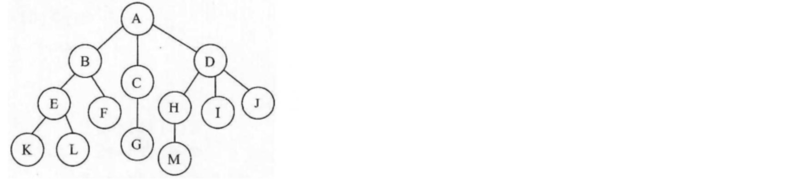

* 我们一般称位于最上方的结点为树的**根节点**（Root），因为整棵树是从这里开始延伸出去的。
* 每个结点连接的子节点数目（分支的数目），我们称为结点的度（Degree），而各个结点度的最大值称为树的度。
* 每个结点延伸下去的下一个结点都可以称为一棵**子树**（SubTree），比如结点B及其之后延伸的所有分支合在一起，就是一棵A的子树。
* 每个**结点的层次**（Level）按照从上往下的顺序，树的根节点为1，每向下一层+1，比如G的层次就是3，整棵树中所有结点的最大层次，就是这棵**树的深度**（Deepth），比如上面这棵树的深度为4，因为最大层次就是4.

由于整棵树错综复杂，我们需要规定一下结点之间的称呼：

* 与当前结点直接向下相连的结点，我们称之为**子节点**（Child），比如：B、C、D，都是A的子结点，就像族谱当中的父子关系一样，下一代一定是子女，相反的，那么A就是B、C、D的**父结点**（Parent），也可以叫双亲结点。
* 如果某个结点没有任何的子结点（结点度为0时）那么我们称这个结点为叶子结点（因为已经到头了，后面没有分支了，这时就该树枝长叶子了那样），比如K、L、F、G、M、I、J结点，都是叶子结点。
* 如果两个结点的父节点是同一个，那么称这两个结点为**兄弟结点**（Sibling），比如B和C就是兄弟结点，因为都是A的孩子。
* 从根结点开始一直到某个结点的整条路径的所有结点，都是这个结点的**祖先节点**（Ancestor）比如L的祖先结点就是A、B、E。

### 二叉树

**二叉树**（Binary Tree)，它是一种特殊的树，它的度最大只能为 2 。

并且二叉树的任何结点的子树是有左右之分的，不能颠倒顺序，比如A结点左边的子树，称为左子树，右边的子树称为右子树。

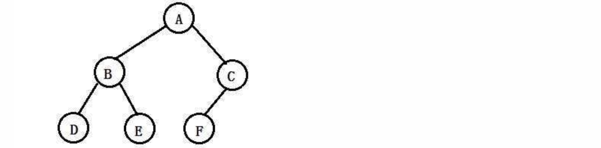

在一颗二叉树中，所有分支结点都存在左子树和右子树，且叶子结点都在同一层，这样的二叉树我们称为**满二叉树**。整棵树都非常饱满，没有出现度为 1 的情况。

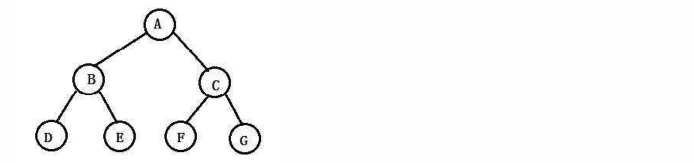

只有最后一层有空缺，并且所有的叶子结点是按照从左往右的顺序排列的，这样的二叉树我们一般称其为**完全二叉树**。所以，一棵满二叉树一定是一棵完全二叉树。


### 二叉树的构造

```java
public static class TreeNode<E> {

        public E element;
        public TreeNode<E> left,right;

        public TreeNode(E element) {
            this.element = element;
        }
    }
```


### 二叉树的遍历

遍历二叉树主要有四种访问方式：**前序遍历**、**中序遍历**、**后序遍历**、**层序遍历**。

#### 前序遍历（中左右）

1.打印根节点

2.前序遍历左子树

3.前序遍历右子树


前序遍历结果应为：ABDECF

```java
  public static void preOrder(TreeNode<Character> root){
        if(root == null) return;
        System.out.print(root.element+" ");
        preOrder(root.left);
        preOrder(root.right);
    }
```

#### 中序遍历（左中右）

1.中序遍历左子树

2.打印结点

3.中序遍历右子树

中序遍历结果为：DBEACF

```
 public static void inOrder(TreeNode<Character> root){
        if(root == null) return;
        inOrder(root.left);
        System.out.print(root.element+" ");
        inOrder(root.right);
    }
```

#### 后序遍历（左右中）

1.后序遍历左子树

2.后序遍历右子树

3.打印结点

后续遍历结果为：DEBFCA

```java
public static void postOrder(TreeNode<Character> root){
        if(root == null) return;
        postOrder(root.left);
        postOrder(root.right);
        System.out.print(root.element+" ");
    }
```

#### 层序遍历

可以利用队列来实现层序遍历，首先将根节点存入队列中，接着循环执行以下步骤：

* 进行出队操作，得到一个结点，并打印结点的值。
* 将此结点的左右孩子结点依次入队。

重复以上操作，直至队列为空。

```java
public static void levelOrder(TreeNode<Character> root){
       LinkedQueue<TreeNode<Character>> queue = new LinkedQueue<>();
       queue.offer(root);
       while(!queue.isEmpty()){
           TreeNode<Character> node = queue.poll();
           System.out.print(node.element+" ");
           if(node.left != null)
               queue.offer(node.left);
           if(node.right != null)
               queue.offer(node.right);
       }
    }
```


### 二叉查找树和平衡二叉树

**二叉查找树**也叫二叉搜索树或者二叉排序树，它具有一定的规则：

* 左子树中所有结点的值，均小于其根结点的值。
* 右子树中所有结点的值，均大于其根节点的值。
* 二叉搜索树的子树也是二叉搜索树


二叉查找树只有在理性状态下搜索效率是最高的。

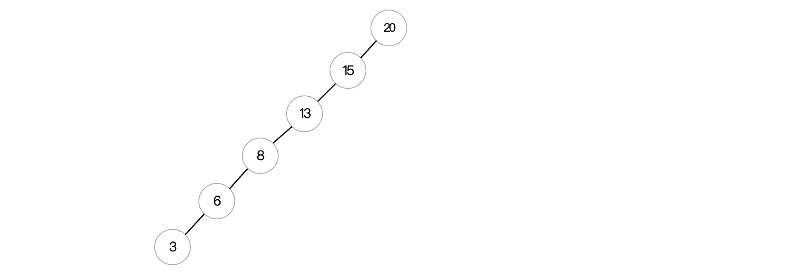

所以，我们在进行结点插入时，需要尽可能地避免这种一边倒的情况，这里就需要引入**平衡二叉树**的概念了。实际上我们发现，在插入时如果不去维护二叉树的平衡，某一边只会无限制地延伸下去，出现极度不平衡的情况，而我们理想中的二叉查找树左右是尽可能保持平衡的，**平衡二叉树**（AVL树）就是为了解决这样的问题而生的。

平衡二叉树性质如下：

* 平衡二叉树一定是一棵二叉查找树。
* 任意节点的左右子树也是一棵平衡二叉树。
* 从根节点开始，左右子树的高度差不能超过1，否则视为不平衡。 

当插入之后，不再满足平衡二叉树的定义时，就出现了失衡的情况，而对于这种失衡情况，为了继续保持平衡状态，我们就需要进行处理了。我们可能会遇到以下几种情况导致失衡：

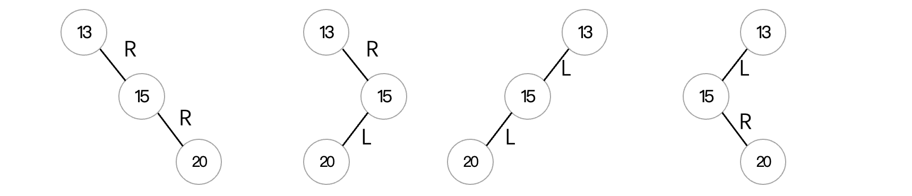

根据插入结点的不同偏向情况，分为LL型、LR型、RR型、RL型。针对于上面这几种情况，我们依次来看一下如何进行调整，使得这棵二叉树能够继续保持平衡：

动画网站：https://www.cs.usfca.edu/~galles/visualization/AVLtree.html（实在不理解可以看看动画是怎么走的）

1. **LL型调整**（右旋）

   

   首先我们来看这种情况，这是典型的LL型失衡，为了能够保证二叉树的平衡，我们需要将其进行**旋转**来维持平衡，去纠正最小不平衡子树即可。那么怎么进行旋转呢？对于LL型失衡，我们只需要进行右旋操作，首先我们先找到最小不平衡子树，注意是最小的那一个：

   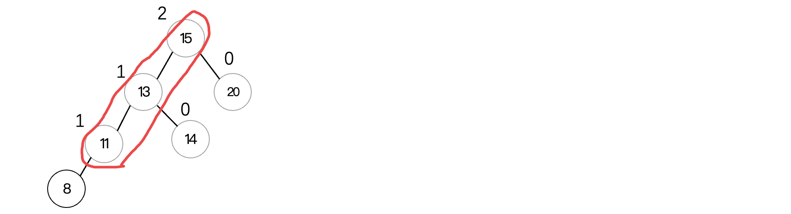

   可以看到根结点的平衡因子是2，是目前最小的出现不平衡的点，所以说从根结点开始向左的三个结点需要进行右旋操作，右旋需要将这三个结点中间的结点作为新的根结点，而其他两个结点现在变成左右子树：

   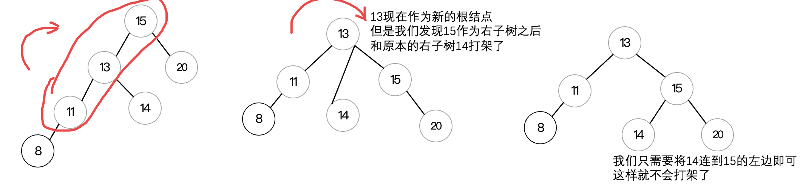

   这样，我们就完成了右旋操作，可以看到右旋之后，所有的结点继续保持平衡，并且依然是一棵二叉查找树。

2. **RR型调整**（左旋）

   前面我们介绍了LL型以及右旋解决方案，相反的，当遇到RR型时，我们只需要进行左旋操作即可：

   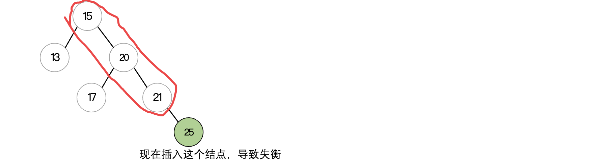

   操作和上面是一样的，只不过现在反过来了而已：

   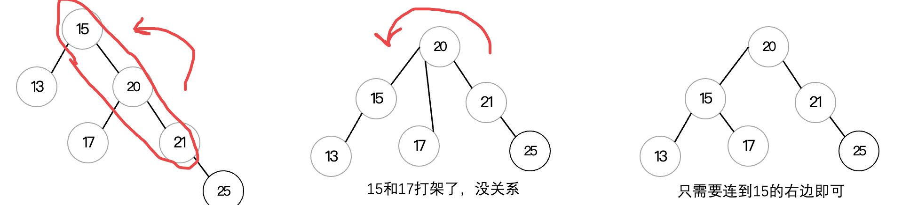

   这样，我们就完成了左旋操作，使得这棵二叉树继续保持平衡状态了。

3. **RL型调整**（先右旋，再左旋）

   剩下两种类型比较麻烦，需要旋转两次才行。我们来看看RL型长啥样：

   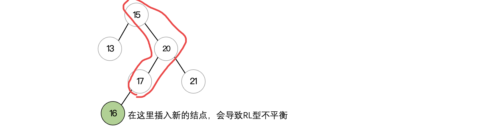

   可以看到现在的形状是一个回旋镖形状的，先右后左的一个状态，也就是RL型，针对于这种情况，我们需要先进行右旋操作，注意这里的右旋操作针对的是后两个结点：

   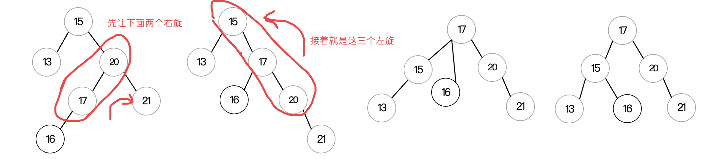

   其中右旋和左旋的操作，与之前一样，该怎么分配左右子树就怎么分配，完成两次旋转后，可以看到二叉树重新变回了平衡状态。

4. **LR型调整**（先左旋，再右旋）

   和上面一样，我们来看看LR型长啥样，其实就是反着的：

   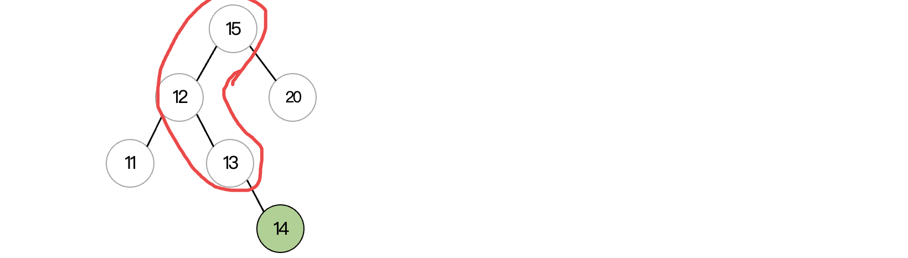

   形状是先向左再向右，这就是典型的LR型了，我们同样需要对其进行两次旋转：

   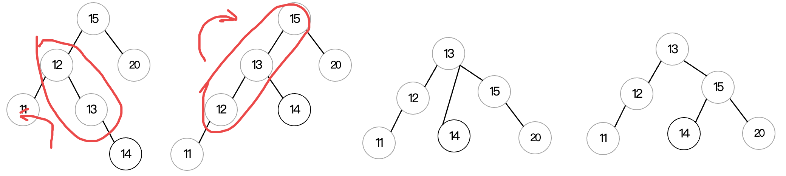

   这里我们先进行的是左旋，然后再进行的右旋，这样二叉树就能继续保持平衡了。

这样，我们只需要在插入结点时注意维护整棵树的平衡因子，保证其处于稳定状态，这样就可以让这棵树一直处于高度平衡的状态，不会再退化了。

### 红黑树

**注意：** 本部分只进行理论介绍，不做代码实现。

很多人都说红黑树难，其实就那几条规则，跟着我推一遍其实还是很简单的，当然前提是一定要把前面的平衡二叉树搞明白。

前面我们讲解了二叉平衡树，通过在插入结点时维护树的平衡，这样就不会出现极端情况使得整棵树的查找效率急剧降低了。但是这样是否开销太大了一点，因为一旦平衡因子的绝对值超过1那么就失衡，这样每插入一个结点，就有很大的概率会导致失衡，我们能否不这么严格，但同时也要在一定程度上保证平衡呢？这就要提到红黑树了。

在线动画网站：https://www.cs.usfca.edu/~galles/visualization/RedBlack.html

红黑树也是二叉查找树的一种，它大概长这样，可以看到结点有红有黑：

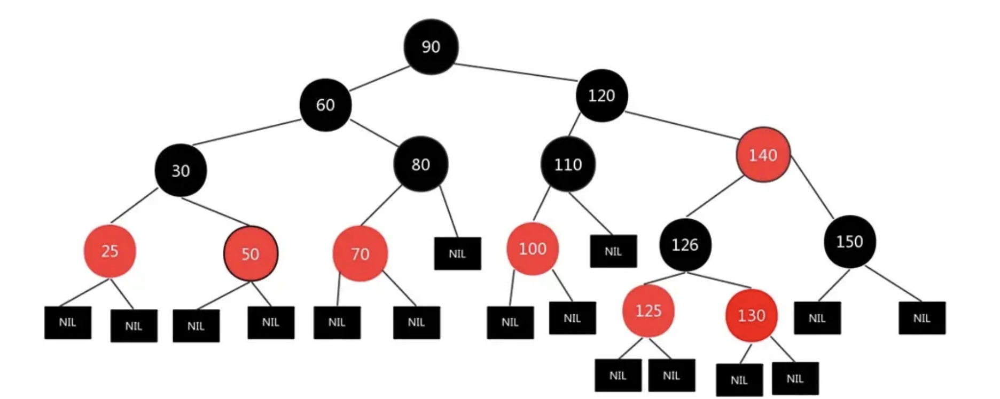


它并不像平衡二叉树那样严格要求高度差不能超过1，而是只需要满足五个规则即可，它的规则如下：

- 规则1：每个结点可以是黑色或是红色。
- 规则2：根结点一定是黑色。
- 规则3：红色结点的父结点和子结点不能为红色，也就是说不能有两个连续的红色。
- 规则4：所有的空结点都是黑色（空结点视为NIL，红黑树中是将空节点视为叶子结点）
- 规则5：每个结点到空节点（NIL）路径上出现的黑色结点的个数都相等。

它相比平衡二叉树，通过不严格平衡和改变颜色，就能在一定程度上减少旋转次数，这样的话对于整体性能是有一定提升的，只不过我们在插入结点时，就有点麻烦了，我们需要同时考虑变色和旋转这两个操作了，但是会比平衡二叉树更简单。

那么什么时候需要变色，什么时候需要旋转呢？我们通过一个简单例子来看看：


首先这棵红黑树只有一个根结点，因为根结点必须是黑色，所以说直接变成黑色。现在我们要插入一个新的结点了，所有新插入的结点，默认情况下都是红色：


所以新来的结点7根据规则就直接放到11的左边就行了，然后注意7的左右两边都是NULL，那么默认都是黑色，这里就不画出来了。同样的，我们往右边也来一个：


现在我们继续插入一个结点：


插入结点4之后，此时违反了红黑树的规则3，因为红色结点的父结点和子结点不能为红色，此时为了保持以红黑树的性质，我们就需要进行**颜色变换**才可以，那么怎么进行颜色变换呢？我们只需要直接将父结点和其兄弟结点同时修改为黑色（为啥兄弟结点也需要变成黑色？因为要满足性质5）然后将爷爷结点改成红色即可：


当然这里还需注意一下，因为爷爷结点正常情况会变成红色，相当于新来了个红色的，这时还得继续往上看有没有破坏红黑树的规则才可以，直到没有为止，比如这里就破坏了性质一，爷爷结点现在是根结点（不是根结点就不需要管了），必须是黑色，所以说还要给它改成黑色才算结束：


接着我们继续插入结点：


此时又来了一个插在4左边的结点，同样是连续红色，我们需要进行变色才可以讲解问题，但是我们发现，如果变色的话，那么从11开始到所有NIL结点经历的黑色结点数量就不对了：

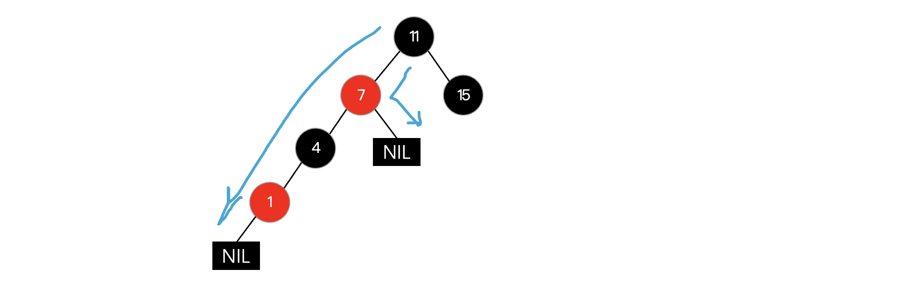


所以说对于这种**父结点为红色，父结点的兄弟结点为黑色**（NIL视为黑色）的情况，变色无法解决问题了，那么我们只能考虑旋转了，旋转规则和我们之前讲解的平衡二叉树是一样的，这实际上是一种LL型失衡：

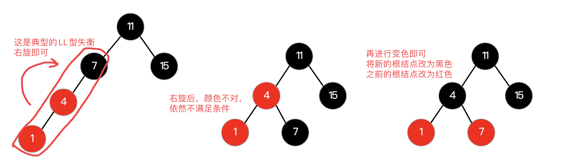


同样的，如果遇到了LR型失衡，跟前面一样，先左旋在右旋，然后进行变色即可：

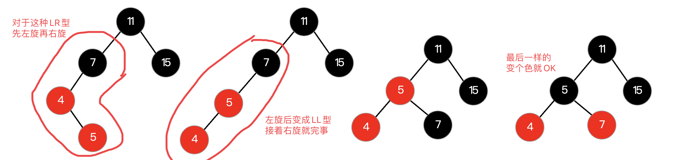


而RR型和RL型同理，这里就不进行演示了，可以看到，红黑树实际上也是通过颜色规则在进行旋转调整的，当然旋转和变色的操作顺序可以交换。所以，在插入时比较关键的判断点如下：

- 如果整棵树为NULL，直接作为根结点，变成黑色。
- 如果父结点是黑色，直接插入就完事。
- 如果父结点为红色，且父结点的兄弟结点也是红色，直接变色即可（但是注意得继续往上看有没有破坏之前的结构）
- 如果父结点为红色，但父结点的兄弟结点为黑色，需要先根据情况（LL、RR、LR、RL）进行旋转，然后再变色。

在了解这些步骤之后，我们其实已经可以尝试去编写一棵红黑树出来了，当然代码太过复杂，这里就不演示了。

### 哈希表

散列（Hashing）通过散列函数（哈希函数）将要参与检索的数据与散列值（哈希值）关联起来，生成一种便于搜索的数据结构，我们称其为散列表（哈希表）。也就是说，我们现在需要将一堆数据保存起来，这些数据会通过哈希函数进行计算，得到与其对应的哈希值，当我们下次需要查找在这些数据时，只需要再次计算哈希值就能快速找到对应的元素了。

通过哈希表，我们可以将数据的查找时间提升到常数阶。

## 反转链表

```java
 public class ListNode{
        int val;

        ListNode next;
        ListNode(){}
        ListNode(int val) {this.val = val;}
        ListNode(int val,ListNode next) {this.val = val;this.next = next;}
    }

    public ListNode reverseList(ListNode head){
        ListNode prev = null,node = head;
        while(node != null){
            ListNode temp = node;
            node = node.next;
            temp.next = prev;
            prev = temp;
        }
        return prev;
    }
```


## 括号匹配

```java
 public boolean isValid(String s){
        LinkedStack<Character> stack = new LinkedStack<>();
        char[] chars = s.toCharArray();
        for(char c:chars){
            if(c == '('||c == '['||c == '{'){
                stack.push(c);
            }else{
                if(stack.isEmpty()) return false;
                Character ch = stack.pop();
                if( c == ')' && ch != '(') return false;
                if( c == ']' && ch != '[') return false;
                if( c == '}' && ch != '{') return false;
             }
        }
        return stack.isEmpty();
    }
```
