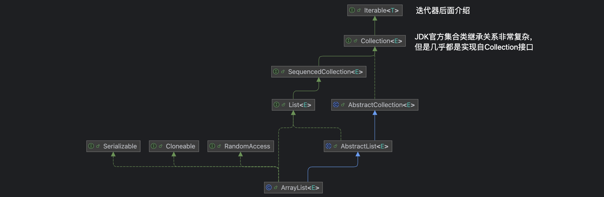

# 集合类

集合跟数组一样，可以表示同样的一组元素。

相同之处：

1. 它们都是容器，都能容纳一组元素。

不同之处：

1. 数组的大小是固定的，集合的大小是可变的。
2. 数组可以存放基本数据类型，但集合只能存放对象。

## 集合根接口

## List列表

List列表是集合类型的一个分支，它的主要特性有：

* 是一个有序的集合，插入元素默认是插入到尾部，按顺序从前往后存放，每个元素都有一个自己的下标位置。
* 列表中允许存在重复元素。

**ArrayList**：更适合随机访问，因为可以直接读取某个下标的元素，插入性能较差，因为需要移动一组元素，让出空间。

**LinkedList**：不适合随机访问，因为无法直接获取某个元素，只能遍历查找。插入性能较好，因为可以直接改变链表中结点的指向。

## 迭代器

## Set集合

我们发现接口中定义的方法都是Collection中直接继承的，因此，Set支持的功能其实也就和Collection中定义的差不多，只不过：

* 不允许出现重复元素
* 不支持随机访问（不允许通过下标访问）

## Map映射

映射（Mapping），指的是两个元素之间相互”对应“的关系。也就是说，我们的元素之间是两两对应的，是以键值对的形式存在。Map就是为了实现这种数据关系而存在的，我们通过保存键值对的形式来存储映射关系，就可以轻松地通过键找到对应的映射值。
