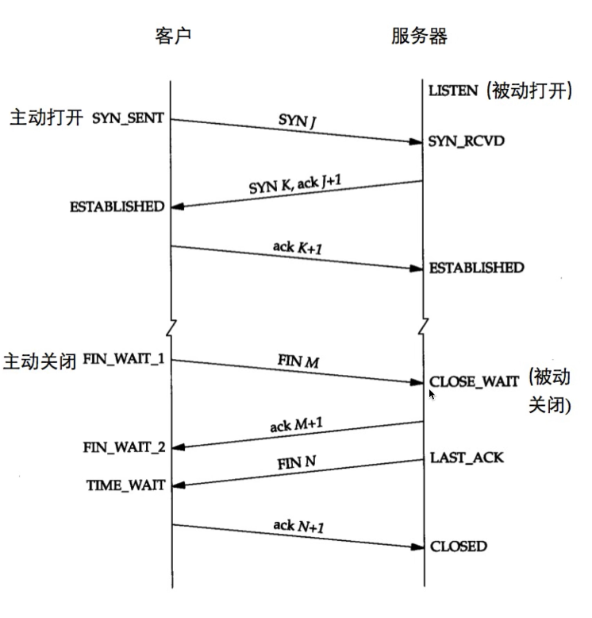

# Java网络编程

跨越不同的主机进行I/O操作

## 计算机网络基础

利用不同的通信线路和通信设备，将地理位置不同的，功能独立的多台计算机互连起来，以功能完善的网络软件来实现资源共享和信息传递，就构成了了计算机网络系统。

**IP地址：**找到哪台电脑

**端口：**找到这台电脑里的哪个程序

**端口号**是一个0~65535的整数，用于标识电脑里的具体程序。因为一台电脑可以运行很多服务，系统要靠端口区分。

TCP和UCP是两种不同的传输层协议：

* TCP：当一台计算机想要与另一台计算机通讯时，两台计算机之间的通信需要畅通且可靠（会进行三次握手，断开也会进行四次挥手），这样才能保证正确收发数据，因此TCP更适合一些可靠的数据传输场景。
* UDP：它是一种无连接协议，数据想发就发，而且不会建立可靠传输，也就是说传输过程中有可能会导致部分数据丢失，但是它比TCP传输更加简单高效，适合视频直播之类的。

| 对比项     | TCP        | UDP            |
| ---------- | ---------- | -------------- |
| 是否连接   | ✅ 需要     | ❌ 不需要       |
| 是否可靠   | ✅ 可靠     | ❌ 不可靠       |
| 速度       | 较慢       | 很快           |
| 是否有顺序 | ✅ 有       | ❌ 可能乱       |
| 是否重发   | ✅ 自动重发 | ❌ 不重发       |
| Java类     | Socket     | DatagramSocket |

## Socker技术

通过Socker技术（是计算机之间进行通信的一种约定或一种方式），可以实现两台计算机之间的通信，Socker也可以被翻译为**套接字**，是操作系统底层提供的一项通信技术，它支持TCP和UDP。而Java就对Socker底层支持进行了一套完整的封装，我们可以通过Java来实现Socker通信。

要实现Socket通信，我们必须创建一个数据发送者和一个数据接收者，也就是客户端和服务端，我们需要提前启动服务端，来等待客户端的连接，而客户端只需要随时启动去连接服务端即可！

java复制代码

```java
//服务端
public static void main(String[] args) {
    try(ServerSocket server = new ServerSocket(8080)){    //将服务端创建在端口8080上
        System.out.println("正在等待客户端连接...");
        Socket socket = server.accept();  //当没有客户端连接时，线程会阻塞，直到有客户端连接为止
        System.out.println("客户端已连接，IP地址为："+socket.getInetAddress().getHostAddress());
    }catch (IOException e){
        e.printStackTrace();
    }
}
```

java复制代码

```java
//客户端
public static void main(String[] args) {
    try (Socket socket = new Socket("localhost", 8080)){
        System.out.println("已连接到服务端！");
    }catch (IOException e){
        System.out.println("服务端连接失败！");
        e.printStackTrace();
    }
}
```

实际上它就是一个TCP连接的建立过程：



一旦TCP连接建立，服务端和客户端之间就可以相互发送数据，直到客户端主动关闭连接。当然，服务端不仅仅可以让一个客户端进行连接，服务端可以一直运行来不断接受客户端的连接。

## 使用Socket进行数据传输

通过Socket对象，我们就可以获取到对应的I/O流进行网络数据传播。

## 使用Socket进行文件传输

# 数据库

数据库是数据管理的有效技术，是由一批数据构成的有序集合，这些数据被存放在结构化的数据表里。数据表之间相互关联，反映客观事物间的本质联系。数据库能有效地帮助一个组织或企业科学地管理各类信息资源。简而言之，我们的数据可以交给数据库来帮助我们进行管理，同时数据库能够为我们提供高效的访问性能。

## 常见的几种数据库

* MySQL - 免费，用的最多，开源数据库，适用于中小型
* Microsoft SQL Server - 收钱的，但是提供技术支持，适用于Windows Server
* Qracle - 收钱的，大型数据库系统

## 数据模型

数据模型与现实世界中的模型是一样的，是对现实世界的一种抽象。实际上，我们之前学习的的类就是对现实世界数据的一种抽象，比如一个学生的特征包括姓名、年龄、年纪、专业、学号等，这些特征也称为实体的一种属性，属性具有以下特点：

* 属性不可再分
* 一个实体的属性可以有多个
* 用于唯一区分不同实体的属性，称为Key，比如每个同学的学号都是不一样的
* 属性取值可以有一定的约束，比如性别只能是男和女

实体或者属性之间可以具有一定的联系。

MySQL就是一种关系型数据库，通过使用关系型数据库，我们就可以很好地储存这样带有一定联系的数据。

## 数据库的创建

在数据库中用于存放数据的表，每一张表都代表一种实体的数据，。首先我们要明确，我们需要创建什么样子的表：

* 学生表：用于存放所有学生的数据，学生（<u>学号</u>，姓名，性别）
* 教师表：用于存放所有教师的数据，教师（<u>教师号</u>，姓名）
* 授课表：用于存放教师与学生的授课信息，授课（<u>学号</u>，<u>教师号</u>）

其中，标注下划线的是属性，作为Key，用于区别于其他实体数据的唯一标记，而授课则需要两个Key，因为学号和教师号都是一种唯一区别于其他实体数据的标记。
