# Web前端开发（Vue工程化）

前面我们在介绍Vue的时候，我们讲到Vue是一款用于构建用户界面的渐进式JavaScript框架 。（官方：https://cn.vuejs.org/）

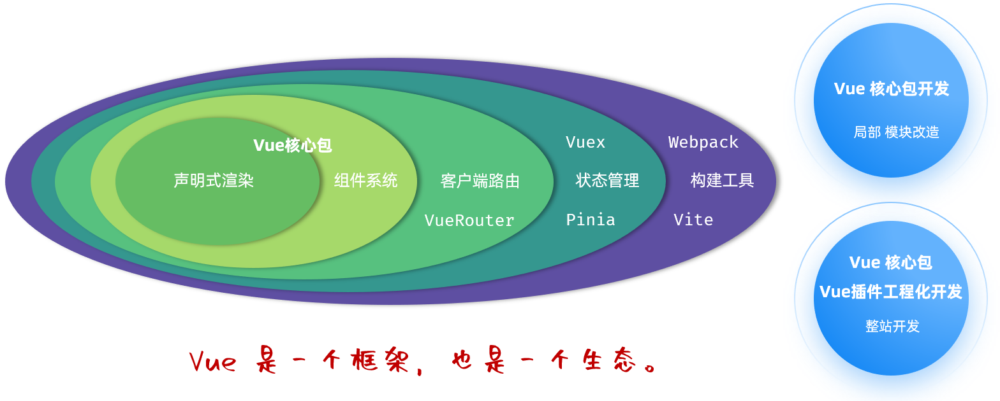

那在前面的课程中，我们已经学习了Vue的基本语法、表达式、指令，并基于Vue的核心包，完成了Vue的案例。 那今天呢，我们要来讲解的基于Vue进行整站开发。

## 介绍

在前面的课程中，我们学习了HTML、CSS、JS、Axios、Vue等技术，并基于完成了一些前端开发的案例 。我们目前的前端开发中，当我们需要使用一些资源时，例如：`vue.js`，和 `axios.js` 文件，都是直接再工程中导入的，如下图所示：

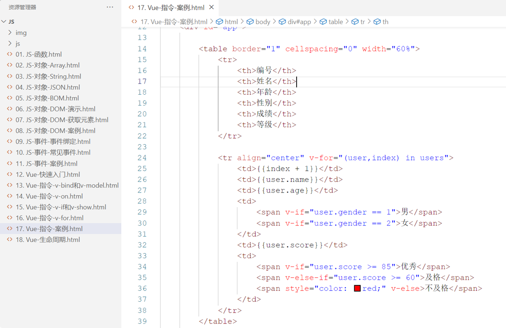

但是上述开发模式存在如下问题：

- **不规范**：每次开发都是从零开始，比较麻烦
- **难复用**：多个页面中的组件共用性不好
- **难维护**：js、图片等资源没有规范化的存储目录，没有统一的标准，不方便维护

所以现在企业开发中更加讲究前端工程化方式的开发，主要包括如下4个特点:

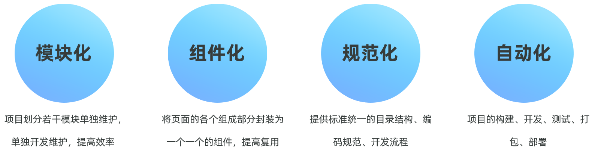

- 模块化：将js和css等，做成一个个可复用模块
- 组件化：我们将UI组件，css样式，js行为封装成一个个的组件，便于管理
- 规范化：我们提供一套标准的规范的目录接口和编码规范，所有开发人员遵循这套规范
- 自动化：项目的构建，测试，部署全部都是自动完成

所以对于**前端工程化，说白了，就是在企业级的前端项目开发中，把前端开发所需要的工具、技术、流程、经验进行规范化和标准化**。从而统一开发规范、提升开发效率，降低开发难度、提高复用等等。接下来我们就需要学习vue的官方提供的脚手架帮我们完成前端的工程化。


## 环境准备

1. #### 介绍

- 介绍：create-vue是Vue官方提供的最新的脚手架工具，用于快速生成一个工程化的Vue项目。
- create-vue提供了如下功能：
  - 统一的目录结构
  - 本地调试
  - 热部署
  - 单元测试
  - 集成打包上线
- 而要想使用create-vue来创建vue项目，则必须安装依赖环境：NodeJS 

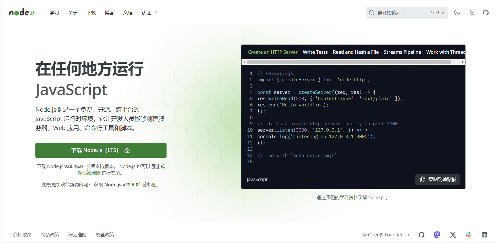

1. #### NodeJS安装

安装包，在课程资料中已经提供了。如下：

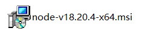

**1). 双击msi文件，勾选我接受**

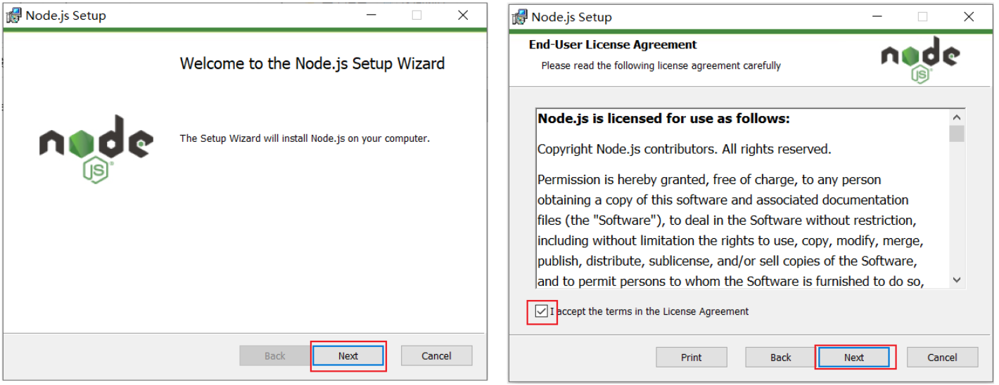

**2). 选择安装到一个，****没有中文，没有空格** **的目录下（新建一个文件夹NodeJS）**

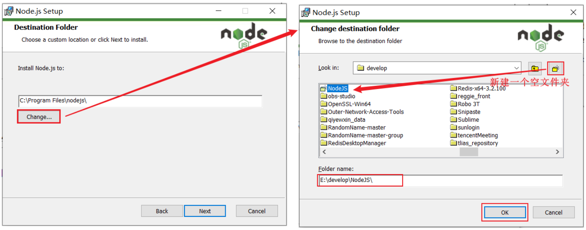

**3). 点击 Next，下一步下一步的安装即可。**

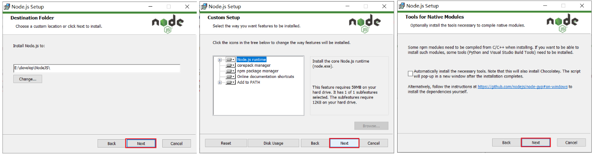

**4). 验证NodeJS的环境变量**

NodeJS 安装完毕后，会自动配置好环境变量，我们验证一下是否安装成功，通过： `node -v`

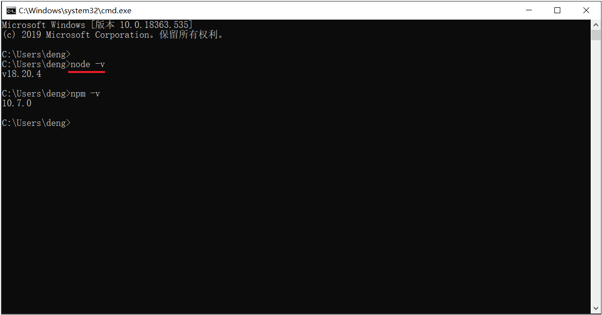

**5). 配置npm的全局安装路径**

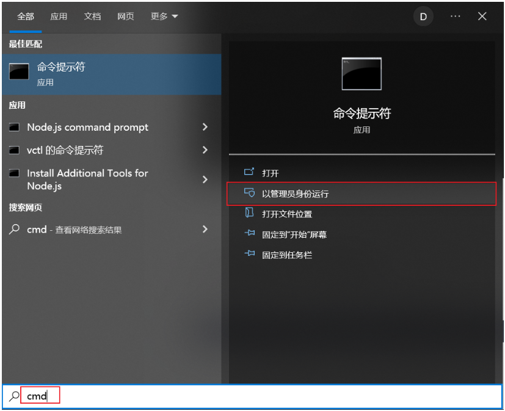

使用 **管理员身份** 运行命令行，在命令行中，执行如下指令：

```Java
npm config set prefix "D:\develop\NodeJS"
```

**注意：D:\develop\NodeJS 这个目录是NodeJS的安装目录 !!!!!**

**注意：D:\develop\NodeJS 这个目录是NodeJS的安装目录 !!!!!**

**注意：D:\develop\NodeJS 这个目录是NodeJS的安装目录 !!!!!**

**6). 切换为淘宝镜像，加速下载：**

```Java
npm config set registry https://registry.npmmirror.com
```

1. #### npm介绍

- **npm：**Node Package Manager，是NodeJS的软件包管理器。

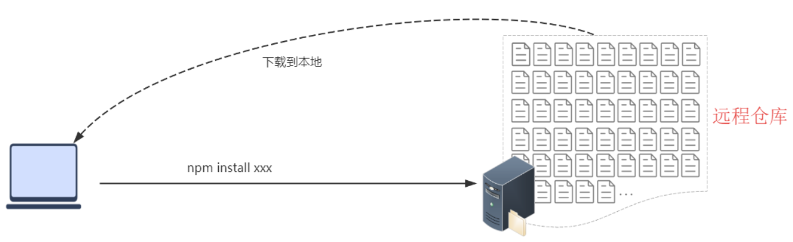

在开发前端项目的过程中，我们需要相关的依赖，就可以直接通过 `npm install xxx` 命令，直接从远程仓库中将依赖直接下载到本地了。


## Vue项目创建

1. #### 项目创建

创建一个工程化的Vue项目，执行命令：`npm create vue``@3.3.4`

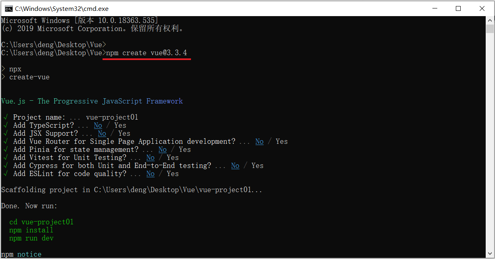

**详细步骤说明：**

- `Project name：`------------------》项目名称，默认值：vue-project，可输入想要的项目名称。
- `Add TypeScript?` ----------------》是否加入TypeScript组件？默认值：No。
- `Add JSX Support?` --------------》是否加入JSX支持？默认值：No。
- `Add Vue Router...`--------------》是否为单页应用程序开发添加Vue Router路由管理组件？默认值：No。
- `Add Pinia ...`----------------------》是否添加Pinia组件来进行状态管理？默认值：No。
- `Add Vitest ...`---------------------》是否添加Vitest来进行单元测试？默认值：No。
- `Add an End-to-End ...`-----------》是否添加端到端测试？默认值No。
- `Add ESLint for code quality?` ---》是否添加ESLint来进行代码质量检查？默认值：No。

**提示：**执行上述指令，将会安装并执行 create-vue，它是 Vue 官方的项目脚手架工具

项目创建完成以后，进入`vue-project01` 项目目录，执行命令安装当前项目的依赖：`npm install`

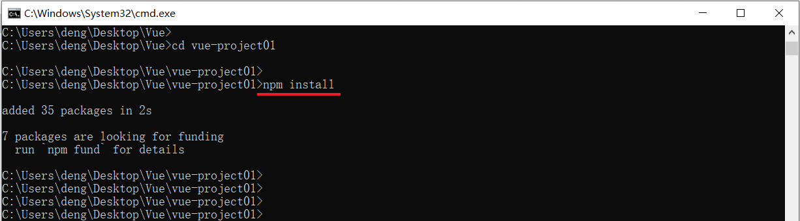

创建项目以及安装依赖的过程，都是需要联网的。【如果网络不太好，可能会造成依赖下载不完整报错，继续再次执行 命令安装。】 

1. #### 项目结构

我们可以使用VsCode直接打开这个Vue项目。

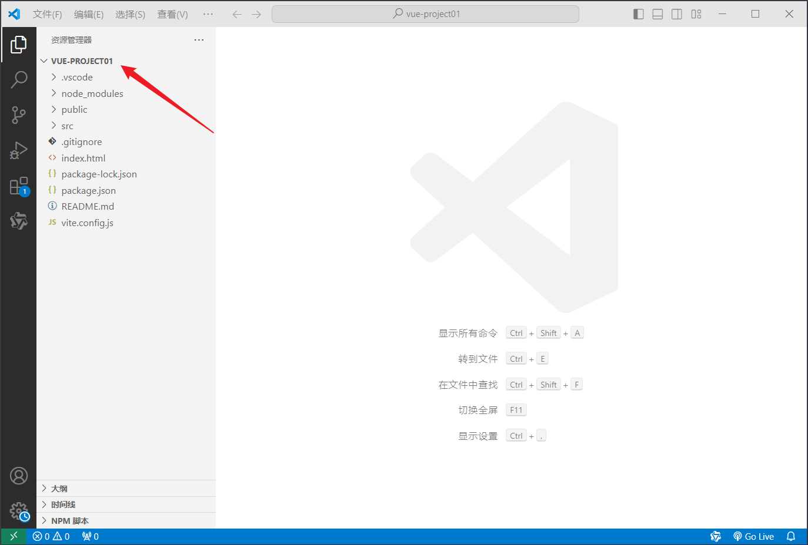

这是我们创建的第一个项目结构，接下来呢，我们来介绍一下这个项目的结构。如图所示：

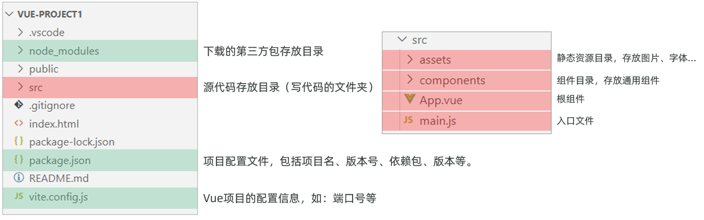

在上述的目录中，我们以后操作的最多的目录，就是src目录，因为我们需要在这个目录下来编写前端代码。

1. #### 启动项目

- **方式一：命令行**

启动项目，我们可以在命令行中执行命令：`npm run dev`，就可以启动Vue项目了。

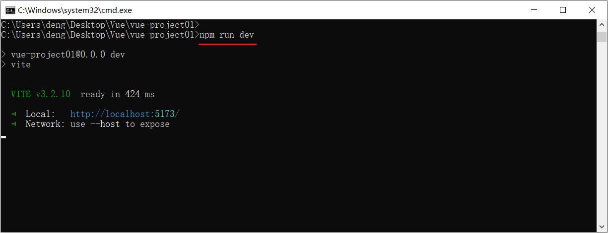

- **方式二：Vscode图形化界面**

点击NPM脚本中的dev后的运行按钮，就可以启动项目。

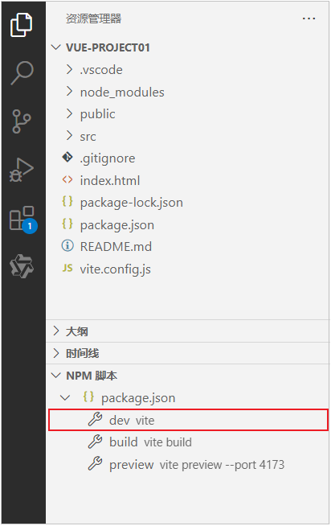

启动起来之后，我们就可以访问前端Vue项目了，访问路径：`http://localhost:5173`

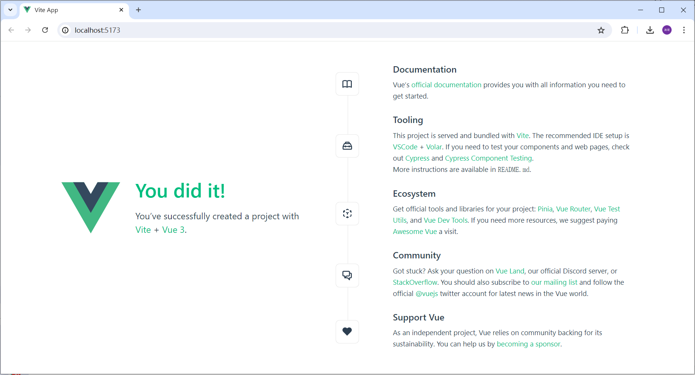


1. > Vue项目操作
   >
   > * 创建：`npm create vue@版本号`
   > * 安装依赖：`npm install`
   > * 启动：`npm run dev`


## Vue项目开发流程

如下图：

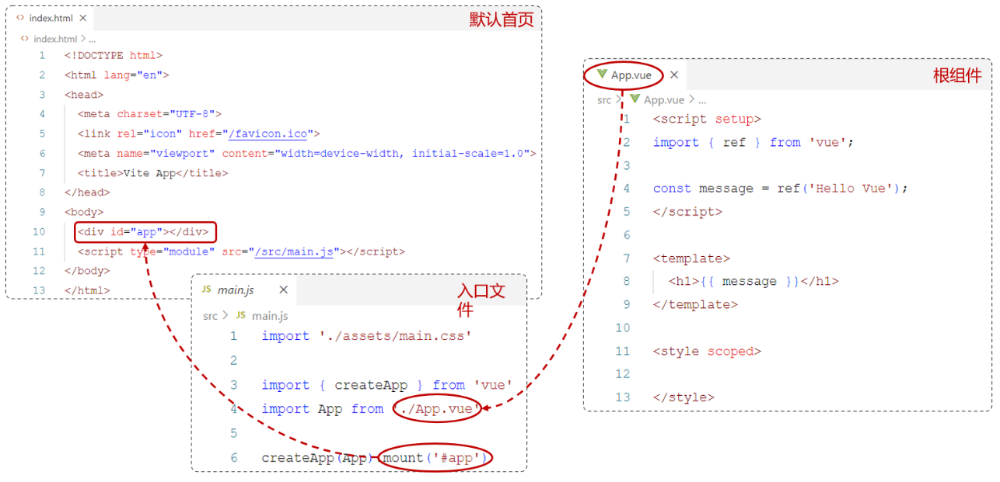

其中`*.vue`是Vue项目中的组件文件，在Vue项目中也称为单文件组件（[SFC](https://cn.vuejs.org/guide/scaling-up/sfc.html)，Single-File Components）。Vue 的单文件组件会将一个组件的逻辑 (JS)，模板 (HTML) 和样式 (CSS) 封装在同一个文件里（`*.vue`） 

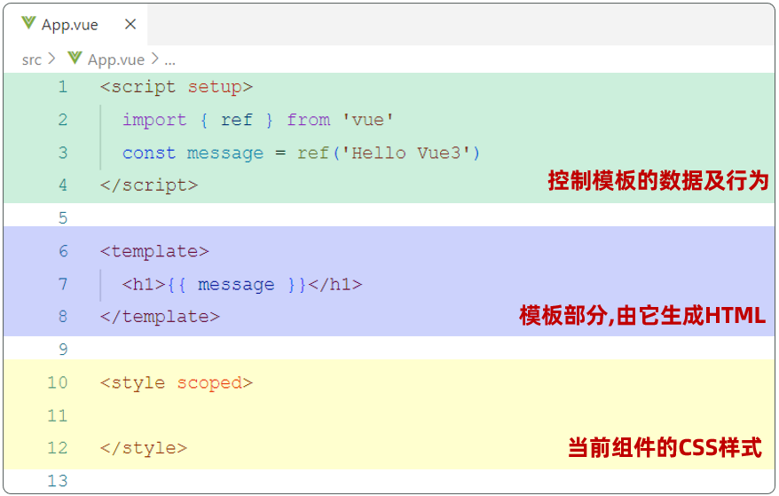


## API风格

- Vue的组件有两种不同的风格：**组合式API** 和 **选项式API**
- **组合式API****：**是Vue3提供的一种基于函数的组件编写方式，通过使用函数来组织和复用组件的逻辑。它提供了一种更灵活、更可组合的方式来编写组件。代码形式如下：

```HTML
<script setup>
import { ref, onMounted } from 'vue';
const count = ref(0); //声明响应式变量

function increment(){ //声明函数
   count.value++;
}

onMounted(() => { //声明钩子函数
  console.log('Vue Mounted....'); 
})
</script>

<template>
   <input type="button" @click="increment"> Api Demo1 Count : {{ count }}
</template>

<style scoped>
   
</style>
```

- `setup`：是一个标识，告诉Vue需要进行一些处理，让我们可以更简洁的使用组合式API。
- `ref()`：接收一个内部值，返回一个响应式的ref对象，此对象只有一个指向内部值的属性 value。
- `onMounted()`：在组合式API中的钩子方法，注册一个回调函数，在组件挂载完成后执行。

- **选项式API**

**选项式API：**可以用包含多个选项的对象来描述组件的逻辑，如：`data`，`methods`，`mounted`等。选项定义的属性都会暴露在函数内部的`this`上，它会指向当前的组件实例。

```HTML
<script>
export default{
   data() {
      return {
         count: 0
      }
   },
   methods: {
      increment: function(){
         this.count++
      }
   },
   mounted() {
      console.log('vue mounted.....');
   }
}
</script>

<template>
  <input type="button" @click="increment">Api Demo1 Count :  {{ count }}
</template>

<style scoped>

</style>
```

**在Vue中的组合式API使用时，是没有this对象的，this对象是undefined。 **


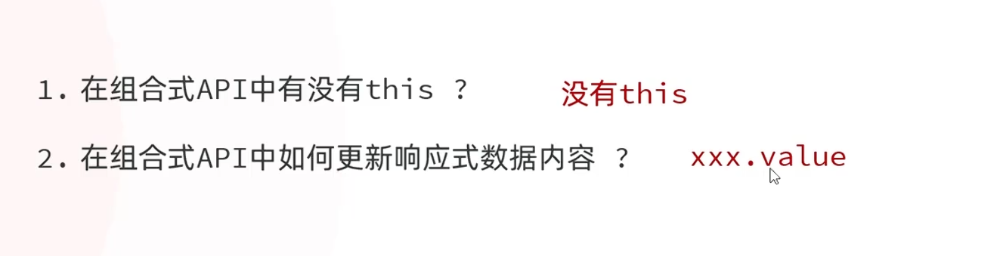


## 案例

在Vue项目中，基于组合式API完成用户列表数据渲染。 要求：在页面加载完毕之后，发送异步请求，加载数据，渲染表格。

最终实现效果：

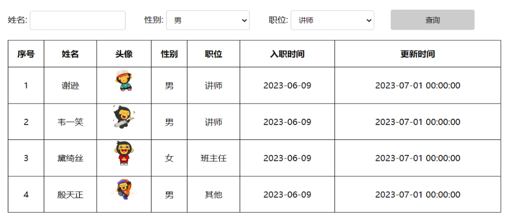

**代码实现如下：**

在 src 下定义 views 目录，在 views 目录中定义文件 `UserList.vue`，  然后，我们就可以将之前实现的Vue案例中的代码，基于Vue工程化的形式来实现一遍。 (之前实现的这个页面，在资料中已经提供了：`1.工程化-案例-素材.html`)

1). 把原来定义的CSS样式代码，拷贝到 `<style></style>` 标签中。

2). 把页面的`<div id="app"></div>` 中的页面展示的html标签代码，拷贝到 `<template></template>` 标签中。

3). 将页面的JS代码，按照组合式API的形式，在 `<script></script>` 中定义出来。

4). 而由于在这个案例中，需要用到`axios`来发送异步请求，所以还需要安装 `axios`。

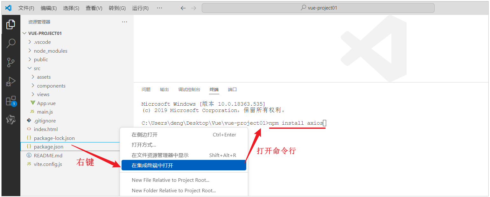

**具体代码如下：**

`views/UserList.vue` 代码如下：

```HTML
<script setup>
//引入ref
import { ref, onMounted } from 'vue'
import axios from 'axios'

//声明数据变量 userList, name, gender, job
const userList = ref([])
const name = ref('')
const gender = ref('')
const job = ref('')

//声明函数,基于axios查询数据
const search = () => {
  //发送请求
  axios.get(`https://web-server.itheima.net/emps/list?name=${name.value}&gender=${gender.value}&job=${job.value}`).then(res => {
    //将查询到的数据赋值给userList
    userList.value = res.data.data
  })
}

//定义钩子函数 onMounted
onMounted(() => {
  //调用search函数
  search()
})
</script>

<template>
  <div id="center">
    姓名: <input type="text" name="name" v-model="name">

    性别:
    <select name="gender" v-model="gender">
      <option value="1">男</option>
      <option value="2">女</option>
    </select>

    职位:
    <select name="job" v-model="job">
      <option value="1">班主任</option>
      <option value="2">讲师</option>
      <option value="3">其他</option>
    </select>

    <input class="btn" type="button" value="查询" @click="search">
  </div>
  
  <table>
    <tr>
      <th>序号</th>
      <th>姓名</th>
      <th>头像</th>
      <th>性别</th>
      <th>职位</th>
      <th>入职时间</th>
      <th>更新时间</th>
    </tr>

    <!-- v-for 用于列表循环渲染元素 -->
    <tr v-for="(user, index) in userList" :key="user.id">
      <td>{{index + 1}}</td>
      <td>{{user.name}}</td>
      <td>  </td>
      <td>
        <span v-if="user.gender == 1">男</span>
        <span v-else-if="user.gender == 2">女</span>
        <span v-else>其他</span>
      </td>
      <td>
        <span v-show="user.job == 1">班主任</span>
        <span v-show="user.job == 2">讲师</span>
        <span v-show="user.job != 1 && user.job != 2">其他</span>
      </td>
      <td>{{user.entrydate}}</td>
      <td>{{user.updatetime}}</td>
    </tr>
  </table>
</template>

<style scoped>
  table,th,td {
    border: 1px solid #000;
    border-collapse: collapse;
    line-height: 50px;
    text-align: center;
  }

  #center,table {
    width: 60%;
    margin: auto;
  }

  #center {
    margin-bottom: 20px;
  }

  img {
    width: 50px;
  }

  input,select {
    width: 17%;
    padding: 10px;
    margin-right: 30px;
    border: 1px solid #ccc;
    border-radius: 4px;
  }

  .btn {
    background-color: #ccc;
  }
</style>
```

然后在 `App.vue` 中，将 `UserList.vue` 引入进来。

```HTML
<script setup>
import UserList from './views/user/UserList.vue'
</script>

<template>
   <UserList></UserList>
</template>

<style scoped>

</style>
```

最终展示形式如下：

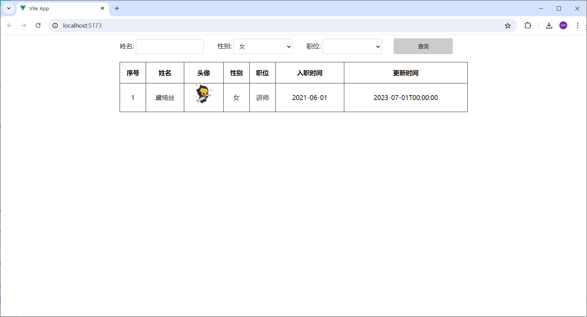
