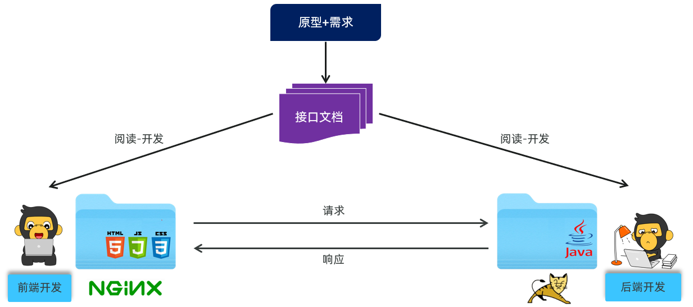

# Web前端开发（实战）

## 开发模式

在之前的课程中，我们介绍过，现在的企业项目开发有2种开发模式：**前后台混合开发** 和 **前后台分离开发**。

前后台混合开发，顾名思义就是前台后台代码混在一起开发。这种开发模式有如下缺点：

- 沟通成本高：后台人员发现前端有问题，需要找前端人员修改，前端修改成功，再交给后台人员使用
- 分工不明确：后台开发人员需要开发后台代码，也需要开发部分前端代码。很难培养专业人才
- 不便管理：所有的代码都在一个工程中
- 难以维护：前端代码更新，和后台无关，但是需要整个工程包括后台一起重新打包部署。

所以我们目前基本都是采用的前后台分离开发方式，如下图所示：

我们将原先的工程分为前端工程和后端工程这2个工程，然后前端工程交给专业的前端人员开发，后端工程交给专业的后端人员开发。

前端页面需要数据，可以通过发送异步请求，从后台工程获取。但是，我们前后台是分开来开发的，那么前端人员怎么知道后台返回数据的格式呢？后端人员开发，怎么知道前端人员需要的数据格式呢？

所以针对这个问题，我们前后台统一制定一套规范！我们前后台开发人员都需要遵循这套规范开发，这就是我们的 **接口文档**。接口文档有离线版和在线版本，接口文档示可以查询今天提供 **资料/接口文档** 里面的资料。

那么接口文档的内容怎么来的呢？是我们后台开发者根据产品经理提供的产品原型和需求文档所撰写出来的，产品原型示例可以参考今天提供**资料/页面原型** 里面的资料。

那么基于前后台分离开发的模式下，我们后台开发者开发一个功能的具体流程如何呢？如下图所示：

1. 需求分析：首先我们需要阅读需求文档，分析需求，理解需求。
2. 接口定义：查询接口文档中关于需求的接口的定义，包括地址，参数，响应数据类型等等
3. 前后台并行开发：各自按照接口文档进行开发，实现需求
4. 测试：前后台开发完了，各自按照接口文档进行测试
5. 前后段联调测试：前段工程请求后端工程，测试功能

> 1. 什么是前后端分离的开发模式？
>    * 前后端开发人员独立开发，独立部署
>
> 2. 需求的开发流程
>    * 需求分析 -> 接口定义 -> 前后端并行开发 -> 测试 -> 前后端联动测试

## 整体布局

### 准备工作

### 动态菜单

## 部门管理
