# Web后端实战


## 准备工作


### 开发范式 - 开发模式

* 当前最为主流的开发模式：前后端分离开发

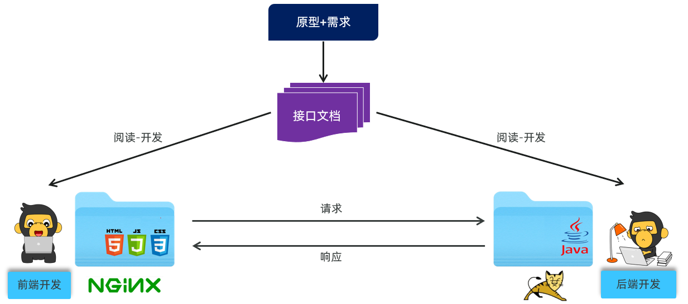


那么基于前后台分离开发的模式下，我们后台开发者开发一个功能的具体流程如何呢？如下图所示：


1. 需求分析：首先我们需要阅读需求文档，分析需求，理解需求。
2. 接口定义：查询接口文档中关于需求的接口的定义，包括地址，参数，响应数据类型等等
3. 前后台并行开发：各自按照接口文档进行开发，实现需求
4. 测试：前后台开发完了，各自按照接口文档进行测试
5. 前后段联调测试：前段工程请求后端工程，测试功能


### 开发规范 - Restful

REST （REpresentational State Transfer），表述性状态转换，它是一种软件架构风格

**传统URL风格如下：**

- `http://localhost:8080/user/getById?id=1`      GET：查询id为1的用户
- `http://localhost:8080/user/saveUser`            POST：新增用户
- `http://localhost:8080/user/updateUser`         POST：修改用户
- `http://localhost:8080/user/deleteUser?id=1`  GET：删除id为1的用户

我们看到，原始的传统URL呢，定义比较复杂，而且将资源的访问行为对外暴露出来了。而且，对于开发人员来说，每一个开发人员都有自己的命名习惯，就拿根据id查询用户信息来说的，不同的开发人员定义的路径可能是这样的：`getById`，`selectById`，`queryById`，`loadById`... 。 每一个人都有自己的命名习惯，如果都按照各自的习惯来，一个项目组，几十号或上百号人，那最终开发出来的项目，将会变得难以维护，没有一个统一的标准。

**基于REST风格URL如下：**

- `http://localhost:8080/users/1`       GET：查询id为1的用户
- `http://localhost:8080/users`          POST：新增用户
- `http://localhost:8080/users`          PUT：修改用户
- `http://localhost:8080/users/1`       DELETE：删除id为1的用户

其中总结起来，就一句话：通过URL定位要操作的资源，通过HTTP动词(请求方式)来描述具体的操作。

在REST风格的URL中，通过四种请求方式，来操作数据的增删改查。 

- GET ：  查询
- POST ：新增
- PUT ：  修改
- DELETE ：删除

我们看到如果是基于REST风格，定义URL，URL将会**更加简洁、更加规范、更加优雅**。

**注意事项：**

- REST是风格，是约定方式，约定不是规定，可以打破
- 描述模块的功能通常使用复数，也就是加s的格式来描述，表示此类资源，而非单个资源。如：users、emps、books…


### 开发规范 - Apifox

因为在浏览器地中所发起的所有的请求，都是GET方式的请求。那大家就需要思考两个问题：

- 前后端都在并行开发，后端开发完对应的接口之后，如何对接口进行请求测试呢？
- 前后端都在并行开发，前端开发过程中，如何获取到数据，测试页面的渲染展示呢？

那这里我们就可以借助一些接口测试工具，比如项：Postman、Apipost、Apifox等。


那这些工具的使用基本类似，只不过Apifox工具的功能更强强大、更加完善，所以在课程中，我们会采用功能更为强大的**Apifox**工具。 


介绍：Apifox是一款集成了Api文档、Api调试、Api Mock、Api测试的一体化协作平台。

作用：接口文档管理、接口请求测试、Mock服务。

官网： https://apifox.com/

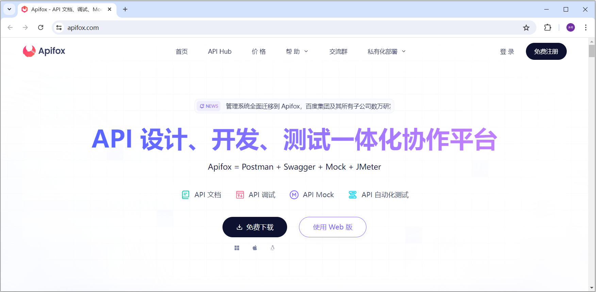


### 工程搭建

1. 创建 SpringBoot 工程，并引入 web 开发起步依赖，mybatis 、mysql 驱动、lombok
2. 创建基础数据库表 dept ，并在 application.yml 中配置数据库的基本信息
3. 准备基础代码结构，并引入实体类 Dept 及统一的响应结果封装类 Result


## 查询部门


### 查询部门 - 接口开发

实现思路：

- 明确了删除部门的需求之后，再来梳理一下实现该功能时，三层架构每一层的职责:

  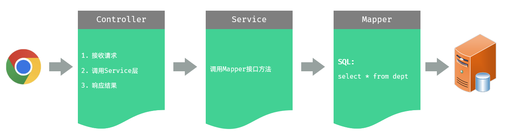

  - Controller层，负责接收前端发起的请求，并调用service查询部门数据，然后响应结果。
  - Service层，负责调用Mapper接口方法，查询所有部门数据。
  - Mapper层，执行查询所有部门数据的操作。


### 查询部门 - 结果封装

在上述测试中，我们发现部门的数据中，id、name两个属性是有值的，但是createTime、updateTime两个字段值并未成功封装，而数据库中是有对应的字段值的，这是为什么呢？ 

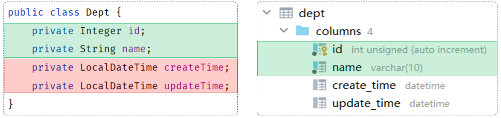

原因如下： 

- 实体类属性名和数据库表查询返回的字段名一致，mybatis会自动封装。
- 如果实体类属性名和数据库表查询返回的字段名不一致，不能自动封装。

 解决方案：

- 手动结果映射
- 起别名
- 开启驼峰命名

**1).** **手动****结果映射**

在DeptMapper接口方法上，通过 @Results及@Result 进行手动结果映射。

```Java
@Results({@Result(column = "create_time", property = "createTime"),
          @Result(column = "update_time", property = "updateTime")})
@Select("select id, name, create_time, update_time from dept")
public List<Dept> findAll();
```

说明：

- `@Results` 注解源码：

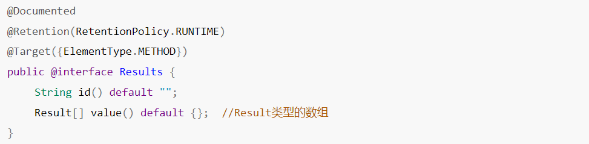

- `@Result`源代码：

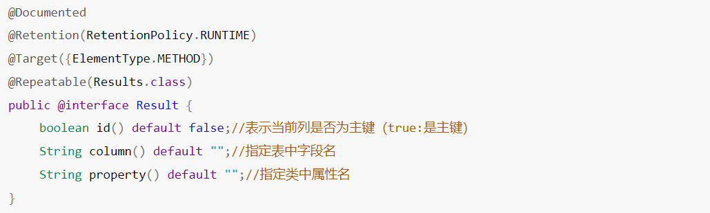

**2). 起别名**

在SQL语句中，对不一样的列名起别名，别名和实体类属性名一样。

```Java
@Select("select id, name, create_time createTime, update_time updateTime from dept")
public List<Dept> findAll();
```

**3). 开启驼峰命名****(推荐)**

如果字段名与属性名符合驼峰命名规则，mybatis会自动通过驼峰命名规则映射。驼峰命名规则：   abc_xyz    =>   abcXyz

- 表中字段名：abc_xyz
- 类中属性名：abcXyz

在application.yml中做如下配置，开启开关。

```YAML
mybatis:
  configuration:
    map-underscore-to-camel-case: true
```

要使用驼峰命名前提是 实体类的属性 与 数据库表中的字段名严格遵守驼峰命名。


### 查询部门 - 前后端联调测试

前端工程请求服务器的地址为 `http://localhost:90/api/depts`，是如何访问到后端的tomcat服务器的？

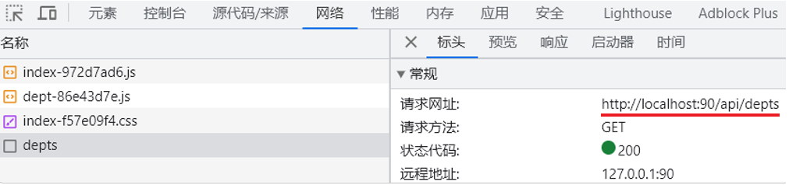

其实这里，是通过前端服务Nginx中提供的反向代理功能实现的。

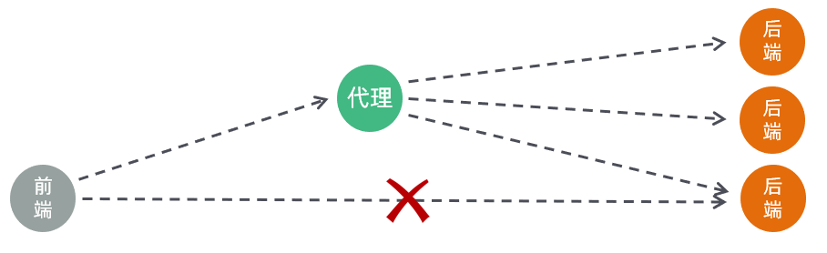

1). 浏览器发起请求，请求的是localhost:90 ，那其实请求的是nginx服务器。

2). 在nginx服务器中呢，并没有对请求直接进行处理，而是将请求转发给了后端的tomcat服务器，最终由tomcat服务器来处理该请求。

这个过程就是通过nginx的反向代理实现的。 那为什么浏览器不直接请求后端的tomcat服务器，而是直接请求nginx服务器呢，主要有以下几点原因：

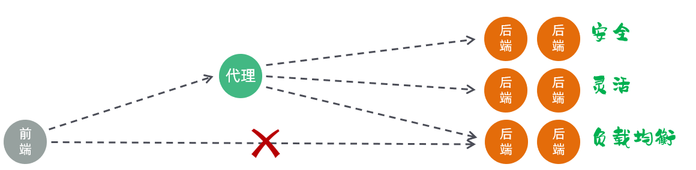

1). 安全：由于后端的tomcat服务器一般都会搭建集群，会有很多的服务器，把所有的tomcat暴露给前端，让前端直接请求tomcat，对于后端服务器是比较危险的。

2). 灵活：基于nginx的反向代理实现，更加灵活，后端想增加、减少服务器，对于前端来说是无感知的，只需要在nginx中配置即可。

3). 负载均衡：基于nginx的反向代理，可以很方便的实现后端tomcat的负载均衡操作。

**反向代理**是一种网络架构，通过代理服务器为后端的服务器做代理，客户端的请求直接请求代理服务器，然后转发给后端的服务器（安全、灵活、负载均衡）

具体的请求访问流程如下：

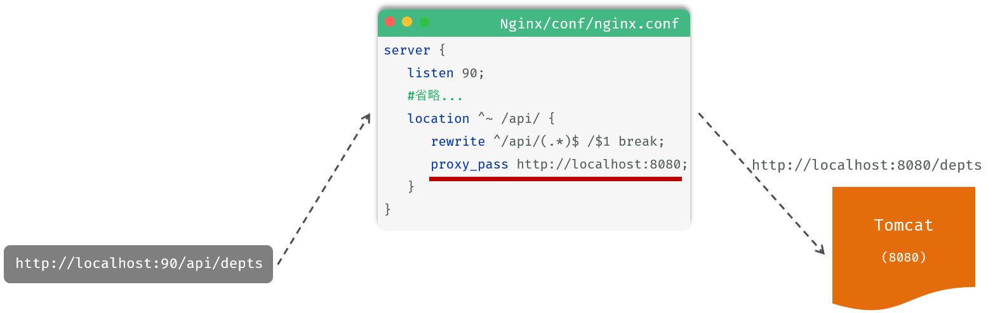

> 1. location：用于定义匹配特定uri请求的规则。
> 2. ^~ /api/：表示精确匹配，即只匹配以/api/开头的路径。
> 3. rewrite：该指令用于重写匹配到的uri路径。
> 4. proxy_pass：该指令用于代理转发，它将匹配到的请求转发给位于后端的指令服务器。


## 删除部门

明确了删除部门的需求之后，再来梳理一下实现该功能时，三层架构每一层的职责：

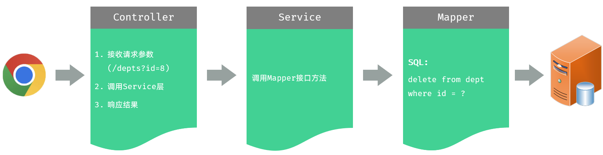

简单参数接收

我们看到，在controller中，需要接收前端传递的请求参数。 那接下来，我们就先来看看在服务器端的Controller程序中，如何获取这类简单参数。 具体的方案有如下三种：

- **方案一：通过原始的** **`HttpServletRequest`** **对象获取请求参数**

```Java
/**
* 根据ID删除部门 - 简单参数接收: 方式一 (HttpServletRequest)
*/
@DeleteMapping("/depts")
public Result delete(HttpServletRequest request){
    String idStr = request.getParameter("id");
    int id = Integer.parseInt(idStr);
    
    System.out.println("根据ID删除部门: " + id);
    return Result.success();
}
```

这种方案实现较为繁琐，而且还需要进行手动类型转换。**【项目开发很少用】**

- **方案二：通过Spring提供的** **`@RequestParam`** **注解，将请求参数绑定给方法形参**

```Java
@DeleteMapping("/depts")
public Result delete(@RequestParam("id") Integer deptId){
    System.out.println("根据ID删除部门: " + deptId);
    return Result.success();
}
```

`@RequestParam` 注解的value属性，需要与前端传递的参数名保持一致 。

@RequestParam注解required属性默认为true，代表该参数必须传递，如果不传递将报错。 如果参数可选，可以将属性设置为false。

- **方案三：****如果请求参数名与形参变量名相同****，直接定义方法形参即可接收。（省略@RequestParam）**

```Java
@DeleteMapping("/depts")
public Result delete(Integer id){
    System.out.println("根据ID删除部门: " + deptId);
    return Result.success();
}
```

对于以上的这三种方案呢，我们**推荐第三种方案**。


## 新增部门

明确了新增部门的需求之后，再来梳理一下实现该功能时，三层架构每一层的职责：

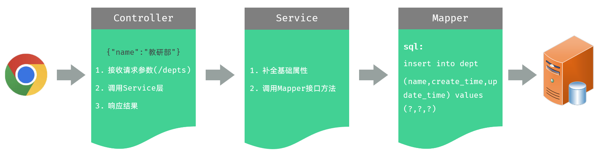

JSON参数接收

我们看到，在controller中，需要接收前端传递的请求参数。 那接下来，我们就先来看看在服务器端的Controller程序中，如何获取json格式的参数。 

- JSON格式的参数，通常会使用一个实体对象进行接收 。
- 规则：JSON数据的键名与方法形参对象的属性名相同，并需要使用`@RequestBody`注解标识。

前端传递的请求参数格式为json，内容如下：`{"name":"研发部"}`。这里，我们可以通过一个对象来接收，只需要保证对象中有name属性即可。

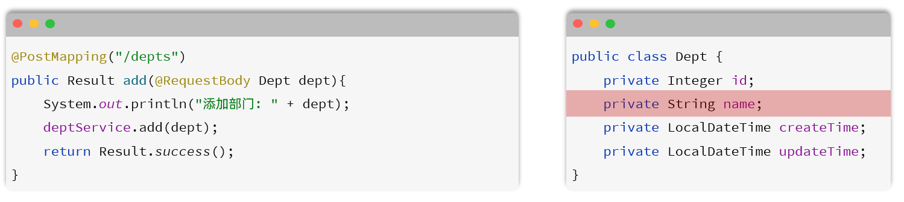


代码实现

**1). Controller层**

在`DeptController`中增加方法save，具体代码如下：

```Java
/**
 * 新增部门 - POST http://localhost:8080/depts   请求参数：{"name":"研发部"}
 */
@PostMapping("/depts")
public Result save(@RequestBody Dept dept){
    System.out.println("新增部门, dept=" + dept);
    deptService.save(dept);
    return Result.success();
}
```

**2). Service层**

在`DeptService`中增加接口方法save，具体代码如下：

```Java
/**
 * 新增部门
 */
void save(Dept dept);
```

在`DeptServiceImpl`中增加save方法，完成添加部门的操作，具体代码如下：

```Java
public void save(Dept dept) {
    //补全基础属性
    dept.setCreateTime(LocalDateTime.now());
    dept.setUpdateTime(LocalDateTime.now());
    //保存部门
    deptMapper.insert(dept);
}
```

**3). Mapper层**

```Java
/**
 * 保存部门
 */
@Insert("insert into dept(name,create_time,update_time) values(#{name},#{createTime},#{updateTime})")
void insert(Dept dept);
```

如果在mapper接口中，需要传递多个参数，可以把多个参数封装到一个对象中。 在SQL语句中获取参数的时候，`#{...}` 里面写的是对象的属性名【注意是属性名，不是表的字段名】。

如何接收 JSON 格式的请求参数：

* 通常通过实体对象接收，保证 JSON 格式的键名与对象属性名保持一致，并添加 @RequestBody 注解

JSON 格式的请求参数适用场景：

* 主要在 POST、PUT 请求中，在请求体传递请求参数


## 修改部门


### 查询回显

明确了根据ID查询部门的需求之后，再来梳理一下实现该功能时，三层架构每一层的职责：

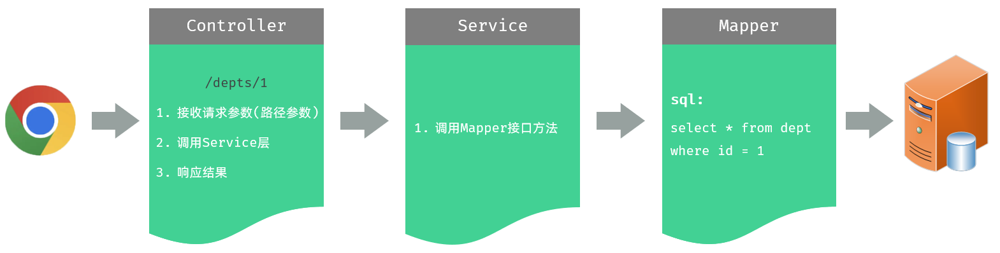

了解了需求之后，我们再看看接口文档中，关于根据ID查询部门的接口的描述，然后根据接口文档进行服务端接口的开发 。

路径参数接收：

`/depts/1`，`/depts/2` 这种在url中传递的参数，我们称之为**路径参数**。 那么如何接收这样的路径参数呢 ？

路径参数：通过请求URL直接传递参数，使用{…}来标识该路径参数，需要使用 **`@PathVariable`**获取路径参数。如下所示：

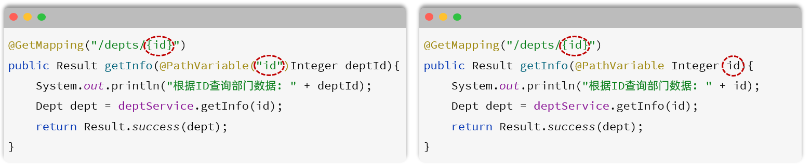

如果路径参数名与controller方法形参名称一致，`@PathVariable`注解的value属性是可以省略的。


### 修改数据

参照接口文档，梳理三层架构每一层的职责：

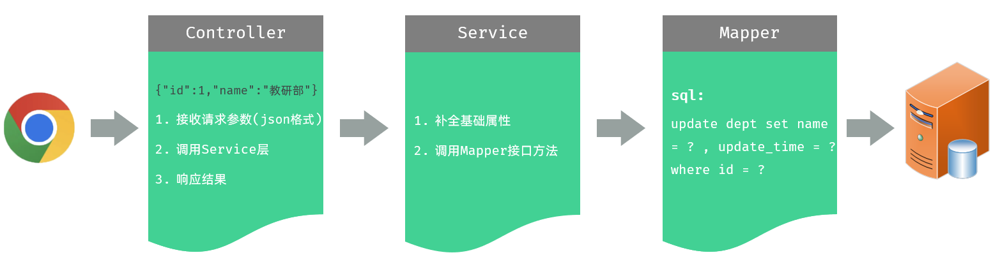

通过接口文档，我们可以看到前端传递的请求参数是json格式的请求参数，在Controller的方法中，我们可以通过 `@RequestBody` 注解来接收，并将其封装到一个对象中。

**1). Controller层**

在 `DeptController` 中增加 `update` 方法，具体代码如下：

```Java
/**
 * 修改部门 - PUT http://localhost:8080/depts  请求参数：{"id":1,"name":"研发部"}
 */
@PutMapping("/depts")
public Result update(@RequestBody Dept dept){
    System.out.println("修改部门, dept=" + dept);
    deptService.update(dept);
    return Result.success();
}
```

**2). Service层**

在 `DeptService` 中增加 `update` 方法。

```Java
/**
 * 修改部门
 */
void update(Dept dept);
```

在 `DeptServiceImpl` 中增加 `update` 方法。 由于是修改操作，每一次修改数据，都需要更新updateTime。所以，具体代码如下：

```Java
public void update(Dept dept) {
    //补全基础属性
    dept.setUpdateTime(LocalDateTime.now());
    //保存部门
    deptMapper.update(dept);
}
```

**3). Mapper层**

在 `DeptMapper` 中增加 `update` 方法，具体代码如下：

```Java
/**
 * 更新部门
 */
@Update("update dept set name = #{name},update_time = #{updateTime} where id = #{id}")
void update(Dept dept);
```


### @RequestMapping

我们在 `DeptController` 中所定义的方法，所有的请求路径，都是 `/depts` 开头的，只要操作的是部门数据，请求路径都是 `/depts` 开头。 

那么这个时候，我们其实是可以把这个公共的路径 `/depts` 抽取到类上的，那在各个方法上，就可以省略了这个 `/depts` 路径。 代码如下：

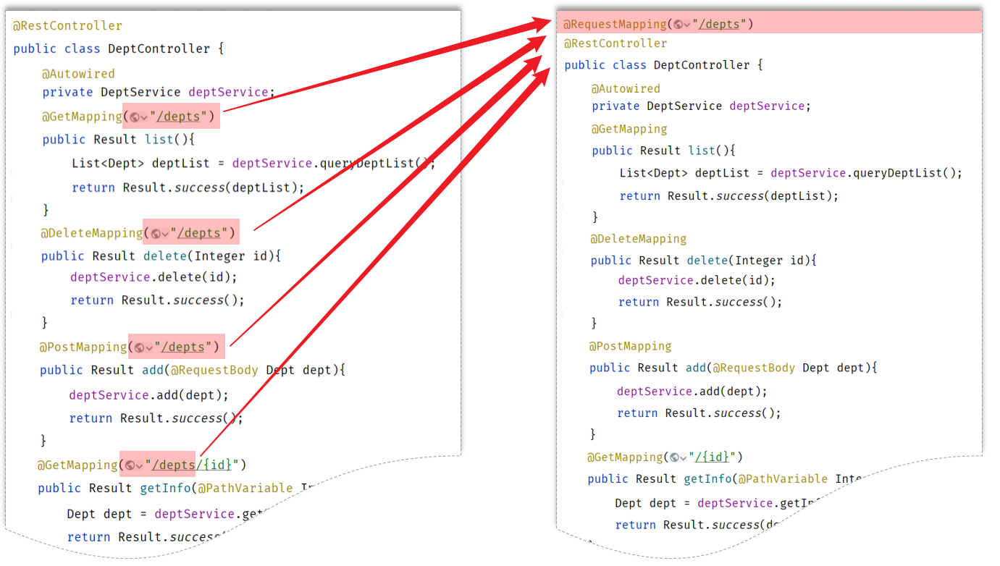

一个完整的请求路径，应该是类上的 @RequestMapping 的value属性 + 方法上的 @RequestMapping的value属性。


## 日志技术

程序中的日志，是用来记录应用程序的运行信息、状态信息、错误信息等

为什么要在程序中记录日志呢？

- 便于追踪应用程序中的数据信息、程序的执行过程。
- 便于对应用程序的性能进行优化。
- 便于应用程序出现问题之后，排查问题，解决问题。
- 便于监控系统的运行状态。

### 日志框架

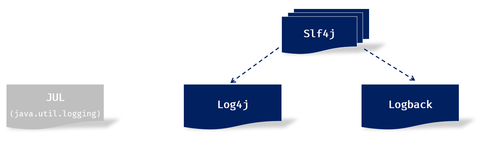

- **JUL**：这是JavaSE平台提供的官方日志框架，也被称为JUL。配置相对简单，但不够灵活，性能较差。
- **Log4j**：一个流行的日志框架，提供了灵活的配置选项，支持多种输出目标。
- **Logback：**基于Log4j升级而来，提供了更多的功能和配置选项，性能由于Log4j。
- **Slf4j**：（Simple Logging Facade for Java）简单日志门面，提供了一套日志操作的标准接口及抽象类，允许应用程序使用不同的底层日志框架。

### Logback快速入门

**1). 准备工作：引入logback的依赖（springboot中无需引入，在springboot中已经传递了此依赖）**

```XML
<dependency>
    <groupId>ch.qos.logback</groupId>
    <artifactId>logback-classic</artifactId>
    <version>1.4.11</version>
</dependency>
```

**2). 引入配置文件** **`logback.xml`**  **（资料中已经提供，拷贝进来，放在** **`src/main/resources`** **目录下； 或者直接AI生成）**

```XML
<?xml version="1.0" encoding="UTF-8"?>
<configuration>
    <!-- 控制台输出 -->
    <appender name="STDOUT" class="ch.qos.logback.core.ConsoleAppender">
        <encoder class="ch.qos.logback.classic.encoder.PatternLayoutEncoder">
            <!--格式化输出：%d表示日期，%thread表示线程名，%-5level：级别从左显示5个字符宽度  %msg：日志消息，%n是换行符 -->
            <pattern>%d{yyyy-MM-dd HH:mm:ss.SSS} [%thread] %-5level %logger{50}-%msg%n</pattern>
        </encoder>
    </appender>

    <!-- 日志输出级别 -->
    <root level="ALL">
        <appender-ref ref="STDOUT" />
    </root>
</configuration>
```

**3). 记录日志：定义日志记录对象Logger，记录日志**

```Java
public class LogTest {
    
    //定义日志记录对象
    private static final Logger log = LoggerFactory.getLogger(LogTest.class);

    @Test
    public void testLog(){
        log.debug("开始计算...");
        int sum = 0;
        int[] nums = {1, 5, 3, 2, 1, 4, 5, 4, 6, 7, 4, 34, 2, 23};
        for (int i = 0; i < nums.length; i++) {
            sum += nums[i];
        }
        log.info("计算结果为: "+sum);
        log.debug("结束计算...");
    }

}
```


### Logback配置文件详解

Logback日志框架的配置文件叫 `logback.xml` 。 

该配置文件是对Logback日志框架输出的日志进行控制的，可以来配置输出的格式、位置及日志开关等。

常用的两种输出日志的位置：控制台、系统文件。

**1). 如果需要输出日志到控制台。添加如下配置：**

```XML
<!-- 控制台输出 -->
<appender name="STDOUT" class="ch.qos.logback.core.ConsoleAppender">
    <encoder class="ch.qos.logback.classic.encoder.PatternLayoutEncoder">
            <!--格式化输出：%d 表示日期，%thread 表示线程名，%-5level表示级别从左显示5个字符宽度，%msg表示日志消息，%n表示换行符 -->
            <pattern>%d{yyyy-MM-dd HH:mm:ss.SSS} [%thread] %-5level %logger{50}-%msg%n</pattern>
    </encoder>
</appender>
```

**2). 如果需要输出日志到文件。添加如下配置：**

```XML
<!-- 按照每天生成日志文件 -->
<appender name="FILE" class="ch.qos.logback.core.rolling.RollingFileAppender">
    <rollingPolicy class="ch.qos.logback.core.rolling.SizeAndTimeBasedRollingPolicy">
        <!-- 日志文件输出的文件名, %i表示序号 -->
        <FileNamePattern>D:/tlias-%d{yyyy-MM-dd}-%i.log</FileNamePattern>
        <!-- 最多保留的历史日志文件数量 -->
        <MaxHistory>30</MaxHistory>
        <!-- 最大文件大小，超过这个大小会触发滚动到新文件，默认为 10MB -->
        <maxFileSize>10MB</maxFileSize>
    </rollingPolicy>

    <encoder class="ch.qos.logback.classic.encoder.PatternLayoutEncoder">
        <!--格式化输出：%d 表示日期，%thread 表示线程名，%-5level表示级别从左显示5个字符宽度，%msg表示日志消息，%n表示换行符 -->
        <pattern>%d{yyyy-MM-dd HH:mm:ss.SSS} [%thread] %-5level %logger{50}-%msg%n</pattern>
    </encoder>
</appender>
```

**3). 日志开关配置 （开启日志（****ALL****），取消日志（OFF））**

```XML
<!-- 日志输出级别 -->
<root level="ALL">
    <!--输出到控制台-->
    <appender-ref ref="STDOUT" />
    <!--输出到文件-->
    <appender-ref ref="FILE" />
</root>
```


### Logback日志级别

日志级别指的是日志信息的类型，日志都会分级别，常见的日志级别如下（优先级由低到高）：

| 日志级别 | 说明                                                         | 记录方式           |
| -------- | ------------------------------------------------------------ | ------------------ |
| trace    | 追踪，记录程序运行轨迹【使用很少】                           | `log.trace("...")` |
| debug    | 调试，记录程序调试过程中的信息，实际应用中一般将其视为最低级别【使用较多】 | `log.debug("...")` |
| info     | 记录一般信息，描述程序运行的关键事件，如：网络连接、io 操作【使用较多】 | `log.info("...")`  |
| warn     | 警告信息，记录潜在有害的情况【使用较多】                     | `log.warn("...")`  |
| error    | 错误信息【使用较多】                                         | `log.error("...")` |

可以在配置文件`logback.xml`中，灵活的控制输出那些类型的日志。（大于等于配置的日志级别的日志才会输出）

```XML
<!-- 日志输出级别 -->
<root level="info">
    <!--输出到控制台-->
    <appender-ref ref="STDOUT" />
    <!--输出到文件-->
    <appender-ref ref="FILE" />
</root>
```


## 多表关系

项目开发中，在进行数据库表结构设计时，会根据业务需求及业务模块之间的关系，分析并设计表结构。由于业务之间相互关联，所以各个表结构之间也存在着各种联系

多表关系分为三种：

* 一对多（多对一）
* 一对一
* 多对多


### 一对多（多对一）

场景：部门与员工的关系（一个部门下有多个员工）

一对多关系实现：在数据库多的一方，添加字段，来关联一的一方的主键

现象：部门数据可以直接删除，然而还有部分员工归属于该部门下，此时就出现了数据的不完整、不一致问题 。

原因：目前上述的两张表，在数据库层面，并未建立关联，所以是无法保证数据的一致性和完整性的 。

解决方案：想解决上述的问题呢，我们就可以通过数据库中的 **外键约束** 来解决。

（原截图含账号、凭据或个人信息，公开版已省略。）

**外键约束：让两张表的数据建立连接，保证数据的一致性和完整性。** 

**对应的关键字：foreign key** 

外键约束的语法：

```SQL
-- 创建表时指定
create table 表名(
        字段名    数据类型,
        ...
        [constraint]   [外键名称]  foreign  key (外键字段名)   references   主表 (主表列名)        
);


-- 建完表后，添加外键
alter table  表名  add constraint  外键名称  foreign key(外键字段名) references 主表(主表列名);
```

那接下来，我们就为员工表的dept_id 建立外键约束，来关联部门表的主键。

当我们添加外键约束时，我们得保证当前数据库表中的数据是完整的。 所以，我们需要将之前删除掉的数据再添加回来。

**方式1：通过SQL语句操作**

```SQL
-- 修改表： 添加外键约束
alter table emp  add  constraint  fk_dept_id  foreign key (dept_id)  references  dept(id);
```

**方式2：****图形化界面操作**

在左侧菜单栏，在emp表上右键，选择 `modify Table... (old UI)`

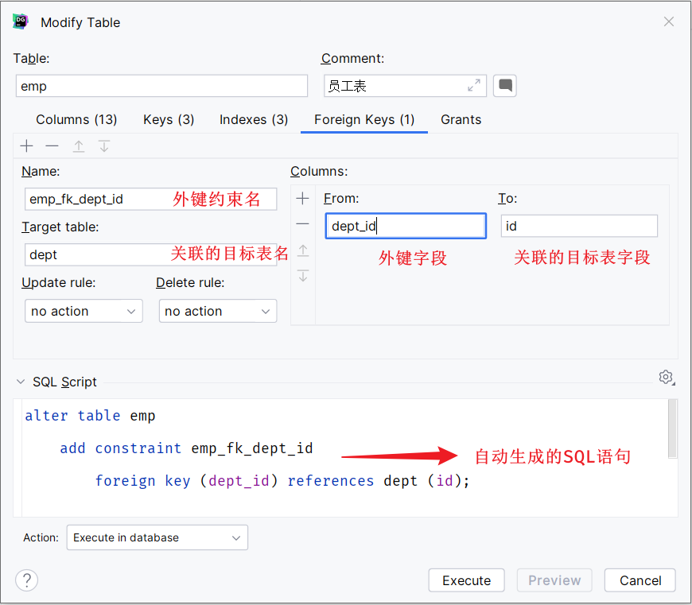

当我们添加了外键之后，再删除ID为3的部门，就会发现，此时数据库报错了，不允许删除。

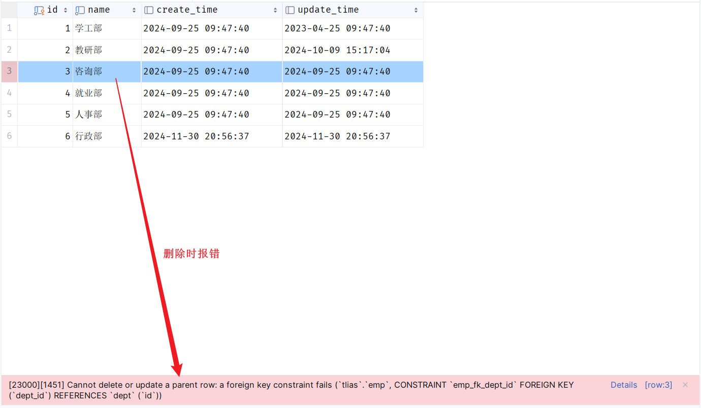

外键约束（foreign key）：保证了数据的完整性和一致性。

外键约束在多表操作中保证数据的一致性、完整性和正确性


### 物理外键和逻辑外键

物理外键

- 概念：使用foreign key定义外键关联另外一张表。
- 缺点：
  - 影响增、删、改的效率（需要检查外键关系）。
  - 仅用于单节点数据库，不适用于分布式、集群场景。
  - 容易引发数据库的死锁问题，消耗性能。

逻辑外键

- 概念：在业务层逻辑中，解决外键关联。
- 通过逻辑外键，就可以很方便的解决上述问题。

在现在的企业开发中，很少会使用物理外键，都是使用逻辑外键。 甚至在一些数据库开发规范中，会明确指出禁止使用物理外键 foreign key 


### 一对一

关系：一对一关系，多用于单表拆分，将一张表的基础字段放在一张表中，其他字段放在另一张表中，以提升操作效率

实现：在任意一方加入外键，关联另外一方的主键，并且设置外键为唯一的（UNIQUE）


### 多对多

案例：学生与课程的关系

关系：一个学生可以选修多门课程，一门课程也可以供多个学生选择

**实现：建立第三张中间表，中间至少包含两个外键，分别关联两方主键**


## 多表查询

多表查询：指从多张表中查询数据

**笛卡尔积：指在数学中，两个集合（ A集合 和 B集合）的所有组合情况（在多表查询时，需要消除无效的笛卡尔积）**

多表查询可以分为：

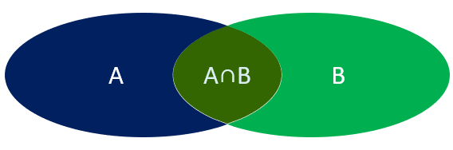

1. 连接查询
   1. 内连接：相当于查询A、B交集部分数据
   2. 外连接
      - 左外连接：查询左表所有数据(包括两张表交集部分数据)
      - 右外连接：查询右表所有数据(包括两张表交集部分数据)
2. 子查询


### 内连接

内连接查询的是两张表交集部分的数据（从语法上可以分为隐式内连接和显式内连接），具体语法为：

**隐式内连接语法：**

```SQL
select  字段列表   from   表1 , 表2   where  条件 ... ;
```

**显式内连接语法：**

```SQL
select  字段列表   from   表1  [ inner ]  join 表2  on  连接条件 ... ;
```


**给表起别名简化书写：**

```SQL
select  字段列表 from 表1 as 别名1 , 表2 as  别名2  where  条件 ... ;

select  字段列表 from 表1 别名1 , 表2  别名2  where  条件 ... ;  -- as 可以省略
```

**注意事项:** 一旦为表起了别名，就不能再使用表名来指定对应的字段了，此时只能够使用别名来指定字段。


### 外连接

外连接分为左外连接和右外连接。具体语法为：

**左外连接语法：**

```SQL
select  字段列表   from   表1  left  [ outer ]  join 表2  on  连接条件 ... ;
```

左外连接相当于查询表1(左表)的所有数据，当然也包含表1和表2交集部分的数据。

**右外连接语法：**

```SQL
select  字段列表   from   表1  right  [ outer ]  join 表2  on  连接条件 ... ;
```

右外连接相当于查询表2(右表)的所有数据，当然也包含表1和表2交集部分的数据。

**注意事项：**

左外连接和右外连接是可以相互替换的，只需要调整连接查询时SQL语句中表的先后顺序就可以了。而我们在日常开发使用时，更偏向于左外连接。


### 子查询

SQL语句中嵌套select语句，称为嵌套查询，又称子查询。

```SQL
SELECT  *  FROM   t1   WHERE  column1 =  ( SELECT  column1  FROM  t2 ... );
```

子查询外部的语句可以是insert / update / delete / select 的任何一个，最常见的是 select。

根据子查询结果的不同分为：

1. 标量子查询（子查询结果为单个值 [一行一列]）
2. 列子查询（子查询结果为一列，但可以是多行）
3. 行子查询（子查询结果为一行，但可以是多列）
4. 表子查询（子查询结果为多行多列[相当于子查询结果是一张表]）

子查询可以书写的位置：

1. where之后
2. from之后
3. select之后

子查询的要点是，先对需求做拆分，明确具体的步骤，然后再逐条编写SQL语句。 最终将多条SQL语句合并为一条。


## 员工列表查询

### 准备工作


### 分页查询

**原始方式**

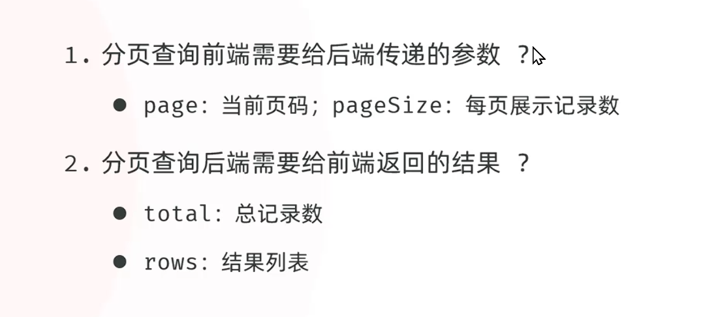


PageHelper 分页插件

PageHelper 是第三方提供的在 Mybatis 框架中用来实现分页的插件，用来简化分页操作，提高开发效率

使用步骤：

1. 引入 PageHelper 的依赖
2. 定义 Mapper 接口的查询方法（无需考虑分页）
3. 在 Service 方法中实现分页查询

我们可以对比一下，使用PageHelper分页插件进行分页 与 原始方式进行分页代码实现的上的差别。


- Mapper接口层：
  - 原始的分页查询功能中，我们需要在Mapper接口中定义两条SQL语句。   
  - PageHelper实现分页查询之后，只需要编写一条SQL语句，而且不需要考虑分页操作，就是一条正常的查询语句。
- Service层：
  - 需要根据页码、每页展示记录数，手动的计算起始索引。
  - 无需手动计算起始索引，直接告诉PageHelper需要查询那一页的数据，每页展示多少条记录即可。

**注意：**

- PageHelper实现分页查询时，SQL语句的结尾一定一定一定不要加分号(;).。
- PageHelper只会对紧跟在其后的第一条SQL语句进行分页处理。


### 条件分页查询

思路分析：

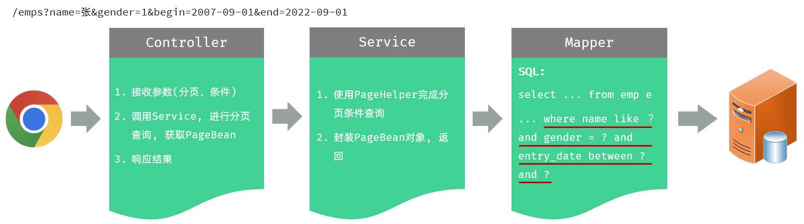


日期时间类型参数接收时，需要通过 @DateTimeFormat 注解指定前端传递的日期格式


**动态SQL**

随着用户的输入或外部条件的变化而变化的 SQL 的语句，我们称为 **动态SQL**

我们用到了两个动态SQL的标签：`<if>`  `<``where``>`。 这两个标签的具体作用如下：

`<if>`：判断条件是否成立，如果条件为true，则拼接SQL。

`<where>`：根据查询条件，来生成where关键字，并会自动去除条件前面多余的and或or。


## 新增员工


新增员工的具体的流程：

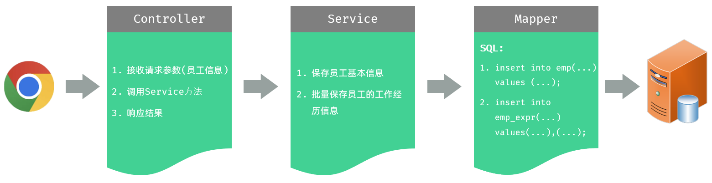


Mybatis中的动态SQL里提供的 `<foreach>` 标签，改标签的作用，是用来遍历循环，常见的属性说明：

1. collection：集合名称
2. item：集合遍历出来的元素/项
3. separator：每一次遍历使用的分隔符
4. open：遍历开始前拼接的片段
5. close：遍历结束后拼接的片段

上述的属性，是可选的，并不是所有的都是必须的。 可以自己根据实际需求，来指定对应的属性。


## 事务管理

### 介绍 & 操作

**概念**：事务是一组操作的集合，它是一个不可分割的工作单位。事务会把所有的操作作为一个整体一起向系统提交或撤销操作请求，即这些操作**要么同时成功，要么同时失败**

注意：默认MySQL的事务是自动提交的，也就是说，当执行一条DML语句，MySQL会立即隐式的提交事务

**操作**：

事务控制主要三步操作：开启事务、提交事务 / 回滚事务

- 需要在这组操作执行之前，先开启事务  ( `start transaction; / begin;`)。
- 所有操作如果全部都执行成功，则提交事务 ( `commit;` )。
- 如果这组操作中，有任何一个操作执行失败，都应该回滚事务 ( `rollback` )。

场景：

* 银行转账
* 下单扣减库存


### Spring 事务管理 - 控制事务

* 注解：@Transactional
* 作用：将当前方法交给 spring 进行事务管理，方法执行前，开启事务；成功执行完毕，提交完毕；出现异常，回滚事务
* 位置：业务（·service·）层的方法上、类上、接口上


**事务进阶** 

@Transactional注解当中的两个常见的属性：

- 异常回滚的属性：`rollbackFor `
- 事务传播行为：`propagation`

`rollbackFor`属性用于控制出现何种异常类型，回滚事务（默认情况下，只有出现RuntimeException才会回滚）

`propagation`

* 事务传播行为：指的就是当一个事务方法被另一个事务方法调用时，这个事务方法应该如何进行事务控制

| 属性值        | 含义                                                         |
| ------------- | ------------------------------------------------------------ |
| REQUIRED      | 【默认值】需要事务，有则加入，无则创建新事务                 |
| REQUIRES_NEW  | 需要新事务，无论有无，总是创建新事务                         |
| SUPPORTS      | 支持事务，有则加入，无则在无事务状态中运行                   |
| NOT_SUPPORTED | 不支持事务，在无事务状态下运行，如果当前存在已有事务，则挂起当前事务 |
| MANDATORY     | 必须有事务，否则抛异常                                       |
| NEVER         | 必须没事务，否则抛异常                                       |
| ...           |                                                              |

> 对于这些事务传播行为，我们只需要关注以下两个就可以了：
>
> 1. REQUIRED（默认值）
> 2. REQUIRES_NEW

1. 事务的传播行为控制的是什么？
   * 一个事务方法，调用另外一个事务方法时，事务应该如何控制（加入？新建？...）

2. 常见的传播行为及应用场景？
   * REQUIRED：大部分场景
   * REQUIRES_NEW：希望两个方法在独立的事务中运行，互不影响

### 四大特性

面试题：事务有哪些特性？

- 原子性（Atomicity）：事务是不可分割的最小单元，要么全部成功，要么全部失败。
- 一致性（Consistency）：事务完成时，必须使所有的数据都保持一致状态。
- 隔离性（Isolation）：数据库系统提供的隔离机制，保证事务在不受外部并发操作影响的独立环境下运行。
- 持久性（Durability）：事务一旦提交或回滚，它对数据库中的数据的改变就是永久的。

事务的四大特性简称为：ACID

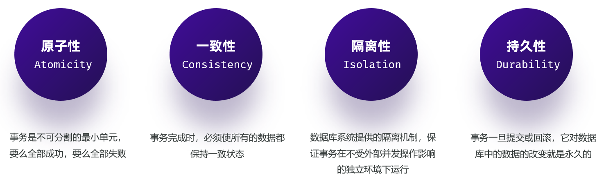

- **原子性（Atomicity）** ：原子性是指事务包装的一组sql是一个不可分割的工作单元，事务中的操作要么全部成功，要么全部失败。
- **一致性（Consistency）**：一个事务完成之后数据都必须处于一致性状态。
  - 如果事务成功的完成，那么数据库的所有变化将生效。
  - 如果事务执行出现错误，那么数据库的所有变化将会被回滚(撤销)，返回到原始状态。
- **隔离性（Isolation）**：多个用户并发的访问数据库时，一个用户的事务不能被其他用户的事务干扰，多个并发的事务之间要相互隔离。
  - 一个事务的成功或者失败对于其他的事务是没有影响。
- **持久性（Durability）**：一个事务一旦被提交或回滚，它对数据库的改变将是永久性的，哪怕数据库发生异常，重启之后数据亦然存在。


## 文件上传

### 简介

* 文件上传：是指将本地图片、视频、音频等文件上传到服务器，供其他用户浏览或下载的过程
* 文件上传在项目中应用非常广泛，我们经常发微博，发微信朋友圈都用到了文件上传功能


### 本地存储

1. 如何将上传的文件存储在服务器本地？
   * `multipartFile.getOriginalFilename()`：获取原始文件名
   * `multipartFile.transferTo(File dest)`：将文本转存至磁盘文件

2. 上传文件大小受限怎么办？

   * 默认文件上传文件的最大大小为1MB，超过大小需要在配置文件中配置

   * ```yaml
     spring：
       servlet:
         multipart:
           max-file-size: 10MB
           max-request-size: 100MB
     ```

     

到时此，我们文件上传的本地存储方式已完成了。但是这种本地存储方式还存在一问题： 

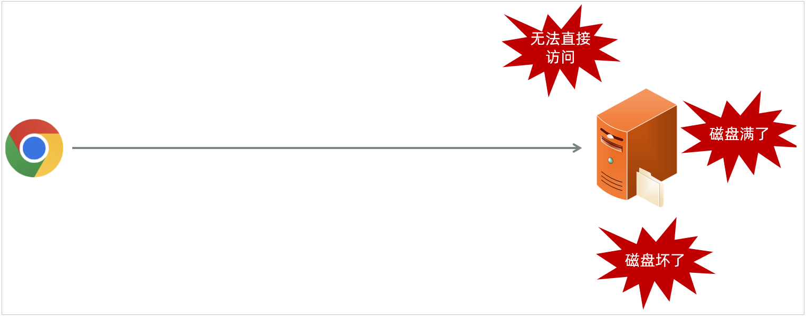

如果直接存储在服务器的磁盘目录中，存在以下缺点：

- 不安全：磁盘如果损坏，所有的文件就会丢失
- 容量有限：如果存储大量的图片，磁盘空间有限(磁盘不可能无限制扩容)
- 无法直接访问

为了解决上述问题呢，通常有两种解决方案：

- 自己搭建存储服务器，如：fastDFS 、MinIO
- 使用现成的云服务，如：阿里云，腾讯云，华为云


### 阿里云OSS

阿里云对象储存OSS（`Object Storage Service`），是一款海量、安全、低成本、高可靠的云存储服务器。使用OSS，您可以通过网络随时存储和调用包括文本图片、音频和视频等在内的各种文件

**第三方服务 - 通用思路**

实我们主要学习的是如何在项目当中来使用云服务完成具体的业务功能。而无论使用什么样的云服务，阿里云也好，腾讯云、华为云也罢，在使用第三方的服务时，操作的思路都是一样的。


**SDK**：**Software Development Kit 的缩写，软件开发工具包，包括辅助软件开发的依赖（jar包）、代码示例等，都可以叫做SDK。

简单说，sdk中包含了我们使用第三方云服务时所需要的依赖，以及一些示例代码。我们可以参照sdk所提供的示例代码就可以完成入门程序。

第三方服务使用的通用思路，我们做一个简单介绍之后，接下来我们就来介绍一下我们当前要使用的阿里云oss对象存储服务具体的使用步骤。

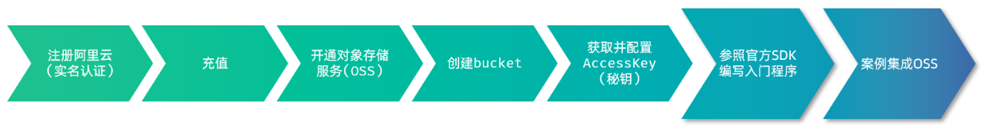

**Bucket：**存储空间是用户用于存储对象（Object，就是文件）的容器，所有的对象都必须隶属于某个存储空间。


#### 案例集成

步骤：

1. 引入阿里云OSS文件上传工具类（由官方的示例代码改造而来）
2. 上传文件接口开发


#### 参数配置化

指将一些需要灵活变化的参数，配置在配置文件中，然后通过`@Value`注解来注入外部配置的属性

（原截图含账号、凭据或个人信息，公开版已省略。）


如果只有一两个属性需要注入，而且不需要考虑复用性，使用`@Value`注解就可以了。

但是使用@Value注解注入配置文件的配置项，如果配置项多，注入繁琐，不便于维护管理 和 复用。如下所示:

（原截图含账号、凭据或个人信息，公开版已省略。）

那么有没有一种方式可以简化这些配置参数的注入呢？答案是肯定有，在Spring中给我们提供了一种简化方式，可以直接将配置文件中配置项的值自动的注入到对象的属性中。

Spring提供的简化方式套路：

1). 需要创建一个实现类，且实体类中的属性名和配置文件当中key的名字必须要一致

​     比如：配置文件当中叫endpoint，实体类当中的属性也得叫endpoint，另外实体类当中的属性还需要提供 getter / setter方法

2). 需要将实体类交给Spring的IOC容器管理，成为IOC容器当中的bean对象

3). 在实体类上添加`@ConfigurationProperties`注解，并通过perfect属性来指定配置参数项的前缀

（原截图含账号、凭据或个人信息，公开版已省略。）


1. 注入外部配置文件中的配置项的两种方式？
   * `Value`：一个属性一个属性的注入
   * `ConfigurationProperties`：批量将多个属性注入到bean对象中

2. 两种方式各自的使用场景？
   * 如果属性较少，建议`@Value`注入即可
   * 如果属性较多，考虑复用，建议使用`@ConfigurationProperties`


## 员工管理

### 删除员工

* 删除单条数据也是一种特殊的批量删除，所以，删除员工的功能，我们只需要开发一个接口就可以了

**思路分析：**

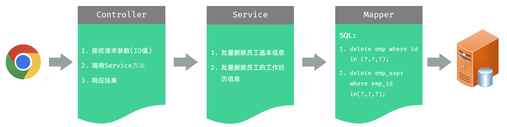


1. #### Controller接收参数

在 `EmpController` 中增加如下方法 `delete` ，来执行批量删除员工的操作。

**方式一：在Controller方法中通过数组来接收**

多个参数，默认可以将其封装到一个数组中，需要保证前端传递的参数名 与 方法形参名称保持一致。

```Java
/**
* 批量删除员工
*/
@DeleteMapping
public Result delete(Integer[] ids){
    log.info("批量删除部门: ids={} ", Arrays.asList(ids));
    return Result.success();
}
```

**方式二：****在Controller方法中通过集合来接收**

也可以将其封装到一个`List<Integer>` 集合中，如果要将其封装到一个集合中，需要在集合前面加上 `@RequestParam` 注解。

```Java
/**
* 批量删除员工
*/
@DeleteMapping
public Result delete(@RequestParam List<Integer> ids){
    log.info("批量删除部门: ids={} ", ids);
    empService.deleteByIds(ids);
    return Result.success();
}
```

两种方式，选择其中一种就可以，我们一般推荐选择集合，因为基于集合操作其中的元素会更加方便。


### 修改员工

#### 查询回显

具体的实现思路如下：

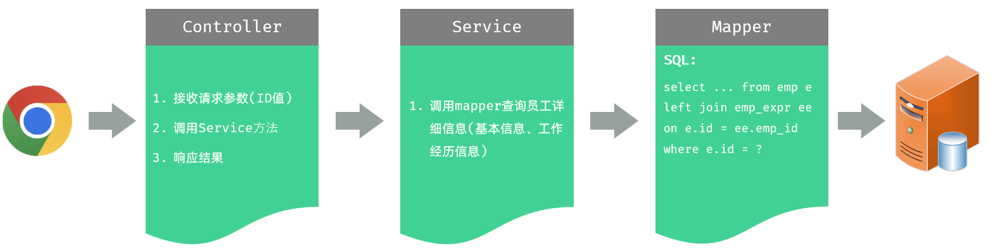


1. `Mybatis`中封装查询结果，什么时候用`resultType`，什么时候用`resultMap`？
   * 如果查询返回的字段名与实体的属性名可以直接对接上，用`resultType`
   * 如果查询返回的字段名与实体的属性名对应不上，或实体属性比较复杂，可以通过`resultMap`手动封装

#### 修改数据

实现思路

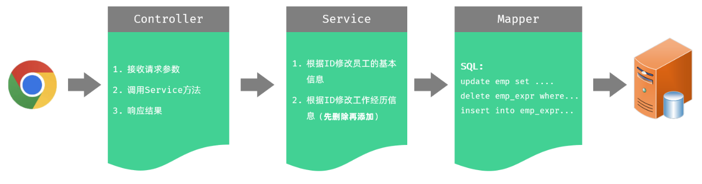


#### 修改数据 - 程序优化

`set`标签：

1. 会自动生成`set`关键字
2. 会自动的删除掉更新字段后多余逗号


### 异常处理

* 全局异常处理器

全局异常处理器的使用，主要涉及到两个注解：

- @RestControllerAdvice  //表示当前类为全局异常处理器
- @ExceptionHandler  //指定可以捕获哪种类型的异常进行处理


### 员工信息统计

#### 职位统计

`case`函数：

```sql
case 表达式 when val1 then result1 when val2 then result2...else...end
```

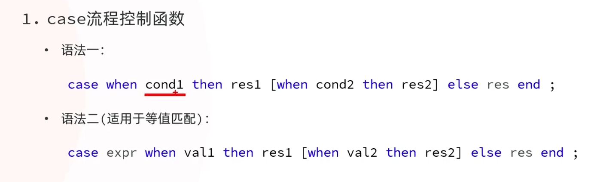


#### 性别统计

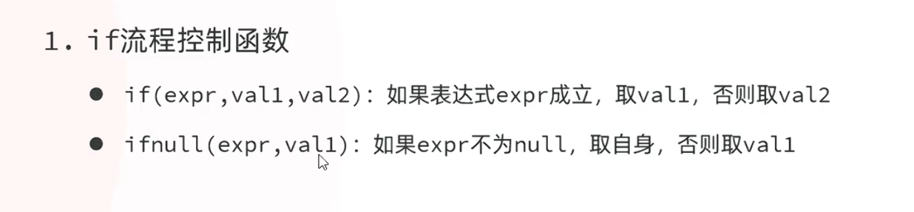
