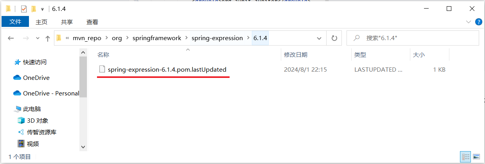

# Maven

Maven是一款用于管理和构建Java项目的工具，是apache旗下的一个开源项目，它基于项目对象模型（POM）的概念，通过一小段描述信息来管理项目的构建

作用：

* 方便的依赖管理
* 标准的项目构建流程
* 统一的项目结构

## IDEA集成Maven

### 创建Maven项目

### Maven坐标

* Maven 中的坐标是资源（jar）的唯一标识，通过该坐标可以唯一定位资源位置
* 使用坐标来定义项目或引入项目中需要的依赖

主要组成：

* groupId：定义当前Maven项目隶属组织名称（通常是域名反写）
* artifactId：定义当前Maven项目名称（通常是模块名称）
* version：定义当前项目版本号
  * SNAPSHOT：功能不稳定，尚处于开发中的版本，即快照版本
  * RELEASE：功能趋于稳定、当前停止更新，可以用于发行的版本

### 导入Mavne项目

在IDEA中导入Maven项目，有两种方式。

- 方式一：`File` -> `Project Structure` -> `Modules` -> `Import Module` -> `选择maven项目的pom.xml`。

- 方式二：`Maven面板` -> `+（Add Maven Projects）` -> `选择maven项目的pom.xml`。

**建议**

* 建议将要导入的Maven项目复制到你的项目目录下
* 建议选择maven项目的pom.xml文件进行导入

## 依赖管理

### 依赖配置

依赖：指当前项目运行所需要的 jar 包，一个项目中可以引入多个依赖

配置：

1.在 pom.xml 中编写 `<dependencies>` 标签

2.在`<dependencies>`标签中，使用`<dependency>` 引入坐标

3.定义坐标的 groupId ，artifactId，version

4.点击刷新按钮，引入最新坐标


**排除依赖**

指主动断开依赖的资源，被排除的资源无需指定版本

```java
<dependency>
    <groupId>org.springframework</groupId>
    <artifactId>spring-context</artifactId>
    <version>6.1.4</version>

    <!--排除依赖, 主动断开依赖的资源-->
    <exclusions>
        <exclusion>
            <groupId>io.micrometer</groupId>
            <artifactId>micrometer-observation</artifactId>
        </exclusion>
    </exclusions>
</dependency>
```

注意事项：

* 一旦依赖配置变更了，记得重新加载
* 引入的依赖本地仓库不存在，记得联网

### 生命周期

Maven的生命周期就是为了对所有的 maven 项目构建过程进行抽象和统一

Maven当中有3套相互独立的生命周期：

* clean：清理工作
* default：核心工作，如：编译、测试、打包、安装、部署等
* site：生成报告、发布站点

每套生命周期包含一些阶段，阶段是有顺序的，后面的阶段依赖于前面的阶段

#### 生命周期阶段

* clean：移除上一次构建生成的文件
* compile：编译项目源代码
* test：使用合适的单元测试框架运行测试（junit）
* package：将编译后的文件打包，如：jar，war等
* install：安装项目到本地仓库

在**同一套**生命周期中，当运行后面的阶段时，前面的阶段都会运行

#### 执行生命周期

执行生命周期的两种方式：

* 在 idea 中，右侧的 maven 工具栏，选中对应的生命周期，双击执行
* 在命令行中，通过命令执行

## 单元测试

测试：是一种用来促进鉴定软件的正确性、完整性、安全性和质量的过程

阶段划分：单元测试（白盒测试）、集成测试（灰盒测试）、系统测试（黑盒测试）、验收测试（黑盒测试）

**单元测试**是对软件的基本组成单位进行测试，最小测试单位。目的是为了检验软件基本组成单位的正确性

**集成测试**是将已分别通过测试的单元，按设计要求组合成系统或子系统，再进行测试。其目的是检查单元之间的协作是否正确

**系统测试**是对已经集成好的软件系统进行彻底的测试。目的是验证软件系统的正确性、性能是否满足指定的要求

**验收测试**是交付测试，是针对用户需求、业务流程进行的正式的测试。目的是验证软件系统是否满足验收标准

测试方法：白盒测试、黑盒测试和灰盒测试

白盒测试

* 清楚软件内部结构，代码逻辑
* 用于验证代码、逻辑正确性

黑盒测试

* 不清楚软件内部结构、内部结构
* 用于验证软件的功能、兼容性等方面

灰盒测试

* 结合了白盒测试和黑盒测试的特点，既关注软件的内部结构又考虑外部表现（功能）


单元测试：就是针对最小的功能单元（方法），编写测试代码对其正确性进行测试

JUnit：最流行的 Java 测试框架之一，提供了一些功能，方便程序进行单元测试（第三方公司提供

通过**main方法**是可以进行测试的，可以测试程序是否正常运行。但是main方法进行测试时，会存在如下问题：

1. 测试代码与源代码未分开，难维护。
2. 一个方法测试失败，影响后面方法。
3. 无法自动化测试，得到测试报告。

而如果我们使用了**JUnit单元测试**框架进行测试，将会有以下优势：

1. 测试代码与源代码分开，便于维护。
2. 可根据需要进行自动化测试。
3. 可自动分析测试结果，产出测试报0（通过：绿色，失败：红色）。

**注意：**

- 测试类的命名规范为：XxxxTest
- 测试方法的命名规定为：public void xxx(){...}

### 断言

JUnit 提供了一些辅助方法，用来帮我们确定被测试的方法是否按照预期的效果正常工作，这种方式称为断言

| 断言方法                                                     | 描述                                       |
| ------------------------------------------------------------ | ------------------------------------------ |
| `Assertions.assertEquals(Object exp, Object act, String msg)` | 检查两个值是否相等，不相等就报错。         |
| `Assertions.assertNotEquals(Object unexp, Object act, String msg)` | 检查两个值是否不相等，相等就报错。         |
| `Assertions.assertNull(Object act, String msg)`              | 检查对象是否为 null，不为 null，就报错。   |
| `Assertions.assertNotNull(Object act, String msg)`           | 检查对象是否不为 null，为 null，就报错。   |
| `Assertions.assertTrue(boolean condition, String msg)`       | 检查条件是否为 true，不为 true，就报错。   |
| `Assertions.assertFalse(boolean condition, String msg)`      | 检查条件是否为 false，不为 false，就报错。 |
| `Assertions.assertThrows(Class expType, Executable exec, String msg)` | 检查程序运行抛出的异常，是否符合预期。     |

单元测试方法运行不报错，不代表业务方法没问题

通过断言可以检测方法运行结果是否和预期一致，从而判断业务方法的正确性

### 常见注解

在JUnit 中还提供了一些注解，增强其功能，常见的注解有以下几个：

| 注解                 | 说明                                                         | 备注                              |
| -------------------- | ------------------------------------------------------------ | --------------------------------- |
| `@Test`              | 测试类中的方法用它修饰才能成为测试方法，才能启动执行         | 单元测试                          |
| `@ParameterizedTest` | 参数化测试的注解（可以让单个测试运行多次，每次运行时仅参数不同） | 用了该注解，就不需要`@Test`注解了 |
| `@ValueSource`       | 参数化测试的参数来源，赋予测试方法参数                       | 与参数化测试注解配合使用          |
| `@DisplayName`       | 指定测试类、测试方法显示的名称（默认为类名、方法名）         | —                                 |
| `@BeforeEach`        | 用来修饰一个实例方法，该方法会在每一个测试方法执行之前执行一次 | 初始化资源（准备工作）            |
| `@AfterEach`         | 用来修饰一个实例方法，该方法会在每一个测试方法执行之后执行一次 | 释放资源（清理工作）              |
| `@BeforeAll`         | 用来修饰一个静态方法，该方法会在所有测试方法之前只执行一次   | 初始化资源（准备工作）            |
| `@AfterAll`          | 用来修饰一个静态方法，该方法会在所有测试方法之后只执行一次   | 释放资源（清理工作）              |

### 企业开发规范

原则：编写测试方法时，要尽可能的覆盖业务方法中所有可能的情况（尤其是边界值）

### Maven依赖范围

依赖的 jar 包，默认情况下，可以在任何地方使用。可通过`<scope>...</scope>` 设置其作用范围

作用范围：

* 主程序范围有效（main文件夹范围内）
* 测试程序范围有效（test 文件夹范围有效）
* 是否参与打包运行（package 指令范围内）

| scope 值        | 主程序 | 测试程序 | 打包（运行） | 范例        |
| --------------- | ------ | -------- | ------------ | ----------- |
| compile（默认） | Y      | Y        | Y            | log4j       |
| test            | -      | Y        | -            | junit       |
| provided        | Y      | Y        | -            | servlet-api |
| runtime         | -      | Y        | Y            | jdbc 驱动   |

## Maven常见问题



- **问题现象：**Maven项目中添加的依赖，未正确下载，造成右侧Maven面板中的依赖报红，再次reload重新加载也不会再下载。
- **产生原因：**由于网络原因，依赖没有下载完整导致的，在maven仓库中生成了**xxx.lastUpdated**文件，该文件不删除，不会再重新下载。


**解决方案：**

1. 根据maven依赖的坐标，找到仓库中对应的 xxx.lastUpdated 文件，删除，删除之后重新加载项目即可。
2. 通过命令 (del /s *.lastUpdated) 批量递归删除指定目录下的 xxx.lastUpdated 文件，删除之后重新加载项目即可。
3. 重新加载依赖，依赖下载了之后，maven面板可能还会报红，此时可以关闭IDEA，重新打开IDEA加载此项目即可。
