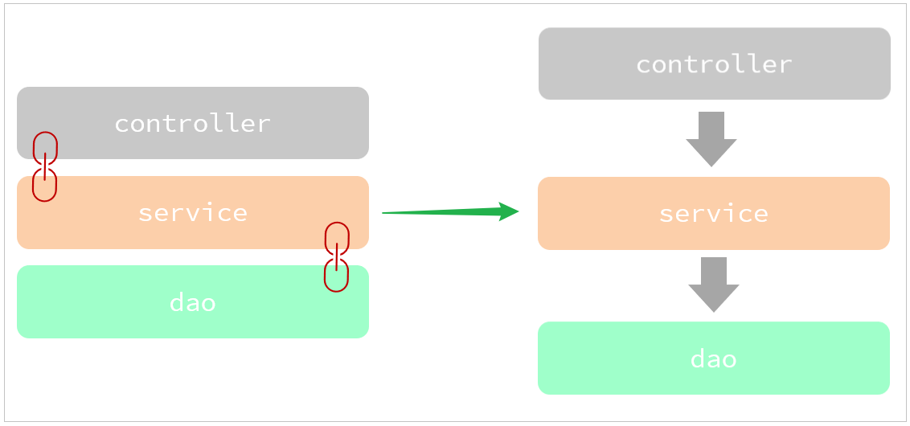

# Web基础

静态资源：服务器上存储的不会改变的数据，通常不会根据用户的请求而变化。比如：HTML、CSS、JS、图片、视频等（负责页面展示）

动态资源：服务器端根据用户请求和其他数据动态生成的，内容可能会在每次请求时都发生变化。比如：Servlet、JSP等（负责逻辑处理）

B / S 架构：Browser / Server，浏览器 / 服务器架构模式。客户端只需浏览器，应用程序的逻辑和数据都存在服务器端（维护方便 体验一般）

 C / S架构：Client / Server，客户端 / 服务器架构模式。需要单独开发维护客户端（体验不错 开发维护麻烦）

## Spring Boot

Spring Boot 可以帮助我们非常快速的构建应用程序、简化开发、提高效率

### 入门程序

需求：基于Spring Boot 开发一个Web应用，浏览器发起请求 / hello 之后，给浏览器返回一个字符串"Hello Xxx"

步骤：

1. 创建spring boot 工程，并勾选 web 开发相关依赖
2. 定义HelloController类，添加方法 hello ，并添加注解

### 入门解析

那在上面呢，我们已经完成了SpringBootWeb的入门程序，并且测试通过。 在入门程序中，我们发现，我们只需要一个main方法就可以将web应用启动起来了，然后就可以打开浏览器访问了。

那接下来我们需要明确两个问题：

**1). 为什么一个main方法就可以将Web应用启动了？**



因为我们在创建springboot项目的时候，选择了web开发的**起步依赖** `spring-boot-starter-web`。而`spring-boot-starter-web`依赖，又依赖了`spring-boot-starter-tomcat`，由于maven的依赖传递特性，那么在我们创建的springboot项目中也就已经有了tomcat的依赖，这个其实就是springboot中内嵌的tomcat。 


而我们运行引导类中的main方法，其实启动的就是springboot中内嵌的Tomcat服务器。 而我们所开发的项目，也会自动的部署在该tomcat服务器中，并占用8080端口号 。 


**起步依赖：**

- 一种为开发者提供简化配置和集成的机制，使得构建Spring应用程序更加轻松。起步依赖本质上是一组预定义的依赖项集合，它们一起提供了在特定场景下开发Spring应用所需的所有库和配置。
  - spring-boot-starter-web：包含了web应用开发所需要的常见依赖。
  - spring-boot-starter-test：包含了单元测试所需要的常见依赖。
- 官方提供的starter：[https://docs.spring.io/spring-boot/docs/3.1.3/reference/htmlsingle/#using.build-systems.starters](https://docs.spring.io/spring-boot/docs/3.1.3/reference/htmlsingle/)

## HTTP协议

概念：Hyper Text Transfer Protocol ，超文本传输协议，规定了浏览器和服务器之间数据传输的规则

特点：

1. 基于TCP协议：面向连接，安全
2. 基于请求-响应模型的：一次请求对应一次响应
3. HTTP协议是无状态的协议：对于事务处理没有记忆能力。每次请求-响应都是独立的
   * 缺点：多次请求间不能共享数据
   * 优点：速度快

### HTTP - 请求协议

#### 请求数据格式

* 请求行：（请求数据的第一行）
* 请求头（key：value）
* 请求体：（与请求头之间隔了一个空行）

| 字段名          | 含义说明                                                     |
| --------------- | ------------------------------------------------------------ |
| Host            | 请求的主机名                                                 |
| User-Agent      | 浏览器版本，例如 Chrome 浏览器的标识类似 Mozilla/5.0 ... Chrome/79，IE 浏览器的标识类似 Mozilla/5.0 (Windows NT ...) like Gecko |
| Accept          | 表示浏览器能接收的资源类型，如 text/*，image/*或者*/* 表示所有； |
| Accept-Language | 表示浏览器偏好的语言，服务器可以据此返回不同语言的网页；     |
| Accept-Encoding | 表示浏览器可以支持的压缩类型，例如 gzip，deflate 等。        |
| Content-Type    | 请求主体的数据类型。                                         |
| Content-Length  | 请求主体的大小（单位：字节）。                               |

GET请求和POST请求的区别：

| **区别方式** | **GET请求**                                                  | **POST请求**         |
| ------------ | ------------------------------------------------------------ | -------------------- |
| 请求参数     | 请求参数在请求行中。<br/>例：/brand/findAll?name=OPPO&status=1 | 请求参数在请求体中   |
| 请求参数长度 | 请求参数长度有限制(浏览器不同限制也不同)                     | 请求参数长度没有限制 |
| 安全性       | 安全性低。原因：请求参数暴露在浏览器地址栏中。               | 安全性相对高         |


#### 请求数据获取

Web 服务器（Tomcat）对 HTTP 协议的请求数据进行解析，并进行了封装（HttpservletRequst），在调用 Controller 方法的时候传递给了该方法。这样，就使得程序员不必直接对协议进行操作，让 Web 开发更加便捷

HTTP请求数据不需要程序员自己解析，Web服务器负责对 HTTP 请求数据进行解析，并封装为了请求对象

HttpServletRequest 对象里面封装了所有的请求信息


### HTTP响应协议

#### 响应数据格式

* 响应行、响应头、响应体

HTTP响应状态码分类

| 状态码 | 含义说明                                                     |
| ------ | ------------------------------------------------------------ |
| 1xx    | 响应中 - 临时状态码，表示请求已经接收，告诉客户端应该继续请求或者如果它已经完成则忽略它。 |
| 2xx    | 成功 - 表示请求已经被成功接收，处理已完成。                  |
| 3xx    | 重定向 - 重定向到其他地方；让客户端再发起一次请求以完成整个处理。 |
| 4xx    | 客户端错误 - 处理发生错误，责任在客户端。如：请求了不存在的资源、客户端未被授权、禁止访问等。 |
| 5xx    | 服务器错误 - 处理发生错误，责任在服务端。如：程序抛出异常等。 |

- 状态码大全：https://cloud.tencent.com/developer/chapter/13553 

常见HTTP响应头字段

| 响应头字段       | 含义说明                                                     |
| ---------------- | ------------------------------------------------------------ |
| Content-Type     | 表示该响应内容的类型，例如`text/html`，`application/json`。  |
| Content-Length   | 表示该响应内容的长度（字节数）。                             |
| Content-Encoding | 表示该响应压缩算法，例如`gzip`。                             |
| Cache-Control    | 指示客户端应如何缓存，例如`max-age=300`表示可以最多缓存 300 秒。 |
| Set-Cookie       | 告诉浏览器为当前页面所在的域设置 cookie。                    |


#### 响应数据设置

Web服务器对 HTTP 协议的响应数据进行了封装（HttpServletResponse），并在调用 Controller 方法的时候传递给了该方法。这样，就使得程序员不必直接对协议进行操作，让 Web 开发更加便捷

注意：响应状态码 和 响应头如果没有特殊要求的话，通常不手动设定。服务器会根据请求处理的逻辑，自动设置响应状态码和响应头。

## SpringBoot Web 案例

案例：开发Web程序，完成用户列表的渲染展示

1. 准备工作：
   * 创建一个Spring Boot工程，并勾选web依赖、lombok
   * 引入资料中准备好的用户数据文件（user.txt），及前端静态页面
   * 定义一个实体类，用来封装用户信息


## 分层解耦

### 三层架构


- Controller：控制层。接收前端发送的请求，对请求进行处理，并响应数据。
- Service：业务逻辑层。处理具体的业务逻辑。
- Dao：数据访问层(Data Access Object)，也称为持久层。负责数据访问操作，包括数据的增、删、改、查。

对代码进行拆分，是为了遵循单一职责原则，便于复用、后期维护

### 分层解耦

耦合：衡量软件中各个层 / 各个模块的依赖关联程度

内聚：软件中各个功能模块内部的功能联系  

> **软件设计原则：高内聚低耦合。**
>
> > **高内聚****：**指的是一个模块中各个元素之间的联系的紧密程度，如果各个元素(语句、程序段)之间的联系程度越高，则内聚性越高，即 "高内聚"。
> >
> > **低耦合：**指的是软件中各个层、模块之间的依赖关联程序越低越好。
>
> 目前层与层之间是存在耦合的，Controller耦合了Service、Service耦合了Dao。而 高内聚、低耦合的目的是使程序模块的可重用性、移植性大大增强。
>
> 那最终我们的目标呢，就是做到层与层之间，尽可能的降低耦合，甚至解除耦合。
>
> 

**控制反转**：Inversion Of Control，简称**IOC**。对象的创建控制权由程序自身转移到外部（容器），这种思想称为控制反转。

- 对象的创建权由程序员主动创建转移到容器(由容器创建、管理对象)。这个容器称为：IOC容器或Spring容器。
- 

**依赖注入**：Dependency Injection，简称**DI**。容器为应用程序提供运行时，所依赖的资源，称之为依赖注入。

- 程序运行时需要某个资源，此时容器就为其提供这个资源。
- 例：EmpController程序运行时需要EmpService对象，Spring容器就为其提供并注入EmpService对象。

**bean对象：**IOC容器中创建、管理的对象，称之为：bean对象。


实现分层解耦的思路：

* 将项目中的类交给IOC容器管理（IOC，控制反转）
* 应用程序运行时需要什么对象，直接依赖容器为其提供（DI，依赖注入）


### IOC & DI 入门

* @Conmponent (加在实现类上)，可以将一个类交给IOC容器管理
* @Autowired 可以从IOC容器中找到该类型的 bean ，然后完成依赖注入


### IOC 详解

| 注解        | 说明                 | 位置                                              |
| ----------- | -------------------- | ------------------------------------------------- |
| @Component  | 声明bean的基础注解   | 不属于以下三类时，用此注解                        |
| @Controller | @Component的衍生注解 | 标注在控制层类上                                  |
| @Service    | @Component的衍生注解 | 标注在业务层类上                                  |
| @Repository | @Component的衍生注解 | 标注在数据访问层类上（由于与mybatis整合，用的少） |

声明 bean 的时候，可以通过注解的 value 属性指定 bean 的名字，如果没有指定，默认为类名首字母小写


前面声明的 bean 的四大注解，要想生效，还需要被组件扫描注解 @ComponentScan 扫描

该注解虽然没有显式配置，但是实际上已经包含在了启动类声明注解 @SpringBootApplication 中，默认扫描的范围是启动类所在包及其子包


### DI详解

@Autowired 进行依赖注入，常见的方式，有如下三种：

1). 属性注入

```Java
@RestController
public class UserController {

    //方式一: 属性注入
    @Autowired
    private UserService userService;
    
  }
```

- 优点：代码简洁、方便快速开发。
- 缺点：隐藏了类之间的依赖关系、可能会破坏类的封装性。

2). 构造函数注入

```Java
@RestController
public class UserController {

    //方式二: 构造器注入
    private final UserService userService;
    
    @Autowired //如果当前类中只存在一个构造函数, @Autowired可以省略
    public UserController(UserService userService) {
        this.userService = userService;
    }
    
 }   
```

- 优点：能清晰地看到类的依赖关系、提高了代码的安全性。
- 缺点：代码繁琐、如果构造参数过多，可能会导致构造函数臃肿。
- **注意：如果只有一个构造函数，@Autowired注解可以省略。（通常来说，也只有一个构造函数）**

3). setter注入

```Java
/**
 * 用户信息Controller
 */
@RestController
public class UserController {
    
    //方式三: setter注入
    private UserService userService;
    
    @Autowired
    public void setUserService(UserService userService) {
        this.userService = userService;
    }
    
}    
```

- 优点：保持了类的封装性，依赖关系更清晰。
- 缺点：需要额外编写setter方法，增加了代码量。

在项目开发中，基于@Autowired进行依赖注入时，基本都是第一种和第二种方式。（官方推荐第二种方式，因为会更加规范）但是在企业项目开发中，很多的项目中，也会选择第一种方式因为更加简洁、高效（在规范性方面进行了妥协）。


@Autowired 注解，默认是按照类型进行注入的

如果存在多个相同类型的 bean ，将会报出错误

如何解决上述问题呢？Spring提供了以下几种解决方案：

- @Primary
- @Qualifier
- @Resource

**方案一：使用@Primary注解**

当存在多个相同类型的Bean注入时，加上@Primary注解，来确定默认的实现。

```Java
@Primary
@Service
public class UserServiceImpl implements UserService {
}
```

**方案二：使用@Qualifier注解**

指定当前要注入的bean对象。 在@Qualifier的value属性中，指定注入的bean的名称。 @Qualifier注解不能单独使用，必须配合@Autowired使用。

```Java
@RestController
public class UserController {

    @Qualifier("userServiceImpl")
    @Autowired
    private UserService userService;
```

**方案三：使用@Resource注解**

是按照bean的名称进行注入。通过name属性指定要注入的bean的名称。

```Java
@RestController
public class UserController {
        
    @Resource(name = "userServiceImpl")
    private UserService userService;
```

面试题：@Autowird 与 @Resource的区别

- @Autowired 是spring框架提供的注解，而@Resource是JDK提供的注解
- @Autowired 默认是按照类型注入，而@Resource是按照名称注入
