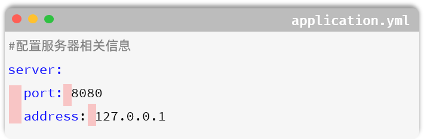

# 数据库


数据库： DataBase（DB），是存储和管理数据的仓库

数据库管理系统： DataBase Management System（DBMS），操控和管理数据库的大型软件

SQL：Structured Query Language，操作关系型数据库的编程语言，定义了一套操作关系型数据库统一标准

## MySQL数据模型

关系型数据库：建立在关系模型基础上，由多张相互连接的二维表组成的数据库

特点：

* 使用表存储数据，格式统一，便于维护
* 使用SQL语言操作，标准统一，使用方便，可用于复杂查询


## SQL语句

SQL：一门操作关系型数据库的编程语言，定义操作所有关系型数据库的统一标准

分类：

| 分类 | 全称                       | 说明                                                   |
| ---- | -------------------------- | ------------------------------------------------------ |
| DDL  | Data Definition Language   | 数据定义语言，用来定义数据库对象（数据库、表、字段）   |
| DML  | Data Manipulation Language | 数据操作语言，用来对数据库表中的数据进行增删改         |
| DQL  | Data Query Language        | 数据查询语言，用来查询数据库中表的记录                 |
| DCL  | Data Control Language      | 数据控制语言，用来创建数据库用户、控制数据库的访问权限 |


### DDL

#### 数据库

操作语法：

```sql
-- 查询所有数据库
show databases;

-- 查询当前数据库
select database();

-- 使用/切换数据库
use 数据库名;

-- 创建数据库
create database [if not exists] 数据库名 [default charset utf8mb4];

-- 删除数据库
drop database [if exists] 数据库名;
```

注意：上述语法中的 database，也可以替换成 schema 。如：create scheme db01；MySQL 8 版本中，默认字符集为 utf8mb4


#### 表操作 — 创建

创建表的语法：

```sql
create table tablename(
    字段1 字段类型 [约束] [comment 字段1注释],
    ......
    字段2 字段类型 [约束] [comment 字段2注释]
)[comment 表注释];
```


**约束：**约束是作用于表中字段上的规则，用于限制存储在表中的数据

目的：保证数据库中数据的正确性、有效性和完整性

| 约束     | 描述                                             | 关键字        |
| -------- | ------------------------------------------------ | ------------- |
| 非空约束 | 限制该字段值不能为 **null**                      | `not null`    |
| 唯一约束 | 保证字段的所有数据都是唯一、不重复的             | `unique`      |
| 主键约束 | 主键是一行数据的唯一标识，要求**非空且唯一**     | `primary key` |
| 默认约束 | 保存数据时，如果未指定该字段值，则采用默认值     | `default`     |
| 外键约束 | 让两张表的数据建立连接，保证数据的一致性和完整性 | `foreign key` |


#### 表操作 — 数据类型

数据类型

MySQL 中的数据有很多，主要分为三类：数值类型、字符串类型、日期时间类型

数值类型

| 类型      | 大小(byte) | 有符号(SIGNED)范围                                    | 无符号(UNSIGNED)范围                                      | 描述             | 备注                                              |
| --------- | ---------- | ----------------------------------------------------- | --------------------------------------------------------- | ---------------- | ------------------------------------------------- |
| tinyint   | 1          | (-128，127)                                           | (0，255)                                                  | 小整数值         |                                                   |
| smallint  | 2          | (-32768，32767)                                       | (0，65535)                                                | 大整数值         |                                                   |
| mediumint | 3          | (-8388608，8388607)                                   | (0，16777215)                                             | 大整数值         |                                                   |
| int       | 4          | (-2147483648，2147483647)                             | (0，4294967295)                                           | 大整数值         |                                                   |
| bigint    | 8          | (-2^63，2^63-1)                                       | (0，2^64-1)                                               | 极大整数值       |                                                   |
| float     | 4          | (-3.402823466 E+38，3.402823466351 E+38)              | 0 和 (1.175494351 E-38，3.402823466 E+38)                 | 单精度浮点数值   | float(5,2)：5表示整个数字长度，2 表示小数位个数   |
| double    | 8          | (-1.7976931348623157 E+308，1.7976931348623157 E+308) | 0 和 (2.2250738585072014 E-308，1.7976931348623157 E+308) | 双精度浮点数值   | double(5,2)：5表示整个数字长度，2 表示小数位个数  |
| decimal   |            |                                                       |                                                           | 小数值(精度更高) | decimal(5,2)：5表示整个数字长度，2 表示小数位个数 |


| 数值类型的选取原则: 在满足业务需求的前提下, 尽可能选择占用磁盘空间小的数据类型 |                      |      |
| ------------------------------------------------------------ | -------------------- | ---- |
|                                                              | age tinyint unsigned |      |
|                                                              | id int unsigned      |      |


字符串类型

| 分类       | 类型                  | 大小                         | 描述       |
| ---------- | --------------------- | ---------------------------- | ---------- |
| 字符串类型 | char                  | 0-255 bytes                  | 定长字符串 |
| varchar    | 0-65535 bytes         | 变长字符串                   |            |
| tinyblob   | 0-255 bytes           | 不超过255个字符的二进制数据  |            |
| tinytext   | 0-255 bytes           | 短文本字符串                 |            |
| blob       | 0-65 535 bytes        | 二进制形式的长文本数据       |            |
| text       | 0-65 535 bytes        | 长文本数据                   |            |
| mediumblob | 0-16 777 215 bytes    | 二进制形式的中等长度文本数据 |            |
| mediumtext | 0-16 777 215 bytes    | 中等长度文本数据             |            |
| longblob   | 0-4 294 967 295 bytes | 二进制形式的极大文本数据     |            |
| longtext   | 0-4 294 967 295 bytes | 极大文本数据                 |            |


|                                                              | 优势         | 劣势         |
| ------------------------------------------------------------ | ------------ | ------------ |
| char(10): 固定占用10个字符空间; 存储A, 占用10个空间; 存储ABC, 占用10个空间; | 性能略高     | 浪费磁盘空间 |
| varchar(10): 最多占用10个字符空间; 存储A, 占用1个空间; 存储ABC, 占用3个空间; | 节约磁盘空间 | 性能略低     |
|                                                              |              |              |
| username varchar(50)                                         |              |              |
| idcard char(18)                                              |              |              |
| phone char(11)                                               |              |              |
|                                                              |              |              |


日期时间类型

| 分类      | 类型 | 大小(byte)                                 | 范围                     | 格式                     | 描述   |
| --------- | ---- | ------------------------------------------ | ------------------------ | ------------------------ | ------ |
| 日期类型  | date | 3                                          | 1000-01-01 至 9999-12-31 | YYYY-MM-DD               | 日期值 |
| time      | 3    | -838:59:59 至 838:59:59                    | HH:MM:SS                 | 时间值或持续时间         |        |
| year      | 1    | 1901 至 2155                               | YYYY                     | 年份值                   |        |
| datetime  | 8    | 1000-01-01 00:00:00 至 9999-12-31 23:59:59 | YYYY-MM-DD HH:MM:SS      | 混合日期和时间值         |        |
| timestamp | 4    | 1970-01-01 00:00:01 至 2038-01-19 03:14:07 | YYYY-MM-DD HH:MM:SS      | 混合日期和时间值，时间戳 |        |


| bithday date         |
| -------------------- |
| operateTime datetime |
|                      |
|                      |
|                      |


#### 表操作 — 查询、修改、删除

表结构的查询、修改、删除相关语法如下：

```sql
-- 查询当前数据库的所有表
show tables;

-- 查询表结构
desc 表名;

-- 查询建表语句
show create table 表名;

-- 添加字段
alter table 表名 add 字段名 类型(长度) [comment 注释] [约束];

-- 修改字段类型
alter table 表名 modify 字段名 新数据类型(长度);

-- 修改字段名与字段类型
alter table 表名 change 旧字段名 新字段名 类型(长度) [comment 注释] [约束];

-- 删除字段
alter table 表名 drop column 字段名;

-- 修改表名
alter table 表名 rename to 新表名;

-- 删除表
drop table [if exists] 表名;
```

注意：在删除表时，表中的全部数据也会被删除


### DML

DML英文全称是Data Manipulation Language(数据操作语言)，用来对数据库中表的数据记录进行增、删、改操作。

- 添加数据（INSERT）
- 修改数据（UPDATE）
- 删除数据（DELETE） 

#### DML — insert

操作语法：

```sql
-- 指定字段添加数据
insert into 表名(字段名1, 字段名2) values (值1, 值2);

-- 全部字段添加数据
insert into 表名 values (值1, 值2, ...);

-- 批量添加数据（指定字段）
insert into 表名(字段名1, 字段名2) values (值1, 值2), (值1, 值2);

-- 批量添加数据（全部字段）
insert into 表名 values (值1, 值2, ...), (值1, 值2, ...);
```

注意：

1. 插入数据时指定的字段顺序需要与值的顺序是一一对应的
2. 字符串和日期型数据应该包含在引号中（单引号、双引号都可以）
3. 插入的数据大小 /  长度，应该在字段的规定范围内


#### DML — update

语法：

```sql
update 表名 set 字段名1 = 值1 , 字段名2 = 值2 , .... [where 条件] ;   --修改数据
```

注意：修改的条件可以有，也可以没有，如果没有条件，则会修改整张表的所有数据


#### DML — delete

语法：

```sql
delete from 表名  [where  条件] ;  --删除数据
```

注意：

1. DELETE 语句的条件可以有，也可以没有，如果没有条件，则会删除整张表的所有数据
2. DELETE 语句不能删除某一个字段的值（如果要操作，可以使用 UPDATE ，将该字段的值设置为 NULL）


### DQL

DQL英文全称是Data Query Language(数据查询语言)，用来查询数据库表中的记录。

查询关键字：**SELECT**

完整的 DQL 语句语法：

```sql
SELECT
        字段列表
FROM
        表名列表
WHERE
        条件列表
GROUP  BY
        分组字段列表
HAVING
        分组后条件列表
ORDER BY
        排序字段列表
LIMIT
        分页参数
```

* 基本查询（select ... from ...）
* 条件查询（where）
* 分组查询（group by）
* 排序查询（order by）
* 分页查询（limit）


#### 基本查询

```sql
-- 查询多个字段
select 字段1,字段2,字段3 from 表名;

-- 查询所有字段(通配符)
select * from 表名;

-- 为查询字段设置别名，as关键字可以省略
select 字段1 [as 别名1], 字段2 [as 别名2] from 表名;

-- 去除重复记录
select distinct 字段列表 from 表名;
```

注意：* 号代表查询所有字段，在实际开发中尽量少用（不直观、影响效率）


#### 条件查询

```sql
select  字段列表  from   表名   where   条件列表 ; -- 条件列表：意味着可以有多个条件
```

学习条件查询就是学习条件的构建方式，而在SQL语句当中构造条件的运算符分为两类：

- 比较运算符
- 逻辑运算符

常用的比较运算符如下: 

| 比较运算符          | 功能                                       |
| ------------------- | ------------------------------------------ |
| >                   | 大于                                       |
| >=                  | 大于等于                                   |
| <                   | 小于                                       |
| <=                  | 小于等于                                   |
| =                   | 等于                                       |
| <> 或！=            | 不等于                                     |
| between ... and ... | 在某个范围之内 (含最小、最大值)            |
| in(...)             | 在 in 之后的列表中的值，多选一             |
| like 占位符         | 模糊匹配 (_匹配单个字符，% 匹配任意个字符) |
| is null             | 是 null                                    |

常用的逻辑运算符如下：

| 逻辑运算符 | 功能                         |
| ---------- | ---------------------------- |
| and 或 &&  | 并且（多个条件同时成立）     |
| or 或 \|\| | 或者（多个条件任意一个成立） |
| not 或 ！  | 非，不是                     |


#### 分组查询

聚合函数：将一列数据作为一个整体，进行纵向计算

| 函数  | 功能     |
| ----- | -------- |
| count | 统计数量 |
| max   | 最大值   |
| min   | 最小值   |
| avg   | 平均值   |
| sum   | 求和     |

注意：

1. null 值不参与所有聚合函数的运算
2. 统计数量可以使用：count（*）、count（字段）、count（常量），**推荐使用 **（*）

语法：

```sql
select  字段列表  from  表名  [where 条件]  group by 分组字段名  [having 分组后过滤条件];
```

**注意事项:**

- 分组之后，查询的字段一般为聚合函数和分组字段，查询其他字段无任何意义
- 执行顺序：where > 聚合函数 > having 

**where与having区别（面试题）**

- 执行时机不同：where是分组之前进行过滤，不满足where条件，不参与分组；而having是分组之后对结果进行过滤。
- 判断条件不同：where不能对聚合函数进行判断，而having可以。


#### 排序查询

```sql
select  字段列表  
from   表名   
[where  条件列表] 
[group by  分组字段 ] 
order  by  字段1  排序方式1 , 字段2  排序方式2 … ;
```

排序方式：

- ASC ：升序（默认值）
- DESC：降序

注意事项：如果是多字段排序，当第一个字段值相同时，才会根据第二个字段进行排序 


#### 分页查询

```sql
-- 排序查询（分页+分组+条件）
select 字段 from 表名 [where 条件] [group by 分组字段 having 过滤条件] [order by 排序字段] limit 起始索引,查询条数;
```

**注意事项:**

1. 起始索引从0开始。           **计算公式 ：起始索引 = （查询页码 - 1）* 每页显示记录数**
2. 分页查询是数据库的方言，不同的数据库有不同的实现，MySQL中是LIMIT
3. 如果查询的是第一页数据，起始索引可以省略，直接简写为 limit  条数


# Java程序操作数据库


# JDBC

**JDBC：**（Java DataBase Connectivity），就是使用Java语言操作关系型数据库的一套API。 【是操作数据库最为基础、底层的技术】

 **本质：**

- sun公司官方定义的一套操作所有关系型数据库的规范，即接口。
- 各个数据库厂商去实现这套接口，提供数据库驱动jar包。
- 我们可以使用这套接口(JDBC)编程，真正执行的代码是驱动jar包中的实现类。


ResultSet（结果集对象）：封装了DQL查询语句查询的结果。

- next()：将光标从当前位置向前移动一行，并判断当前行是否为有效行，返回值为boolean。
  - true：有效行，当前行有数据
  - false：无效行，当前行没有数据
- getXxx(…)：获取数据，可以根据列的编号获取，也可以根据列名获取（推荐）。

##  

## 预编译SQL

* 优势一：可以防止SQL注入，更安全

  SQL注入：可以通过控制输入来修改事先定义好的SQL语句，以达到执行代码对服务器进行攻击的方法

* 优势二：性能更高

  


# MyBatis

Mybatis是一款优秀的持久层框架，用于 简化 JDBC 的开发

**SpringBoot+Mybatis入门程序操作步骤?**

- 准备工作
  - A. 创建springboot工程，引入Mybatis相关依赖
  - B. 准备数据库表，实体类
  - C. 在`application.properties`中配置数据库连接信息
  - 定义Mapper接口（@Mapper），编写SQL

**SpringBoot的单元测试类上需要加什么注解？**

- `@SpringBootTest`：会在单元测试运行时，加载SpringBoot的环境
- 注意：测试类所在包需要与引导类包名相同（或放在引导类所在包的子包下）


## JDBC VS Mybatis

JDBC程序的**缺点**：

- url、username、password 等相关参数全部硬编码在java代码中。
- 查询结果的解析、封装比较繁琐。
- 每一次操作数据库之前，先获取连接，操作完毕之后，关闭连接。 频繁的获取连接、释放连接造成资源浪费。

分析了JDBC的缺点之后，我们再来看一下在mybatis中，是如何解决这些问题的：

- 数据库连接四要素(驱动、链接、用户名、密码)，都配置在springboot默认的配置文件 application.properties中
- 查询结果的解析及封装，由mybatis自动完成映射封装，我们无需关注
- 在mybatis中使用了数据库连接池技术，从而避免了频繁的创建连接、销毁连接而带来的资源浪费。

使用SpringBoot+Mybatis的方式操作数据库，能够提升开发效率、降低资源浪费


## 数据库连接池

* 数据库连接池是个容器，负责分配、管理数据库连接（Connection）
* 它允许应用程序重复使用一个现有的数据库连接，而不是再重新建立一个
* 释放空闲时间超过最大空闲时间的连接，来避免因为没有释放连接而引起的数据库连接遗漏
* 优势：
  1. 资源重用
  2. 提升系统响应速度
  3. 避免数据库连接遗漏

要怎么样实现数据库连接池呢？

- 官方(sun)提供了数据库连接池标准（javax.sql.DataSource接口）
- 功能：获取连接 
  - ```Java
    public Connection getConnection() throws SQLException;
    ```
- 第三方组织必须按照DataSource接口实现

常见的数据库连接池：**C3P0 、DBCP、Druid 、Hikari (springboot默认)**

现在使用更多的是：**Hikari、Druid  （性能更优越）**


## 增删改查 - 删除操作

- 需求：根据ID删除用户信息
- SQL：delete from user where id = 5;
- Mapper接口方法：
  - 方式一：
  - ```Java
    /**
     * 根据id删除
     */
    @Delete("delete from user where id = 5")
    public void deleteById();
    ```

这种方式执行删除操作，调用deleteById方法只能删除id为5的用户信息，因为将id直接写死在代码中了，不可取。

- 方式二：

```Java
/**
 * 根据id删除
 */
@Delete("delete from user where id = #{id}")
public void deleteById(Integer id);
```

在Mybatis中，我们可以通过参数占位符号 `#{...}` 来占位，在调用`deleteById`方法时，传递的参数值，最终会替换占位符。

- 编写单元测试方法进行测试
  -  在单元测试类中,增加如下测试方法.

  - ```Java
    @Test
    public void testDeleteById(){
        userMapper.deleteById(36);
    }
    ```

Mybatis的提供的符号，有两个，一个是 `#{...}`，另一个是 `${...}`，区别如下：

| 符号     | 说明                                                   | 场景                       | 优缺点               |
| -------- | ------------------------------------------------------ | -------------------------- | -------------------- |
| `${...}` | 拼接符。直接将参数拼接在 SQL 语句中，存在 SQL 注入问题 | 表名、字段名动态设置时使用 | 不安全、性能低       |
| `#{...}` | 占位符。执行时，会将`#{...}`替换为`?`，生成预编译 SQL  | 参数值传递                 | 安全、性能高（推荐） |


## 增删改查 - 新增操作

- 需求：添加一个用户
- SQL：insert into user(username,password,name,age) values('zhouyu',:demo_password,'周瑜',20);
- Mapper接口：

```Java
/**
 * 添加用户
 */
@Insert("insert into user(username,password,name,age) values(#{username},#{password},#{name},#{age})")
public void insert(User user);
```

如果在SQL语句中，我们需要传递多个参数，我们可以把多个参数封装到一个对象中。然后在SQL语句中，我们可以通过`#{对象``属性``名}`的方式，获取到对象中封装的属性值。

- 单元测试：

在测试类中添加测试方法，代码如下：

```Java
@Test
public void testInsert(){
    User user = new User();
    user.setUsername("admin");
    user.setPassword(System.getenv("DEMO_PASSWORD"));
    user.setName("管理员");
    user.setAge(30);
    userMapper.insert(user);
}
```


## 增删查改 - 更新操作

- 需求：根据ID更新用户信息
- SQL：update user set username = 'zhouyu', password = :demo_password, name = '周瑜', age = 20 where id = 1；
- Mapper接口方法：

```Java
/**
 * 根据id更新用户信息
 */
@Update("update user set username = #{username},password = #{password},name = #{name},age = #{age} where id = #{id}")
public void update(User user);
```

- 单元测试：

在测试类中添加测试方法，代码如下：

```Java
@Test
public void testUpdate(){
    User user = new User();
    user.setId(6);
    user.setUsername("admin666");
    user.setPassword(System.getenv("DEMO_PASSWORD"));
    user.setName("管理员");
    user.setAge(30);
    userMapper.update(user);
}
```


## 增删改查 - 查询操作

- 需求：根据用户名和密码查询用户信息
- SQL：select* fromuser whereusername = 'zhouyu' and password = :demo_password
- Mapper接口方法：

```Java
/**
 * 根据用户名和密码查询用户信息
 */
@Select("select * from user where username = #{username} and password = #{password}")
public User findByUsernameAndPassword(@Param("username") String username, @Param("password") String password);
```

@param注解的作用是为接口的方法形参起名字的。（由于用户名唯一的，所以查询返回的结果最多只有一个，可以直接封装到一个对象中）

- 单元测试：

在测试类中添加测试方法，代码如下：

```Java
@Test
public void testFindByUsernameAndPassword(){
    User user = userMapper.findByUsernameAndPassword("admin666", System.getenv("DEMO_PASSWORD"));
    System.out.println(user);
}
```

**说明：**基于官方骨架创建的springboot项目中，接口编译时会保留方法形参名，@Param注解可以省略 (#{形参名})。




## XML 映射配置

在 Mybatis 中，既可以通过注解配置 SQL 语句，也可以通过 XML 文件配置 SQL 语句

默认规则：

* XML 映射文件的名称与 Mapper 接口名称一致，并且将 XML 映射文件和 Mapper 接口放置在相同包下（同包同名）
* XML 映射文件的 namespace 属性为 Mapper  接口全限定名一致
* XML 映射文件和 sql 语句中的 id 与 Mapper 接口中的方法名一致，并保持返回类型一致

使用 Mybatis 的注解，主要是来完成一些简单的增删改查功能。如果需要实现复杂的 SQL 功能，建议使用 XML 来配置映射语句


## XML 映射配置 - 辅助配置

配置 XML 映射文件的位置（在 application.properties 中）：

```java
#指定XML映射配置文件的位置
mybatis.mapper-locations=classpath:mapper/*.xml
```


## SpringBoot 项目配置文件

SpringBoot 项目提供了多种属性配置方式（properties、yaml、yml）

yml格式配置文件名字为：`application.yaml` , `application.yml` 这两个配置文件的后缀名虽然不一样，但是里面配置的内容形式都是一模一样的。

我们可以来对比一下，采用 `application.properties` 和 `application.yml` 来配置同一段信息(数据库连接信息)，两者之间的配置对比：

（原截图含账号、凭据或个人信息，公开版已省略。）

（原截图含账号、凭据或个人信息，公开版已省略。）

在项目开发中，我们推荐使用application.yml配置文件来配置信息，简洁、明了、以数据为中心。


yml 语法格式：

* 大小写敏感

* 数值前边必须有空格，作为分隔符
* 使用缩进表示层级关系，缩进时，不允许使用 Tab 键，只能用空格（idea 中会自动将 Tab 转换为空格）
* 缩进的空格数目不重要，只要相同层级的元素左侧对齐即可
* ’ # ’表示注释，从这个字符一直到行尾，都会被解析器忽略


了解完yml格式配置文件的基本语法之后，接下来我们再来看下yml文件中常见的数据格式。在这里我们主要介绍最为常见的两类：

1. 定义对象或Map集合
2. 定义数组、list或set集合

- 对象/Map集合

```YAML
user:
  name: zhangsan
  age: 18
  password: ${DEMO_PASSWORD}
```

- 数组/List/Set集合

```YAML
hobby: 
  - java
  - game
  - sport
```

在yml格式的配置文件中，如果配置项的值是以 0 开头的，值需要使用 '' 引起来，因为以0开头在yml中表示8进制的数据。
